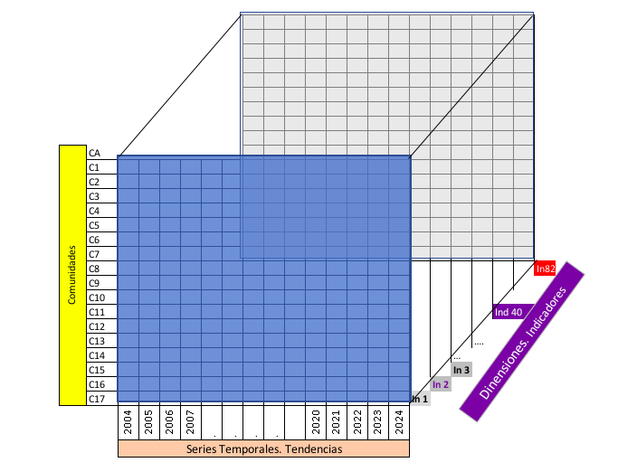
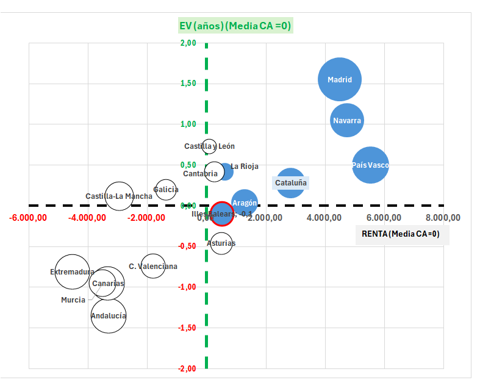

<!-- Informe unico (2026-10-01): reune INE_ICV_CCAA_Analisis.Rmd (apartados 1-7 y
     Anexos A-D) e INE_ICV_CCAA_Rutas.Rmd (apartados 8-10 y Anexo E); el glosario,
     la reproducibilidad y las conclusiones combinan los de ambos. Del primero se
     han quitado la matriz de correlacion (antiguo Anexo D) y, del antiguo
     Anexo E (ahora D), las mezclas gaussianas (GMM) y el t-SNE. -->

```{r setup, include=FALSE}
knitr::opts_chunk$set(echo = FALSE, warning = FALSE, message = FALSE)

library(openxlsx)
library(dplyr)
library(tidyr)
library(ggplot2)
library(plotly)
library(gt)
library(scales)
library(tibble)

# --- Paleta -----------------------------------------------------------------
COLOR_ESPANA  <- "#2a78d6"  # España (Total Nacional)
COLOR_BALEARS <- "#eb6834"  # Illes Balears
COLOR_Z_BAJO  <- "#e34948"  # z-score negativo: Illes Balears por debajo de la media del resto
COLOR_Z_MEDIO <- "#f0efec"  # z-score ~ 0: sin diferencia relevante
COLOR_Z_ALTO  <- "#2a78d6"  # z-score positivo: Illes Balears por encima de la media del resto
COLORES_GRUPO <- c("1" = "#2a78d6", "2" = "#eb6834", "3" = "#1baf7a")
COLOR_POL_MEJOR <- "#d3efe2"  # fondo de la columna Indicador: que suba es bueno
COLOR_POL_PEOR  <- "#e4d9f2"  # fondo de la columna Indicador: que suba es malo

# Polaridad de cada indicador: que su valor SUBA, ¿es bueno ("mejor"), malo
# ("peor") o depende ("depende")? Criterio editorial, uno por nombre corto. Son
# "depende" las categorias del centro de una escala (salud regular, formacion
# 3-4, satisfaccion con el trabajo 5-6, jornada de 40-48 h):
# pueden subir porque la gente sale del extremo malo o porque abandona el bueno.
# Los precios de la vivienda son "peor" desde el punto de vista de quien tiene
# que acceder a ella, que es como los lee el informe.
POLARIDAD <- c(
  "Abandono educativo 18-24" = "peor", "Carencia material" = "peor",
  "Carencia material severa" = "peor", "Fin mes: cierta dificultad" = "peor",
  "Fin mes: dificultad" = "peor", "Fin mes: mucha dificultad" = "peor",
  "Gastos imprevistos" = "peor", "Morbilidad crónica" = "peor",
  "Nec. médicas: otras razones" = "peor", "Nec. médicas: razones" = "peor",
  "Form. total: nivel 0-2" = "peor", "Form. total: nivel 3-4" = "depende",
  "Form. total: nivel 3-8" = "mejor", "Form. total: nivel 5-8" = "mejor",
  "Form. 25-64: nivel 0-2" = "peor", "Form. 25-64: nivel 3-4" = "depende",
  "Form. 25-64: nivel 3-8" = "mejor", "Form. 25-64: nivel 5-8" = "mejor",
  "Form. 65+: nivel 0-2" = "peor", "Form. 65+: nivel 3-4" = "depende",
  "Form. 65+: nivel 3-8" = "mejor", "Form. 65+: nivel 5-8" = "mejor",
  "Form. 18-24: nivel 0-2" = "peor", "Form. 18-24: nivel 3-4" = "depende",
  "Form. 18-24: nivel 3-8" = "mejor", "Form. 18-24: nivel 5-8" = "mejor",
  "Limit. actividad: grave" = "peor", "Limit. actividad: leve" = "peor",
  "Limit. actividad: ninguna" = "mejor", "Formación continua 25-64" = "mejor",
  "Falta espacio vivienda" = "peor", "PM10 anual" = "peor", "PM2,5 anual" = "peor",
  "PM10 días superación" = "peor", "Retrasos en pagos" = "peor",
  "Salud: buena" = "mejor", "Salud: mala" = "peor", "Salud: muy buena" = "mejor",
  "Salud: muy mala" = "peor", "Salud: regular" = "depende",
  "Empleo parcial involuntario" = "peor", "Jornada larga 40-48h" = "depende",
  "Jornada larga 49h+" = "peor", "Tasa de empleo" = "mejor",
  "Paro de larga duración" = "peor", "Tasa de paro" = "peor",
  "Trabajo temporal" = "peor", "Desigualdad S80/S20" = "peor",
  "Gasto elevado vivienda" = "peor", "Pobreza umbral fijo 2008" = "peor",
  "Pobreza relativa" = "peor", "Renta media real" = "mejor",
  "Renta mediana real" = "mejor", "Tasa de criminalidad" = "peor",
  "Tasa de homicidios" = "peor", "Confianza en los demás" = "mejor",
  "Satisfacción vital" = "mejor", "Esperanza de vida" = "mejor",
  "Delincuencia/vandalismo" = "peor", "Contaminación ambiental" = "peor",
  "Ruidos vecinos/exterior" = "peor", "Deficiencias en vivienda" = "peor",
  "Salarios bajos" = "peor", "Fumadores diarios" = "peor",
  "IMC: normopeso" = "mejor", "IMC: obesidad" = "peor", "IMC: bajo peso" = "peor",
  "IMC: sobrepeso" = "peor", "Ejercicio físico regular" = "mejor",
  "Sedentarismo" = "peor", "Satisf. trabajo 0-4" = "peor",
  "Satisf. trabajo 5-6" = "depende", "Satisf. trabajo 7-8" = "mejor",
  "Satisf. trabajo 9-10" = "mejor", "Satisf. trabajo (media)" = "mejor",
  "Satisf. vivienda: algo insat." = "peor", "Satisf. vivienda: muy insat." = "peor",
  "Satisf. vivienda: muy satisf." = "mejor", "Satisf. vivienda: satisfecho" = "mejor",
  "Precio compraventa (€/m²)" = "peor", "Precio alquiler (€/m²/mes)" = "peor",
  "PIB per cápita real" = "mejor"
)
POLARIDAD_TEXTO <- c(mejor = "Bueno", peor = "Malo", depende = "Depende")

# "01.Andalucía" -> "Andalucía"; "03.Asturias,.Principado.de" -> "Asturias, Principado de"
# Caso especial: "Balears, Illes" (la forma que da el gsub, igual que para
# el resto de CCAA con articulo) se cambia a "Illes Balears", el orden en que
# se usa siempre en la prosa de este informe.
limpiar_ccaa <- function(x) {
  nombre <- gsub("\\.", " ", sub("^[0-9]+\\.", "", x))
  ifelse(nombre == "Balears, Illes", "Illes Balears", nombre)
}

# Formato numerico español (coma decimal) para los numeros citados en el texto.
es <- function(x, d = 1) formatC(x, format = "f", digits = d, decimal.mark = ",", big.mark = ".")

# Coma decimal tambien dentro de las tablas gt. drop_trailing_zeros mantiene los
# enteros limpios (22245 -> "22.245", no "22.245,00") sin tener que declarar los
# decimales columna a columna.
fmt_es <- function(tabla) {
  tabla %>%
    fmt_number(columns = where(is.numeric), decimals = 3,
               dec_mark = ",", sep_mark = ".", drop_trailing_zeros = TRUE)
}

# Colorea la columna "Indicador" (nombres cortos) segun su polaridad: verde si
# que suba es bueno, morado si es malo, sin color si depende. Verde y morado, y
# no rojo, para no confundirlo con el rojo/azul de la columna Z-score.
colorear_polaridad <- function(tabla, df, columna = "Indicador") {
  pol <- unname(POLARIDAD[df[[columna]]])
  tabla %>%
    tab_style(style = cell_fill(color = COLOR_POL_MEJOR),
              locations = cells_body(columns = all_of(columna), rows = which(pol == "mejor"))) %>%
    tab_style(style = cell_fill(color = COLOR_POL_PEOR),
              locations = cells_body(columns = all_of(columna), rows = which(pol == "peor"))) %>%
    tab_source_note(html(paste0(
      "Columna <i>", columna, "</i>: <span style='background:", COLOR_POL_MEJOR,
      ";padding:0 4px'>verde</span> = que suba es bueno; <span style='background:",
      COLOR_POL_PEOR, ";padding:0 4px'>morado</span> = que suba es malo; sin color = depende.")))
}

tabla_z_score <- function(df, columna) {
  m <- max(abs(df[[columna]]), na.rm = TRUE)
  df %>%
    gt() %>%
    data_color(
      columns = all_of(columna),
      colors = col_numeric(palette = c(COLOR_Z_BAJO, COLOR_Z_MEDIO, COLOR_Z_ALTO),
                           domain = c(-m, m))
    ) %>%
    colorear_polaridad(df) %>%
    fmt_es() %>%
    opt_row_striping() %>%
    tab_options(table.font.size = px(13), heading.title.font.size = px(15))
}

# --- Datos ------------------------------------------------------------------
d <- read.xlsx("INE_ICV_CCAA_Consolidado.xlsx", sheet = "datos")

# Algunas unidades llegan del INE ilegibles para un lector no especialista:
# concatenadas cuando una misma tabla mezcla hojas con unidades distintas
# ("%1000, Tanto por 100.000" sirve a la vez para criminalidad y homicidios) o
# con rotulos genericos ("Tasas", "Número", "---"). Se sustituyen aqui, SOLO
# para mostrarlas, segun las notas metodologicas de cada tabla del INE (p. ej.
# la de homicidios_y_criminalidad_METADATOS.xlsx: criminalidad = infracciones
# penales por 1.000 habitantes; homicidios = por 100.000).
UNIDADES_LEGIBLES <- c(
  "Tasa de criminalidad"     = "Infracciones por 1.000 hab.",
  "Tasa de homicidios"       = "Por 100.000 hab.",
  "PM10 anual"               = "µg/m³",
  "PM2,5 anual"              = "µg/m³",
  "PM10 días superación"     = "Días al año",
  "Tasa de empleo"           = "%",
  "Tasa de paro"             = "%",
  "Deficiencias en vivienda" = "%",
  "Desigualdad S80/S20"      = "Veces (cociente)",
  "Satisf. trabajo 0-4"      = "%",
  "Satisf. trabajo 5-6"      = "%",
  "Satisf. trabajo 7-8"      = "%",
  "Satisf. trabajo 9-10"     = "%",
  "Satisf. trabajo (media)"  = "Puntuación de 0 a 10"
)
d <- d %>% mutate(unidad = coalesce(unname(UNIDADES_LEGIBLES[nombre_corto]), unidad))

# "fuente" (INE / REGISTRADORES / SERPAVI / PIB_CCAA) se arrastra desde el consolidado para
# poder citarla en el anexo B: desde 2026-09-22 no todos los indicadores son del
# INE (ver apartado "De qué va este informe").
nombres <- d %>% distinct(atributo, nombre_corto, dimension, unidad, fuente)
n_ind <- nrow(nombres)
stopifnot(setequal(names(POLARIDAD), nombres$nombre_corto))

# Pies numerados de figuras y tablas (2026-10-22), con numeracion distinta para
# cada tipo. Se llaman en linea, en orden de aparicion, justo debajo de cada
# figura y justo encima de cada tabla.
N_FIG <- 0
N_TAB <- 0
fig_cap <- function(txt) {
  N_FIG <<- N_FIG + 1
  paste0('<p class="leyenda leyenda-fig mod-claude"><b>Figura ', N_FIG, '.</b> ', txt, '</p>')
}
tab_cap <- function(txt) {
  N_TAB <<- N_TAB + 1
  paste0('<p class="leyenda leyenda-tab mod-claude"><b>Tabla ', N_TAB, '.</b> ', txt, '</p>')
}

# Periodo del estudio. Las series empiezan en años distintos: solo el PIB per
# capita arranca en 2000, la mayoria en 2004 y el resto entre 2006 y 2013. El
# marco se fija en el año desde el que hay dato para mas de la mitad de los
# indicadores (serie de Illes Balears), no en el año mas antiguo del conjunto.
inicio_ind <- d %>%
  filter(!is.na(`04.Balears,.Illes`)) %>%
  group_by(nombre_corto) %>%
  summarise(ini = min(fecha), .groups = "drop")
ANIO_INI <- 2004
ANIO_FIN <- max(d$fecha)
stopifnot(mean(inicio_ind$ini <= ANIO_INI) > 0.5)
# Solo el PIB per capita empieza antes (el texto lo cita por su nombre)
stopifnot(inicio_ind$nombre_corto[inicio_ind$ini < ANIO_INI] == "PIB per cápita real")
n_despues_ini <- sum(inicio_ind$ini > ANIO_INI)
n_en_ini    <- sum(inicio_ind$ini == ANIO_INI)
rango_despues <- range(inicio_ind$ini[inicio_ind$ini > ANIO_INI])

# Indicadores que se quitan SOLO del PCA (y por tanto de k-means y del Anexo D,
# que trabajan sobre sus componentes). Son redundantes POR CONSTRUCCION, no por
# parecerse mucho: su valor sale de restar o sumar otros indicadores que ya
# entran. Comprobado sobre el consolidado (2026-09-24): cada grupo de categorias
# suma 100 con un error maximo de 0,1-0,2 por redondeo en todos los años y CCAA.
# Regla: en cada pregunta de encuesta cuyas respuestas suman 100 %, se quita la
# respuesta mas frecuente (la "normal"); en educacion se quedan solo los dos
# extremos (basicos 0-2 y superiores 5-8), porque 3-4 = 100 - 0-2 - 5-8 y
# 3-8 = 100 - 0-2, y se quita la poblacion "total" (16-64 años), que es la mezcla
# de los grupos 18-24 y 25-64 que ya entran por separado. Los apartados 4 y 5 y
# el analisis de rutas siguen usando los n_ind indicadores.
REDUNDANTES_PCA <- c(
  "Form. total: nivel 0-2" = "Es la población de 16 a 64 años: casi entera, la mezcla de los grupos de 18-24 y 25-64, que ya entran por separado",
  "Form. total: nivel 3-4" = "Ídem",
  "Form. total: nivel 5-8" = "Ídem",
  "Form. total: nivel 3-8" = "Ídem",
  "Form. 18-24: nivel 3-4" = "= 100 − nivel 0-2 − nivel 5-8",
  "Form. 25-64: nivel 3-4" = "= 100 − nivel 0-2 − nivel 5-8",
  "Form. 65+: nivel 3-4"   = "= 100 − nivel 0-2 − nivel 5-8",
  "Form. 18-24: nivel 3-8" = "= 100 − nivel 0-2",
  "Form. 25-64: nivel 3-8" = "= 100 − nivel 0-2",
  "Form. 65+: nivel 3-8"   = "= 100 − nivel 0-2",
  "Salud: buena"           = "= 100 − muy buena − regular − mala − muy mala",
  "Limit. actividad: ninguna" = "= 100 − limitación leve − limitación grave",
  "IMC: normopeso"         = "= 100 − bajo peso − sobrepeso − obesidad",
  "Satisf. trabajo 7-8"    = "= 100 − las franjas 0-4, 5-6 y 9-10",
  "Satisf. vivienda: satisfecho" = "= 100 − muy satisfecho − algo insatisfecho − muy insatisfecho"
)
stopifnot(all(names(REDUNDANTES_PCA) %in% nombres$nombre_corto))
n_ind_pca <- n_ind - length(REDUNDANTES_PCA)

ccaa17 <- c("01.Andalucía", "02.Aragón", "03.Asturias,.Principado.de", "04.Balears,.Illes",
            "05.Canarias", "06.Cantabria", "07.Castilla.y.León", "08.Castilla.-.La.Mancha",
            "09.Cataluña", "10.Comunitat.Valenciana", "11.Extremadura", "12.Galicia",
            "13.Madrid,.Comunidad.de", "14.Murcia,.Región.de", "15.Navarra,.Comunidad.Foral.de",
            "16.País.Vasco", "17.Rioja,.La")

largo <- d %>%
  select(nombre_corto, dimension, unidad, fecha,
         España = Total.Nacional, `Illes Balears` = `04.Balears,.Illes`) %>%
  pivot_longer(c(España, `Illes Balears`), names_to = "geografia", values_to = "valor") %>%
  filter(!is.na(valor)) %>%
  mutate(geografia = factor(geografia, levels = c("España", "Illes Balears")))

# Un facet interactivo por dimensión del ICV. Se hace por dimensión y no en un
# único gráfico de 82 paneles porque 82 paneles juntos son ilegibles; agrupados
# por dimensión son 7 pestañas (8 dimensiones: las dos de un solo indicador van
# juntas) que se leen de una en una.
# Fondo del titulo de cada panel segun POLARIDAD, con los mismos colores que la
# columna Indicador de las tablas. ggplotly convierte cada titulo en una
# anotacion y su fondo en un rectangulo de alto fijo en pixeles (ysizemode =
# "pixel"), en listas separadas: se emparejan por posicion (centro horizontal
# del rectangulo = x de la anotacion, yanchor = y de la anotacion).
colorear_titulos <- function(p, titulos) {
  p <- plotly_build(p)
  anot <- p$x$layout$annotations
  es_tira <- vapply(p$x$layout$shapes, function(s) identical(s$ysizemode, "pixel"), logical(1))
  n_col <- 0
  for (i in which(es_tira)) {
    s <- p$x$layout$shapes[[i]]
    k <- which(vapply(anot, function(a) {
      isTRUE(a$text %in% titulos) &&
        abs(a$x - (s$x0 + s$x1) / 2) < 1e-6 && abs(a$y - s$yanchor) < 1e-6
    }, logical(1)))
    stopifnot(length(k) == 1)
    pol <- POLARIDAD[[anot[[k]]$text]]
    p$x$layout$shapes[[i]]$fillcolor <- switch(pol, mejor = COLOR_POL_MEJOR,
                                               peor = COLOR_POL_PEOR, "transparent")
    n_col <- n_col + 1
  }
  stopifnot(n_col == length(titulos))
  p
}

grafico_dimension <- function(dims, ncol = 3) {
  datos_dim <- largo %>% filter(dimension %in% dims)
  gg <- ggplot(
      datos_dim,
      # group = geografia es imprescindible: sin él, al usar el aes "text" (que
      # es distinto en cada punto, para el tooltip) ggplot agruparía geom_line()
      # por la combinación de TODOS los aes discretos -- incluido "text" -- y
      # cada punto quedaría en su propio grupo, sin línea que los una.
      aes(x = fecha, y = valor, color = geografia, group = geografia,
          text = paste0("<b>", nombre_corto, "</b><br>", geografia, ": ",
                        es(valor, 2), " ", unidad, "<br>Año: ", fecha))
    ) +
    geom_line(linewidth = 0.6) +
    geom_point(size = 0.9) +
    facet_wrap(~ nombre_corto, scales = "free_y", ncol = ncol) +
    scale_color_manual(values = c("España" = COLOR_ESPANA, "Illes Balears" = COLOR_BALEARS),
                       name = NULL) +
    labs(x = NULL, y = NULL) +
    theme_minimal(base_size = 12) +
    theme(
      legend.position = "bottom",
      panel.grid.minor = element_blank(),
      panel.grid.major = element_line(color = "#e1e0d9", linewidth = 0.3),
      strip.text = element_text(size = 10, face = "bold"),
      # Un fondo cualquiera, para que ggplotly genere el rectangulo del titulo;
      # colorear_titulos() le pone despues el color de su polaridad.
      strip.background = element_rect(fill = "white", colour = NA),
      axis.text = element_text(size = 8)
    )

  p <- ggplotly(gg, tooltip = "text") %>%
    layout(legend = list(orientation = "h", x = 0.5, xanchor = "center", y = -0.02))
  # ggplotly repite una entrada de leyenda por cada panel; se oculta toda
  # aparición menos la primera de cada nombre para que la leyenda no salga
  # duplicada una vez por indicador.
  nombres_traza <- vapply(p$x$data, function(tr) if (is.null(tr$name)) "" else tr$name, character(1))
  style(p, showlegend = FALSE, traces = which(duplicated(nombres_traza))) %>%
    colorear_titulos(unique(datos_dim$nombre_corto))
}
```

```{css, echo=FALSE}
.nota {
  background-color: #f4f7fb;
  border-left: 4px solid #2a78d6;
  padding: 0.8em 1.1em;
  margin: 1.2em 0;
  border-radius: 3px;
}
.nota p:last-child { margin-bottom: 0; }
.clave {
  background-color: #fdf5f1;
  border-left: 4px solid #eb6834;
  padding: 0.8em 1.1em;
  margin: 1.2em 0;
  border-radius: 3px;
}
.clave p:last-child { margin-bottom: 0; }
h2 { margin-top: 2em; }
/* Ediciones del borrador de Google Docs (2026-10-22): mismos colores que en el
   documento editado. mod-claude = cambios del volcado, no de los editores. */
.ed-verde { color: #00ff00; }
.ed-azul { color: #0000ff; }
.ed-azulclaro { color: #4a86e8; }
.mod-claude { color: #ff0000; }
.autores { font-size: 0.9em; margin-bottom: 1.5em; }
.autores p { margin-bottom: 0.4em; }
.leyenda { font-size: 0.92em; text-align: center; margin: 0.6em 0 1.4em 0; }
.leyenda-tab { margin: 1.4em 0 0.4em 0; }
```

```{r lecturas-previas}
# La unidad se toma de "nombres" (ya corregida en el setup), no de los xlsx de
# resultados, que traen la del INE sin corregir: por eso se une solo por atributo.
singularidades <- read.xlsx("INE_ICV_CCAA_Baleares_Singularidades.xlsx") %>%
  select(-unidad) %>%
  left_join(nombres, by = "atributo")

# Años que abarca la serie de Illes Balears en cada indicador, para que la tabla de
# tendencias diga a qué periodo se refiere el "cambio total".
periodo_serie <- d %>%
  filter(!is.na(`04.Balears,.Illes`)) %>%
  group_by(atributo) %>%
  summarise(periodo_serie = paste0(min(fecha), "–", max(fecha)), .groups = "drop")

tendencias <- read.xlsx("INE_ICV_CCAA_Baleares_Tendencias.xlsx") %>%
  select(-unidad) %>%
  left_join(nombres, by = "atributo") %>%
  left_join(periodo_serie, by = "atributo")

sing_extremos <- singularidades %>% filter(extremo <= 2) %>% arrange(extremo, desc(abs(z_score)))
tend_extremos <- tendencias    %>% filter(extremo <= 2) %>% arrange(extremo, desc(abs(z_score)))

# Cuántos "extremos" (puesto 1, 2, 16 o 17) saldrían por puro azar si Illes Balears
# fuera una comunidad cualquiera: en cada indicador tiene 4 posibilidades de 17
# de caer en esos puestos. El valor esperado es independiente de que los
# indicadores estén correlacionados entre sí (linealidad de la esperanza).
azar_nivel <- round(nrow(singularidades) * 4 / 17)
azar_tend  <- round(sum(4 / tendencias$n_ccaa))
tend_z3    <- sum(abs(tendencias$z_score) >= 3)
```

```{r medianas}
# Mediana de los ultimos 5 años disponibles de cada indicador en las 17 CCAA:
# la matriz que usan el PCA y los grupos (apartados 6 y 7, Anexo D) y los
# modelos de rutas (apartados 8 a 10). Se calcula aqui, antes del resumen,
# porque el resumen cita resultados de los modelos de rutas.
mediana5 <- d %>%
  group_by(atributo, nombre_corto) %>%
  filter(fecha > max(fecha) - 5) %>%
  summarise(across(all_of(ccaa17), ~ median(.x, na.rm = TRUE)), .groups = "drop")

mat <- mediana5 %>%
  select(nombre_corto, all_of(ccaa17)) %>%
  column_to_rownames("nombre_corto") %>%
  as.matrix() %>%
  t()

# Crecimiento de la poblacion 2000-2023, de la misma extraccion que el PIB per
# capita (../PIB_CCAA/PIB_CCAA_Real.xlsx). NO es uno de los indicadores del
# informe: el apartado 6 lo usa como comprobacion externa de lo que representa
# PC2, y el modelo 2 de rutas, como una variable mas.
pob <- read.xlsx("../PIB_CCAA/PIB_CCAA_Real.xlsx", sheet = "datos") %>%
  filter(anio %in% c(2000, 2023)) %>%
  group_by(codigo_ccaa) %>%
  summarise(crec = 100 * (poblacion[anio == 2023] / poblacion[anio == 2000] - 1), .groups = "drop")
crec_pob <- setNames(pob$crec, pob$codigo_ccaa)[substr(rownames(mat), 1, 2)]
stopifnot(!anyNA(crec_pob))
```

```{r rutas-herramientas}
# --- Analisis de rutas (apartados 8 a 10) ---------------------------------
# Reutiliza "mat" y "crec_pob" (chunk "medianas") y la paleta y los helpers del
# chunk "setup".
COLOR_DEBIL <- "#9a9a9a"  # flecha cuyo intervalo de confianza incluye el 0

# Las tablas del analisis de rutas van siempre con 2 decimales (coeficientes,
# p-valores); fmt_es(), la del resto del informe, quita los ceros finales.
fmt_es2 <- function(tabla) {
  tabla %>%
    fmt_number(columns = where(is.numeric), decimals = 2,
               dec_mark = ",", sep_mark = ".", drop_trailing_zeros = FALSE)
}

N_BOOT <- 2000   # repeticiones del bootstrap
BALEARS <- "04.Balears,.Illes"

# --- Las variables del analisis ---------------------------------------------
# cod: nombre corto de trabajo; etiqueta: para los diagramas; texto: para la prosa.
VARS <- tribble(
  ~cod,     ~nombre_corto,               ~etiqueta,                  ~texto,                          ~unidad,        ~que_mide,
  "EDU",    "Form. 25-64: nivel 5-8",    "Formación\nsuperior",      "formación superior",            "%",            "Porcentaje de la población de 25 a 64 años con estudios superiores (FP de grado superior, universidad o doctorado).",
  "PARO",   "Tasa de paro",              "Paro",                     "paro",                          "%",            "Porcentaje de la población activa (la que trabaja o busca trabajo) que no tiene empleo.",
  "RENTA",  "Renta media real",          "Renta media\nreal",        "renta media",                   "€ de 2023 por unidad de consumo", "Ingresos anuales medios de los hogares, ajustados por su tamaño y composición. Descontada la inflación (euros de 2023).",
  "CAR",    "Carencia material",         "Carencia\nmaterial",       "carencia material",             "%",            "Porcentaje de población que no puede permitirse al menos 3 cosas de una lista básica (una semana de vacaciones, calentar la casa, un gasto imprevisto, comer carne o pescado cada dos días...).",
  "CONF",   "Confianza en los demás",    "Confianza en\nlos demás",  "confianza en los demás",        "%",            "Porcentaje de personas de 16 años o más que puntúa de 7 a 10 su confianza en los demás.",
  "SAT",    "Satisfacción vital",        "Satisfacción\nvital",      "satisfacción vital",            "%",            "Porcentaje de personas de 16 años o más que puntúa de 7 a 10 su satisfacción con la vida.",
  "POB",    NA,                          "Crecimiento\nde población", "crecimiento de la población",  "% 2000–2023",  "Cuánto ha aumentado la población de la comunidad entre 2000 y 2023 (INE, cifras de población).",
  "PRECIO", "Precio compraventa (€/m²)", "Precio de\nla vivienda",   "precio de la vivienda",         "€/m² de 2024", "Precio medio de compraventa de vivienda por metro cuadrado (Colegio de Registradores). Descontada la inflación (euros de 2024).",
  "GASTO",  "Gasto elevado vivienda",    "Gasto elevado\nen vivienda", "gasto elevado en vivienda",   "%",            "Porcentaje de población que dedica más del 40 % de su renta disponible a los gastos de la vivienda.",
  "HACIN",  "Falta espacio vivienda",    "Falta de\nespacio",        "falta de espacio",              "%",            "Porcentaje de población que vive en una vivienda sin espacio suficiente (hacinamiento)."
)
stopifnot(all(na.omit(VARS$nombre_corto) %in% colnames(mat)))
etiq  <- setNames(gsub("\n", " ", VARS$etiqueta), VARS$cod)
texto <- setNames(VARS$texto, VARS$cod)

X <- as.data.frame(mat[, na.omit(VARS$nombre_corto)])
names(X) <- VARS$cod[match(names(X), VARS$nombre_corto)]
X$POB <- crec_pob
X <- X[, VARS$cod]
stopifnot(!anyNA(X), nrow(X) == 17)

# --- Herramientas del analisis de rutas -------------------------------------
# Un modelo de rutas con variables observadas y sin bucles se estima como una
# serie de regresiones, una por cada variable que recibe flechas. Con todas las
# variables estandarizadas, cada coeficiente es un "coeficiente de ruta".
estandarizar <- function(X) as.data.frame(scale(X))

coefs_modelo <- function(ecs, Z) {
  bind_rows(lapply(ecs, function(f) {
    m <- lm(f, data = Z)
    s <- summary(m)$coefficients[-1, , drop = FALSE]
    tibble(desde = rownames(s), hacia = all.vars(f)[1], beta = s[, 1],
           r2 = summary(m)$r.squared)
  }))
}

# B[hacia, desde] = efecto directo. Los efectos totales (directo + todos los
# indirectos) son (I - B)^-1 - I: sumar todas las cadenas de flechas posibles.
matriz_B <- function(cf, vars) {
  B <- matrix(0, length(vars), length(vars), dimnames = list(vars, vars))
  B[cbind(cf$hacia, cf$desde)] <- cf$beta
  B
}
efectos_totales <- function(B) solve(diag(nrow(B)) - B) - diag(nrow(B))

# Bootstrap: se sortean 17 comunidades con reemplazo, se re-estima el modelo, y
# se repite N_BOOT veces. El intervalo del 95 % es el rango que deja fuera el
# 2,5 % de resultados mas bajos y el 2,5 % mas altos.
boot_modelo <- function(ecs, X, vars, B = N_BOOT, semilla = 1) {
  set.seed(semilla)
  n <- length(vars)
  dir <- tot <- array(NA_real_, c(B, n, n), dimnames = list(NULL, vars, vars))
  for (b in seq_len(B)) {
    Zb <- estandarizar(X[sample(nrow(X), replace = TRUE), vars])
    if (any(!is.finite(as.matrix(Zb)))) next
    Bm <- matriz_B(coefs_modelo(ecs, Zb), vars)
    if (anyNA(Bm)) next
    dir[b, , ] <- Bm
    tot[b, , ] <- efectos_totales(Bm)
  }
  list(dir = dir, tot = tot)
}

# Separacion direccional (test de Shipley): cada flecha que NO se dibuja es una
# afirmacion comprobable ("A no influye en B una vez conocidas las causas
# directas de ambas"). Se contrasta cada una con una regresion y se combinan los
# p-valores en el estadistico C de Fisher, que sigue una chi-cuadrado con 2k
# grados de libertad. Un p-valor global alto = los datos no contradicen el modelo.
separacion <- function(ecs, Z) {
  padres <- setNames(lapply(ecs, function(f) all.vars(f)[-1]),
                     sapply(ecs, function(f) all.vars(f)[1]))
  vars  <- unique(c(names(padres), unlist(padres)))
  orden <- c(setdiff(vars, names(padres)), names(padres))
  pa <- function(v) if (v %in% names(padres)) padres[[v]] else character(0)
  filas <- list()
  for (i in seq_along(orden)) for (j in seq_along(orden)) if (i < j) {
    a <- orden[i]; b <- orden[j]
    if (a %in% pa(b) || b %in% pa(a)) next
    cond <- setdiff(unique(c(pa(a), pa(b))), c(a, b))
    p <- summary(lm(reformulate(c(a, cond), response = b), data = Z))$coefficients[a, 4]
    filas[[length(filas) + 1]] <- tibble(a = a, b = b, cond = list(cond), p = p)
  }
  t <- bind_rows(filas)
  C <- -2 * sum(log(t$p))
  list(tabla = t, C = C, gl = 2 * nrow(t), p = pchisq(C, 2 * nrow(t), lower.tail = FALSE))
}

# Todo el modelo de una vez: coeficientes, intervalos, efectos y ajuste.
analizar_modelo <- function(ecs) {
  vars <- unique(unlist(lapply(ecs, all.vars)))
  Z  <- estandarizar(X[, vars])
  cf <- coefs_modelo(ecs, Z)
  B0 <- matriz_B(cf, vars)
  T0 <- efectos_totales(B0)
  bt <- boot_modelo(ecs, X, vars)
  cf$lo <- mapply(function(de, a) quantile(bt$dir[, a, de], 0.025, na.rm = TRUE), cf$desde, cf$hacia)
  cf$hi <- mapply(function(de, a) quantile(bt$dir[, a, de], 0.975, na.rm = TRUE), cf$desde, cf$hacia)
  cf$solida <- cf$lo > 0 | cf$hi < 0
  list(ecs = ecs, vars = vars, Z = Z, cf = cf, B0 = B0, T0 = T0, bt = bt,
       sep = separacion(ecs, Z))
}

# Atajos para citar resultados en el texto.
beta   <- function(m, de, a) m$cf$beta[m$cf$desde == de & m$cf$hacia == a]
b_txt  <- function(m, de, a) es(beta(m, de, a), 2)
ic_txt <- function(m, de, a) {
  f <- m$cf[m$cf$desde == de & m$cf$hacia == a, ]
  paste0("entre ", es(f$lo, 2), " y ", es(f$hi, 2))
}
r2_txt <- function(m, v) es(unique(m$cf$r2[m$cf$hacia == v]), 2)
tot    <- function(m, de, a) m$T0[a, de]
ind    <- function(m, de, a) m$T0[a, de] - m$B0[a, de]
ic_efecto <- function(m, de, a, tipo = c("total", "indirecto")) {
  tipo <- match.arg(tipo)
  v <- if (tipo == "total") m$bt$tot[, a, de] else m$bt$tot[, a, de] - m$bt$dir[, a, de]
  quantile(v, c(0.025, 0.975), na.rm = TRUE)
}
cor_txt <- function(m, de, a) es(cor(m$Z[[de]], m$Z[[a]]), 2)

# --- Tablas -----------------------------------------------------------------
tabla_flechas <- function(m) {
  m$cf %>%
    transmute(Flecha = paste(etiq[desde], "→", etiq[hacia]),
              Coeficiente = beta,
              `Intervalo del 95 %` = paste0("[", es(lo, 2), " ; ", es(hi, 2), "]"),
              `¿Se sostiene?` = ifelse(solida, "Sí", "No está claro")) %>%
    gt() %>%
    data_color(columns = Coeficiente,
               colors = col_numeric(c(COLOR_Z_BAJO, COLOR_Z_MEDIO, COLOR_Z_ALTO), domain = c(-1.1, 1.1))) %>%
    fmt_es2() %>%
    cols_align("center", columns = -Flecha) %>%
    opt_row_striping() %>%
    tab_options(table.font.size = px(13))
}

tabla_separacion <- function(m) {
  m$sep$tabla %>%
    rowwise() %>%
    mutate(Afirmacion = paste0(
      if (length(cond) > 0) paste0("Conocidos ", paste(tolower(etiq[cond]), collapse = ", "), ", ") else "",
      tolower(etiq[a]), " no aporta nada para predecir ", tolower(etiq[b]))) %>%
    ungroup() %>%
    transmute(`Afirmación que hace el modelo (flecha ausente)` = Afirmacion,
              `p-valor` = p,
              `¿Los datos la contradicen?` = ifelse(p < 0.05, "Sí", "No")) %>%
    gt() %>%
    fmt_es2() %>%
    opt_row_striping() %>%
    tab_options(table.font.size = px(13))
}

tabla_efectos <- function(m, pares) {
  pares %>%
    rowwise() %>%
    mutate(
      Correlacion = cor(m$Z[[desde]], m$Z[[hacia]]),
      Directo     = m$B0[hacia, desde],
      Indirecto   = ind(m, desde, hacia),
      Total       = tot(m, desde, hacia),
      `Intervalo del total` = { q <- ic_efecto(m, desde, hacia, "total"); paste0("[", es(q[1], 2), " ; ", es(q[2], 2), "]") },
      Relacion    = paste(etiq[desde], "→", etiq[hacia])
    ) %>%
    ungroup() %>%
    select(Relación = Relacion, `Correlación simple` = Correlacion, Directo, Indirecto, Total,
           `Intervalo del total`) %>%
    gt() %>%
    fmt_es2() %>%
    cols_align("center", columns = -Relación) %>%
    opt_row_striping() %>%
    tab_options(table.font.size = px(13))
}

# Lo que "tocaria" a Illes Balears segun las otras 16: cada ecuacion se estima SIN
# Illes Balears (en las unidades originales) y se predice su valor a partir de sus
# causas directas. El intervalo de prediccion del 95 % dice cuanto se apartan
# normalmente las comunidades de lo que predice el modelo.
prediccion_balears <- function(m) {
  bal <- which(rownames(X) == BALEARS)
  bind_rows(lapply(m$ecs, function(f) {
    v  <- all.vars(f)[1]
    p  <- predict(lm(f, data = X[-bal, ]), X[bal, , drop = FALSE], interval = "prediction")
    tibble(cod = v, observado = X[bal, v], esperado = p[1, "fit"], lo = p[1, "lwr"], hi = p[1, "upr"])
  })) %>%
    mutate(fuera = observado < lo | observado > hi)
}

tabla_balears <- function(pb) {
  unid <- setNames(VARS$unidad, VARS$cod)
  dec  <- ifelse(pb$cod %in% c("RENTA", "PRECIO"), 0, 1)
  es <- function(x, d) mapply(function(xi, di) formatC(xi, format = "f", digits = di,
                                                       decimal.mark = ",", big.mark = "."), x, d)
  pb %>%
    mutate(Variable = etiq[cod], Unidad = unid[cod],
           Observado = es(observado, dec), Esperado = es(esperado, dec),
           `Rango normal (95 %)` = paste0(es(lo, dec), " – ", es(hi, dec)),
           Diferencia = paste0(ifelse(observado >= esperado, "+", "−"), es(abs(observado - esperado), dec),
                               " (", ifelse(observado >= esperado, "+", "−"),
                               es(abs(100 * (observado / esperado - 1)), 0), " %)"),
           `¿Fuera de lo normal?` = ifelse(fuera, "Sí", "No")) %>%
    select(Variable, Unidad, Observado, Esperado, `Rango normal (95 %)`, Diferencia, `¿Fuera de lo normal?`) %>%
    gt() %>%
    cols_align("center", columns = -Variable) %>%
    opt_row_striping() %>%
    tab_options(table.font.size = px(13))
}

# --- Diagramas de rutas -----------------------------------------------------
# Cada caja es una variable; cada flecha, una influencia supuesta. En la version
# "hipotesis" las flechas llevan el signo esperado; en la version "estimada",
# el coeficiente, con color por signo (azul +, rojo -), grosor por intensidad y
# linea discontinua gris si el intervalo del 95 % incluye el 0.
dibujar_ruta <- function(nodos, flechas, estimado = TRUE, r2 = NULL, w = 0.62, h = 0.36) {
  fl <- flechas %>%
    left_join(nodos %>% select(desde = cod, x0 = x, y0 = y), by = "desde") %>%
    left_join(nodos %>% select(hacia = cod, x1 = x, y1 = y), by = "hacia") %>%
    mutate(dx = x1 - x0, dy = y1 - y0,
           t  = pmin(w / abs(dx), h / abs(dy)) + 0.02,   # salir del borde de la caja
           xs = x0 + t * dx, ys = y0 + t * dy, xe = x1 - t * dx, ye = y1 - t * dy,
           xm = (xs + xe) / 2, ym = (ys + ye) / 2)
  if (estimado) {
    fl <- fl %>% mutate(
      color = ifelse(!solida, COLOR_DEBIL, ifelse(beta > 0, COLOR_Z_ALTO, COLOR_Z_BAJO)),
      lt    = ifelse(solida, "solid", "22"),
      lw    = 0.5 + 2.2 * abs(beta),
      etiqueta = es(beta, 2))
  } else {
    fl <- fl %>% mutate(color = "#55606e", lt = "solid", lw = 0.9, etiqueta = signo)
  }
  nodos <- nodos %>%
    mutate(txt = VARS$etiqueta[match(cod, VARS$cod)],
           txt = if (!is.null(r2)) ifelse(cod %in% names(r2),
                                         paste0(txt, "\nR² = ", es(r2[cod], 2)), txt) else txt)
  # La linea y la punta van en capas separadas: si no, la punta de las flechas
  # discontinuas sale tambien discontinua.
  ggplot() +
    geom_segment(data = fl,
                 aes(x = xs, y = ys, xend = xe, yend = ye, color = color, linewidth = lw, linetype = lt)) +
    geom_segment(data = fl,
                 aes(x = xe - 0.01 * dx, y = ye - 0.01 * dy, xend = xe, yend = ye, color = color, linewidth = lw),
                 linetype = "solid", arrow = arrow(length = unit(0.28, "cm"), type = "closed")) +
    geom_tile(data = nodos, aes(x, y), width = 2 * w, height = 2 * h,
              fill = "#f4f7fb", color = "#55606e", linewidth = 0.5) +
    geom_text(data = nodos, aes(x, y, label = txt), size = 3.6, lineheight = 0.9) +
    geom_label(data = fl, aes(xm, ym, label = etiqueta, color = color),
               size = 3.8, fontface = "bold", label.size = 0, fill = "white",
               label.padding = unit(0.12, "lines")) +
    scale_color_identity() + scale_linewidth_identity() + scale_linetype_identity() +
    coord_fixed(clip = "off") +
    theme_void() +
    theme(plot.margin = margin(10, 10, 10, 10))
}

flechas_estimadas <- function(m) m$cf %>% select(desde, hacia, beta, solida)
r2_modelo <- function(m) { r <- m$cf %>% distinct(hacia, r2); setNames(r$r2, r$hacia) }
```

```{r rutas-modelos}
# Modelo 1: de la formacion al bienestar
ECS_1 <- list(PARO  ~ EDU,
              RENTA ~ EDU + PARO,
              CAR   ~ RENTA + PARO,
              CONF  ~ RENTA,
              SAT   ~ CONF + CAR)
# Modelo 2: la vivienda
ECS_2 <- list(PRECIO ~ RENTA + POB,
              GASTO  ~ PRECIO + RENTA,
              HACIN  ~ GASTO)

m1 <- analizar_modelo(ECS_1)
m2 <- analizar_modelo(ECS_2)
pb1 <- prediccion_balears(m1)
pb2 <- prediccion_balears(m2)

# Cifras de Illes Balears que se citan en el texto
xb <- unlist(X[BALEARS, ])
media_resto <- colMeans(X[rownames(X) != BALEARS, ])
puesto <- function(v) rank(-X[[v]])[rownames(X) == BALEARS]
pb_precio <- pb2 %>% filter(cod == "PRECIO")
pb_paro   <- pb1 %>% filter(cod == "PARO")
pb_renta  <- pb1 %>% filter(cod == "RENTA")

# La misma prediccion "sin la propia comunidad" para las 17, en el precio: para
# saber si Illes Balears es la que mas se aparta y quien le sigue (o le precede).
# Desde que el precio y la renta van en euros constantes (2026-09-25), Canarias
# queda por delante de Illes Balears; en euros corrientes era al reves, por poco. El
# texto se adapta al orden, y exige solo que Illes Balears siga entre las dos primeras.
loo_precio <- tibble(
  ccaa = limpiar_ccaa(rownames(X)),
  desvio = sapply(seq_len(nrow(X)), function(i)
    100 * (X$PRECIO[i] / predict(lm(PRECIO ~ RENTA + POB, data = X[-i, ]), X[i, , drop = FALSE]) - 1))
) %>% arrange(desc(abs(desvio)))
pos_loo_bal <- which(loo_precio$ccaa == "Illes Balears")
stopifnot("Illes Balears ya no esta entre las dos comunidades cuyo precio mas se aparta de lo esperado: revisar el texto" =
  pos_loo_bal <= 2)
otra_loo <- loo_precio[setdiff(1:2, pos_loo_bal), ]
otra_loo_txt <- paste0(sub(",.*", "", otra_loo$ccaa), " (", ifelse(otra_loo$desvio > 0, "+", "−"),
                       es(abs(otra_loo$desvio), 0), " %)")
dos_archipielagos <- setequal(loo_precio$ccaa[1:2], c("Illes Balears", "Canarias"))

# Leave-one-out: se re-estima cada modelo quitando una comunidad cada vez
jackknife <- function(m) {
  bind_rows(lapply(seq_len(nrow(X)), function(i) {
    coefs_modelo(m$ecs, estandarizar(X[-i, m$vars])) %>%
      mutate(sin = limpiar_ccaa(rownames(X)[i]))
  }))
}
jk1 <- jackknife(m1)
jk2 <- jackknife(m2)
jk_sin_bal <- function(jk, de, a) jk$beta[jk$desde == de & jk$hacia == a & jk$sin == "Illes Balears"]

# Sin Illes Balears, ¿se sostiene la flecha crecimiento de poblacion -> precio?
m2_sin_bal_p <- summary(lm(PRECIO ~ RENTA + POB,
                           data = estandarizar(X[rownames(X) != BALEARS, m2$vars])))$coefficients["POB", 4]
```

<div class="autores ed-azul">

**Autores:**

**Dr. Luis Álvarez León**. Doctor en Matemática Aplicada (UCM). Catedrático ULPGC

**Dr. Bartomeu Coll Vicens**. Doctor en Ciencias Matemáticas. Catedrático UIB. Área Ciencias Matemáticas e Informática. Matemática Aplicada.

**Jose Vicens Colom.** Economista. Máster en Dirección Financiera. Director del Cercle d’Economia de Mallorca.

**Dr. José Mª Vicens Gómez.** Doctor en Medicina. Especialista Medicina Interna. Experto en Estadística de la Salud y Administración Sanitaria. Ex-presidente del Cercle d’Economia de Mallorca (2018-2026). Académico RAMIB.

</div>

# Introducción y justificación {-}

<!-- Texto de José Mª Vicens (borrador "versión cero", correo del 2026-09-26),
     con retoques solo tipográficos, salvo el último párrafo, adaptado el
     2026-10-01 a petición del usuario al integrar el análisis de rutas en este
     mismo informe (antes remitía a "un trabajo complementario"). El año del
     IMCV (2017, primera publicación dentro de los Indicadores de Calidad de
     Vida) sale de la metodología del INE, INE_ICV/IMCV.metodologia.pdf,
     apartado 1.4. -->

Una de las dificultades fundamentales en la investigación social, o en
cualquier tentativa de hallar respuestas inteligentes a problemas diversos
—*urgentes o no*—, es el hecho de que en el mundo real los procesos que
queremos estudiar, como la salud, el bienestar o la "calidad de vida", deben
abordarse en la actualidad con un análisis riguroso de medidas múltiples, las
cuales, además, suelen estar interrelacionadas entre sí como en una maraña
difícil de desentrañar. Si adicionalmente se pretende comparar entre distintos
individuos, territorios o regiones, la complejidad se multiplica o se hace
imposible. En este ámbito, como en casi todos, la realidad que vivimos es
siempre compleja, multiconceptual y multidimensional, lo que ha llevado a la
implantación y aplicación, cada vez más frecuente, de teorías o técnicas
matemáticas contrastadas, clásicas o innovadoras que, con el desarrollo de las
nuevas tecnologías, la revolución en la potencia de cálculo y en la
representación gráfica, y con el impulso de las denominadas "inteligencias
artificiales", nos facilitan hoy los análisis multivariantes o multivariables
—*reducción de variables, agrupación, relaciones de dependencia o construcción
de modelos*— que nos permiten una aproximación más respetuosa y honesta a la
realidad. La medición del progreso, del bienestar, no puede basarse en un solo
indicador como el PIB, igual que la salud de una persona, <span class="ed-azul">o de un colectivo,</span> no se resume en un
único dato (temperatura o peso). <span class="ed-verde">Y seguramente si hiciéramos una pequeña encuesta en un grupo de personas sobre lo que consideran bienestar las respuestas serían diversas, según los diferentes indicadores que definen este concepto.</span>

En este contexto, en las últimas décadas se han sucedido distintas iniciativas
en el ámbito internacional (OCDE, Eurostat) en relación con la medición de la
calidad de vida, una materia que ha venido ganando importancia en el mundo
académico. El Instituto Nacional de Estadística (INE) publica, desde el año
2017, el denominado **"Indicador multidimensional de calidad de vida"**, basado
en diversos indicadores que se agrupan en nueve dimensiones. Para poder analizar,
desde esta perspectiva, la "calidad de vida en Baleares" hemos estudiado, con
diferentes técnicas matemáticas y de representación gráfica, series de
`r n_ind` indicadores oficiales que se agrupan, finalmente, en varios
componentes principales que abarcan los diferentes aspectos de la "calidad de
vida", en las 17 comunidades autónomas —con especial énfasis en las Islas
Baleares—, siguiendo el esquema multicomponente y multidimensional
(17 territorios × `r n_ind` indicadores × `r ANIO_FIN - ANIO_INI + 1`
años) que sigue:

```{r esquema, out.width = "75%", fig.align = "center"}

```

`r fig_cap(paste0("Esquema de los datos del informe: 17 comunidades autónomas × ", ANIO_FIN - ANIO_INI + 1, " años (", ANIO_INI, "–", ANIO_FIN, ") × ", n_ind, " indicadores."))`

Aprovechando esta abundante información oficial, en la segunda parte de este
informe (apartados 8 a 10) analizamos también las posibles rutas que pueden
conducir a la mejora de la calidad de vida en nuestro territorio: mediante
modelos de relaciones de dependencia, estudiamos cómo se encadenan la
formación, el empleo, la renta y el bienestar, <span class="ed-azul">cómo afecta</span> el precio de la
vivienda y si Baleares sigue las mismas pautas que el resto de comunidades.

# Resumen: las ideas principales {#resumen}

Antes de entrar en los detalles, esto es lo que dicen los datos. Cada afirmación
se justifica en el apartado correspondiente. Las <span class="mod-claude">cinco</span> primeras ideas <span class="ed-azul">narran (explican)</span> en
qué se diferencia Illes Balears del resto de España y hacia dónde va (apartados 3 a
7); las cuatro últimas, qué relaciona unos indicadores con otros (apartados 8
a 10).

<div class="clave">

1. **Illes Balears tiene mucho empleo y<span class="ed-azul"> buena salud subjetiva</span>, pero una renta que no
   destaca.** Es la primera de las 17 comunidades autónomas en tasa de empleo,
   en salud autopercibida "muy buena" y en satisfacción media con el trabajo, y
   la que *menos* enfermedad crónica y *menos* necesidades médicas sin atender
   tiene de toda España, <span class="ed-azul">aunque su esperanza de vida ocupa el lugar 11 de las 17</span>. Parte de esas ventajas se explican, probablemente, porque
   su población es más joven que la media (el apartado 4 lo detalla). Su renta
   por persona, en cambio, está en la zona media: casi todos los años entre el
   **puesto 5 y el 8** de 17, y solo uno (2018) entre las cuatro primeras.

2. **Junto con Madrid, tiene la vivienda más cara de España.** Su metro
   cuadrado cuesta casi el **doble** que la media de las demás comunidades y
   casi **cuatro veces** <span class="ed-azulclaro">más</span> que en la más barata (Extremadura). Como su renta
   no está a esa altura, es la comunidad donde comprar vivienda exige **más
   esfuerzo en relación con lo que se gana**, y lo es todos los años desde 2019. Ese es el verdadero desequilibrio balear: unos precios de comunidad rica
   con rentas de comunidad media. <span class="mod-claude">Un dato ayuda a entenderlo: según el Colegio de Registradores de la Propiedad, en 2025 el 29,9 % de las compraventas de vivienda en Illes Balears las hicieron compradores de nacionalidad extranjera, más del doble que en el conjunto de España (13,8 %).</span>

3. **Y además es donde más rápido sube.** Descontada la inflación, la vivienda
   en Illes Balears vale hoy un **18 % más** que en 2007, mientras que la renta de
   sus hogares ha subido un 6 %. En el conjunto de España, en cambio, vale un
   **27 % menos** que entonces <span class="mod-claude">(no es un efecto del peso de las comunidades menos pobladas: descontada la inflación, 15 de las 17 comunidades valen hoy menos que en 2007, entre ellas Cataluña, un 40 % menos, País Vasco, un 34 %, y Madrid, un 17 %)</span>, y solo Illes Balears y Canarias están por encima de
   aquel nivel. <span class="mod-claude">Es la evolución</span>
   en la que Illes Balears más se aparta del resto del país. El alquiler repite el
   patrón: +23 % desde 2011, también descontada la inflación, la mayor subida
   de España.

4. **Mientras tanto, lo que produce la economía balear por habitante lleva 24
   años sin moverse.** El PIB per cápita real creció un **+0,7 % entre 2000 y
   2023**, la peor cifra de España (la media nacional subió un 19 %). No es que
   la economía no crezca: en total creció un 44 %, algo más que la española.
   Es que la población creció casi lo mismo (**+43 %, el mayor aumento de
   España**), y al repartir lo producido entre muchos más habitantes la cifra
   por persona, el PIB por habitante, se ha quedado donde estaba. Tampoco es un efecto de la
   pandemia: hasta 2019 la cifra era **+0,1 %**. Junto con el punto anterior,
   esa es la tijera que define el problema: **la vivienda sube más rápido que
   en ninguna parte mientras la riqueza por habitante no avanza**.

5. **Su otro punto débil, persistente, es la educación.** Es la segunda
   comunidad con más **abandono escolar temprano** (el 18 % de los jóvenes de
   18 a 24 años ha dejado de estudiar con, como mucho, la ESO, frente al 12 %
   de <span class="mod-claude">media en el resto de comunidades</span>) y la que tiene menos jóvenes con estudios superiores. La
   distancia con el resto de España se ha acortado mucho en veinte años, pero
   no se ha cerrado, y desde 2021 el abandono ha vuelto a subir.

</div>

<div class="clave">

**<span class="ed-azulclaro">¿Y a qué comunidades se parece <span class="mod-claude">Illes Balears</span>?</span>**

Un algoritmo que agrupa las 17
comunidades, sin saber cuál es cada cuál, coloca a Illes Balears junto a Cataluña, Madrid,
Navarra y País Vasco: la España de mayor nivel socioeconómico. Pero dentro de ese grupo
Illes Balears es la de **renta más baja**, la de **menos producción por habitante**
y la de **menos titulados superiores** y, al mismo tiempo, la de **vivienda
más cara**, empatada con Madrid. Comparte los costes del grupo sin compartir
del todo sus ventajas económicas.

</div>

<div class="nota">

**Un matiz importante, porque parece una contradicción.** El porcentaje de
población con *gasto elevado* en vivienda es de los que más rápido **baja** en
Illes Balears, al mismo tiempo que el *precio* del metro cuadrado es el que más
rápido **sube**. No se contradicen: miden cosas distintas. El primero refleja
lo que pagan quienes ya tienen casa (probablemente muchos, propietarios con
hipotecas antiguas); el segundo, lo que cuesta entrar hoy. El apartado 5
vuelve sobre esto.

</div>

<div class="clave">

**<span class="ed-azulclaro">¿Qué influye en qué o cómo se interrelacionan los indicadores?</span>**

El análisis de rutas de los apartados 8 a 10, que
estudia cómo se relacionan los indicadores entre sí y si Illes Balears sigue las
mismas reglas que el resto, añade cuatro ideas más:

6. **La formación, el empleo, la renta y el bienestar forman una cadena que se
   ve con claridad en las 17 comunidades.** Donde hay más titulados superiores
   hay menos paro y más renta, y entre las dos cosas (formación y paro)
   explican el
   **`r es(100 * unique(m1$cf$r2[m1$cf$hacia == "RENTA"]), 0)` %** de las
   diferencias de renta entre comunidades. La renta se relaciona a su vez con
   la satisfacción vital, pero no directamente: el camino pasa por la
   **confianza en los demás**. Las comunidades con más renta tienen personas
   que confían más en los demás, y esas comunidades son las más satisfechas
   con su vida. Una vez que se tiene en cuenta la confianza, la carencia
   material ya no añade nada para predecir la satisfacción.

7. **Illes Balears encaja en esa cadena, con un matiz: tiene menos paro del que le
   "correspondería" por su nivel de formación.** Con su porcentaje de
   titulados superiores, las demás comunidades harían esperar un paro de
   alrededor del `r es(pb_paro$esperado, 0)` %, y Illes Balears tiene un
   `r es(pb_paro$observado, 1)` %. Es la otra cara de su déficit educativo
   (idea 5): la huella de una economía turística que genera mucho empleo que
   no exige estudios superiores. A partir de ahí, su
   renta, su confianza y su satisfacción son las que el modelo espera.

8. **En vivienda, el precio sube con la renta *y* con el crecimiento de la
   población** (esta segunda relación, eso sí, se apoya en buena parte en el
   propio caso balear). Y la renta tiene dos efectos opuestos sobre el esfuerzo que
   supone la vivienda: encarece los precios (lo que aumenta el esfuerzo) pero
   también da más capacidad de pago (lo que lo reduce). 

9. **El precio de la vivienda en Illes Balears va mucho más allá de lo que "le
    tocaría".** Ni su renta ni el fuerte crecimiento de su población (idea 4)
    bastan para explicarlo: con esas dos cifras, <span class="mod-claude">y según lo que ocurre en las otras 16
    comunidades, a Illes Balears le correspondería un precio medio de vivienda</span> de unos
    **`r es(pb_precio$esperado, 0)` €/m²** (en euros de 2024, es decir,
    descontada la inflación); en Illes Balears cuesta
    **`r es(pb_precio$observado, 0)` €/m²**, un
    **`r es(100 * (pb_precio$observado / pb_precio$esperado - 1), 0)` % más**.
    `r if (pos_loo_bal == 1) paste0("Ninguna otra comunidad se aparta tanto de lo esperado; la que más se le acerca es ", otra_loo_txt, ".") else paste0("Solo una comunidad se aparta más de lo esperado: ", otra_loo_txt, ".")`
    `r if (dos_archipielagos) "Que las dos comunidades más caras de lo que les correspondería sean los dos archipiélagos es un indicio (no una prueba) de que la insularidad y el turismo pesan en el precio." else ""`
    Esa parte del precio no la explican ni la renta ni la población, y apunta a
    factores que no están en estos datos (la demanda turística y extranjera, la
    escasez de suelo de un territorio insular,<span class="ed-verde"> y la fuerte demanda de segunda vivienda de extranjeros</span>).

</div>

<div class="nota">

**Qué NO dicen las rutas.** Un análisis de rutas **no demuestra causas**.
Las flechas son hipótesis razonables que el analista dibuja *antes* de mirar
los resultados; el análisis dice cuánto pesaría cada flecha *si* el esquema
fuera correcto, y si los datos contradicen o no el esquema. Además, se trabaja
con <span class="mod-claude">solo</span> 17 comunidades, lo que obliga a usar modelos pequeños y a leer los
números con prudencia. El apartado 8 explica todo esto con detalle.

</div>

# De qué va este informe

## El marco: <span class="mod-claude">los Indicadores</span> de Calidad de Vida del INE

Medir "la calidad de vida" de un territorio con una sola cifra es imposible:
depende de la salud <span class="mod-claude">—objetiva y subjetiva—</span>, del dinero <span class="mod-claude">—riqueza, patrimonio, renta…—</span>, del trabajo<span class="mod-claude">,</span> de la vivienda, de la seguridad,
del entorno... Por eso, <span class="ed-azul">promovido por diversas iniciativas internacionales</span>, el Instituto Nacional de Estadística (INE) publica anualmente <span class="mod-claude">los denominados</span>
**<span class="mod-claude">Indicadores de Calidad de Vida (ICV)</span>**, que no <span class="mod-claude">son</span> un número único sino <span class="mod-claude">un</span>
*conjunto* de indicadores organizados en nueve dimensiones temáticas, siguiendo el
mismo marco que usa Eurostat para toda la Unión Europea. <span class="mod-claude">A partir de 55 de ellos, el INE elabora además desde 2017 un índice único, el Indicador Multidimensional de Calidad de Vida (IMCV), que los resume en una sola cifra. De las nueve dimensiones, la de *Gobernanza y derechos básicos* no tiene ningún dato por comunidad autónoma posterior a 2022, así que este informe trabaja con ocho.</span> <span class="ed-verde">La Encuesta Europea de Calidad de Vida (EQLS)<span class="mod-claude">, de Eurofound,</span> es otra herramienta de seguimiento para captar la calidad de vida en múltiples dimensiones.</span>

Este informe <span class="ed-azulclaro">analiza</span> los `r n_ind` indicadores disponibles **desagregados por
comunidad autónoma** y que siguen actualizándose (datos hasta 2023 o 2024
según el indicador), repartidos en estas dimensiones:

`r tab_cap("Número de indicadores del informe en cada dimensión de los Indicadores de Calidad de Vida.")`

```{r tabla-dimensiones}
nombres %>%
  count(dimension, name = "n_indicadores") %>%
  arrange(desc(n_indicadores)) %>%
  gt() %>%
  cols_label(dimension = "Dimensión del ICV", n_indicadores = "Nº de indicadores") %>%
  opt_row_striping() %>%
  tab_options(table.font.size = px(16), source_notes.font.size = px(14)) %>%
  tab_source_note("Fuentes: INE (Indicadores de Calidad de Vida, Contabilidad Regional de España e IPC, este último para descontar la inflación), Colegio de Registradores de la Propiedad y SERPAVI (Ministerio de Vivienda y Agenda Urbana). Elaboración propia.")
```

<div class="nota">

**¿De dónde salen exactamente estos `r n_ind` indicadores?** El ICV del INE es
un catálogo grande y heterogéneo, así que no todo entra: se aplicaron dos
criterios de selección y un paso de desagregación.

**Primer filtro: que el dato exista por comunidad autónoma.** El catálogo del
ICV tiene **480 tablas**, pero la mayoría solo se publica para el total
nacional o por sexo y edad. Solo **58** están desagregadas por comunidad
autónoma, que es la unidad de comparación de este informe.

**Segundo filtro: que siga vivo.** Solo se conservan indicadores cuyo
último dato disponible es de **2023 o posterior**. Se descartan 
series que el INE ha dejado de actualizar. <span class="mod-claude">Quedan **42** tablas.</span>

**Y un paso de desagregación: una tabla no es un indicador.** Muchas tablas del
ICV no contienen un único número por comunidad y año, sino **varias categorías
de respuesta de la misma pregunta de encuesta**. "Salud autopercibida", por
ejemplo, es una sola tabla pero cinco cifras distintas (muy buena, buena,
regular, mala, muy mala), y cada una cuenta algo diferente. Tratarlas como un
único indicador obligaría a elegir una y tirar el resto, o a promediar
categorías que no son promediables.

Por eso cada categoría se separa como **indicador aparte**. <span class="ed-verde">En este contexto</span>, aparte no quiere
decir independiente: las categorías de una misma pregunta suman 100 %, así que
si una sube, alguna otra tiene que bajar. El apartado 6 tiene esto en cuenta.
De las 42 tablas, 24 tienen una sola cifra y 18 se desdoblan en varias —entre
2 y 8—, lo que da en total **85 indicadores**. El caso extremo es "Nivel de formación
alcanzado por la población adulta", que cruza dos grupos de edad (25–64 y 65+)
con cuatro niveles formativos: 8 indicadores de una sola tabla.

<span class="mod-claude">De esos 85 se quitan 6 que no miden la calidad de vida sino el tamaño de la muestra de las mediciones de contaminación (población y estaciones consideradas), y quedan 79.</span> Añadiendo a estos indicadores los
tres que no salen de una tabla del ICV —dos de precio de la
vivienda y uno de producción económica, que se explican justo debajo—, se
llega a los `r n_ind` de este informe.

</div>

<div class="nota">

**Tres indicadores que no son de una tabla del ICV, y por qué.** El ICV mide
la vivienda solo de forma *indirecta* (qué porcentaje de hogares dedica una
parte excesiva de su renta a pagarla, cuántos viven con falta de espacio,
cuánta gente está satisfecha con la suya, pero en ningún sitio dice **cuánto
cuesta**) y no incluye ningún indicador del tamaño de la economía por
habitante. Para una comunidad en la que el precio de la vivienda es el asunto
público dominante, esas ausencias dejan fuera piezas centrales, así que se han
añadido tres indicadores más:

- **Precio de compraventa** (€/m²), del **Colegio de Registradores de la
  Propiedad**: precio medio de las compraventas efectivamente inscritas en el
  registro, no de tasaciones ni de anuncios. Serie trimestral desde 2007,
  aquí promediada por año.
- **Precio de alquiler** (€/m² al mes), del **SERPAVI** del Ministerio de
  Vivienda y Agenda Urbana: explotación de las fuentes tributarias de los
  contratos de alquiler de vivienda habitual. Serie anual desde 2011. Se usa
  la *mediana* de vivienda colectiva (pisos).
- **PIB per cápita real** (euros constantes de 2023), de la **Contabilidad
  Regional de España** del INE. El INE solo publica por separado el
  índice de volumen encadenado del PIB total (la variación "real", ya sin el
  efecto de los precios) y el PIB nominal, así que aquí se combinan ambos con
  la población de cada comunidad para obtener un PIB per cápita en términos
  reales — sin aplicar ningún deflactor de precios propio, solo piezas ya
  oficiales del INE (el Anexo C explica el cálculo completo).

Los tres se han clasificado en la dimensión **"Condiciones materiales de
vida"**: los dos de vivienda porque es donde el marco del ICV sitúa el resto
de indicadores de ese tema, y el PIB per cápita porque mide el nivel
económico general de una comunidad, igual que la renta. La columna *Fuente*
del [Anexo B](#anexo-b) identifica el origen de cada uno de los `r n_ind`
indicadores.

</div>

<div class="nota">

**Renta y precios de la vivienda, sin el efecto de la inflación.** Que una
renta pase de 16.000 a 20.000 € en quince años no quiere decir que los hogares
vivan un 25 % mejor si en ese tiempo los demás precios también han subido. Por
eso los cuatro indicadores que se miden en euros —renta media, renta mediana,
precio de compraventa y precio de alquiler— se presentan **descontada la
inflación** (se dice que están *deflactados*, o en *euros constantes*), con el
Índice de Precios de Consumo (IPC) que el INE publica para cada comunidad:

- **El último año de cada serie queda tal cual**, y los anteriores se
  expresan **en euros de ese último año**, es decir, en euros de hoy. Por
  ejemplo, el metro cuadrado en Illes Balears costó 2.102 € en 2007; a precios de
  2024 son 2.942 €, que es la cifra que usa este informe (el de 2024, 3.467 €,
  no cambia). Así las cifras recientes coinciden con las que se publican, y
  cuando una de estas series sube, es que la vivienda se ha encarecido (o la
  renta ha crecido) de verdad, y no solo por la inflación.
- **Cada comunidad se ajusta con su propio IPC**, porque la inflación no ha
  sido igual en todas: entre 2007 y 2024 fue del +34 % en Canarias, del +42 %
  en Cataluña y del +40 % en Illes Balears.
- **Una limitación**: el IPC mide cómo cambian los precios *dentro* de cada
  comunidad con el paso del tiempo, no si vivir en una es más caro que en otra.
  Estas cifras quitan la inflación, pero no dicen que 1.000 € den para lo
  mismo en Palma que en <span class="ed-azul">otras capitales peninsulares.</span>

El PIB per cápita ya viene en euros constantes por su propio método, también
anclado en su último año (2023),
y el resto de indicadores son porcentajes o tasas, que no necesitan este
ajuste.

</div>

## La pregunta

> **¿En qué se diferencia realmente Illes Balears del resto de España, y hacia dónde
> se está moviendo?**

Parece una pregunta sencilla, pero tiene trampa. Si se compara Illes Balears con la
media nacional indicador por indicador, salen `r n_ind` comparaciones <span class="ed-azul">distintas</span>: algunas
diferencias serán grandes de verdad y otras serán ruido. Y una diferencia, además, puede
ser llamativa *hoy* pero estar desapareciendo, o al revés: un indicador puede
parecer normal ahora mismo y estar empeorando a toda velocidad.

Por eso el informe ataca la pregunta desde cuatro ángulos complementarios, cada
uno respondiendo a algo que los otros no ven.

Y esa pregunta deja abierta una segunda, a la que se dedican los apartados 8
a 10:

> **¿Cómo se relacionan unos indicadores con otros, <span class="ed-verde">y si Illes Balears sigue</span> las mismas
> reglas que el resto?**

Saber que Illes Balears tiene mucho empleo, pocos titulados superiores y una vivienda
muy cara no dice si esas cosas están conectadas <span class="ed-verde">o interrelacionadas,</span> ni si lo están igual que en
las demás comunidades. Para eso se usa un *análisis de rutas*.

## Guía de lectura

`r tab_cap("Guía de lectura: qué pregunta responde cada apartado del informe.")`

| Apartado | Pregunta que responde | Por qué es interesante |
|---|---|---|
| [3. Panorama](#panorama) | ¿Cómo han evolucionado los `r n_ind` indicadores desde `r ANIO_INI`? | Es la vista completa, sin filtrar. Permite ver con los ojos la forma de cada serie antes de que ningún cálculo resuma nada. |
| [4. Nivel](#nivel) | ¿Dónde está Illes Balears **hoy** respecto a las demás comunidades? | Identifica en qué es Illes Balears realmente excepcional, separando lo que es una diferencia grande de lo que es ruido. |
| [5. Tendencia](#tendencia) | ¿Hacia dónde se **mueve**, y más rápido o más lento que el resto? | Un buen nivel que se está deteriorando es una noticia distinta de un buen nivel estable. Esto no se ve en el apartado anterior. |
| [6. PCA](#pca) | Si miramos los `r n_ind` indicadores **a la vez**, ¿cuáles son los grandes ejes que diferencian a las comunidades? | Resume `r n_ind` cifras en unos pocos ejes. Descubre que muchos indicadores dicen lo mismo con otras palabras. |
| [7. Grupos](#grupos) | ¿A qué comunidades **se parece** Illes Balears? | Contrasta el retrato individual: si un algoritmo ciego agrupa a Illes Balears con Madrid y Cataluña, parte de lo que parecía singular es en realidad el perfil de un tipo de comunidad. |
| [8. Rutas](#rutas) | ¿Cómo se pasa de "estos indicadores van juntos" a "por dónde llega la influencia de uno a otro"? | Las correlaciones dicen qué va junto, pero no por qué. Este apartado explica la técnica que lo intenta, qué puede decir y qué no, y con qué datos trabaja. |
| [9. Modelo 1](#modelo-1) | ¿Por qué caminos se relaciona la formación con el bienestar, y sigue Illes Balears esa cadena? | Muestra por dónde podría llegar la influencia de la formación, el paro y la renta hasta la satisfacción vital, y en qué punto de esa cadena se aparta Illes Balears. |
| [10. Modelo 2](#modelo-2) | ¿Qué explica el precio de la vivienda, y cuánto se aparta Illes Balears de lo que le correspondería? | Separa la parte del precio balear que explican su renta y su crecimiento de población de la que no explica ninguna de las dos. |

<div class="nota">

**Una aclaración sobre el enfoque.** Los apartados 4 a 10 trabajan con las **17
comunidades autónomas** (se excluyen Ceuta y Melilla, que son ciudades
autónomas y no comunidades, y el total nacional, que es un agregado y no un
caso comparable): en los apartados 4 y 5 eso significa medir a Illes Balears contra
las otras 16. El apartado 3, en cambio, compara Illes Balears con el **total
nacional**, que es la referencia más intuitiva para ver una evolución. Son dos
referencias distintas a propósito: <span class="ed-verde">si nos preguntamos</span> "¿es Illes Balears atípica?" hace falta el
grupo de comparación completo; <span class="ed-verde">y si por el contrario la pregunta es</span> "¿cómo ha evolucionado?" basta la media del
país.

</div>

## Cómo se evitan los espejismos estadísticos

Los datos del ICV vienen en buena parte de encuestas, y las encuestas oscilan
de un año a otro por motivos que no tienen que ver con un cambio real (una
muestra algo distinta, un año excepcional). Si se toma un único año como "la
foto", esa oscilación puede inventar diferencias que no existen. Este informe
toma dos precauciones, y las usa de forma consistente en todos los apartados
y con todos los indicadores:

<div class="nota">

**Para el nivel: la mediana de los últimos 5 años**, no el último año suelto.
La *mediana* es el valor central: si de cinco años uno es disparatado, la
mediana ni se entera (la media, en cambio, se desplazaría). Es una forma barata
de preguntar "¿cuánto vale esto normalmente?" en vez de "¿cuánto valió el año
pasado?".

**Para la tendencia: el estimador de Theil-Sen**, no una recta de regresión
clásica. La idea es bonita y fácil: en vez de ajustar una recta que minimice
distancias, se calcula la pendiente **entre cada pareja de años posible** y se
toma la *mediana* de todas esas pendientes. Si un año es atípico, solo estropea
las parejas en las que él participa, y la mediana lo ignora. Una regresión
clásica, en cambio, puede quedar inclinada entera por culpa de un único punto. <span class="mod-claude">Es el efecto de los valores atípicos, cuyo impacto hay que mitigar.</span>

</div>

Hay además dos límites que ninguna de estas precauciones elimina, y conviene
tenerlos presentes desde el principio:

- **Algunos indicadores tienen un solo año reciente.** Las preguntas de
  satisfacción con la vivienda y con el trabajo proceden de módulos que la
  encuesta solo incluye cada varios años; el último es de 2023. Para ellos no
  hay "mediana de cinco años" posible: la cifra es la de ese único año, con
  todo su ruido.
- **La ventana 2020–2024 incluye la pandemia**, y la pandemia golpeó a Illes Balears
  más que a ninguna otra comunidad por su dependencia del turismo. La mediana
  aguanta bien uno o dos años raros, pero en los indicadores económicos
  (renta, PIB) deja a Illes Balears algo más abajo de lo que muestran los años
  normales. Cuando eso cambia una conclusión, el texto lo dice.

# Panorama: dos décadas de evolución {#panorama .tabset .tabset-pills}

Este apartado es la vista sin filtrar: los `r n_ind` indicadores, cada
uno con la serie de España (azul) y la de Illes Balears (naranja) superpuestas. Los
gráficos son **interactivos**: se puede acceder a cada dimensión del ICV haciendo clic en su nombre, empezando por "3.1 Salud" y al pasar el ratón por encima de cualquier punto de las gráficas aparece el valor exacto, el año y las unidades.

Cada pestaña es una dimensión del ICV. Conviene empezar por aquí, antes de
ningún cálculo: mirar las formas permite juzgar por uno mismo si lo que digan
después los números encaja con lo que se ve.

<div class="nota">

**Cómo leer estos gráficos.** <span class="ed-verde">La escala horizontal nos da la evolución con el tiempo medida en años. Por otra parte,</span> cada panel tiene su **propia escala vertical**,
porque los indicadores se miden en cosas distintas (porcentajes, euros,
µg/m³, tasas por 100.000 habitantes...). Eso significa que aquí hay que
comparar **formas**, no alturas: si la línea naranja va por encima de la azul,
Illes Balears está por encima de España en ese indicador; si se separan con el
tiempo, la diferencia está creciendo. El fondo del título de cada panel dice
<span class="mod-claude">si es bueno o malo que ese indicador suba</span>: **verde**, subir es bueno;
**morado**, subir es malo; **sin color**, depende (los mismos colores que la
columna *Indicador* de las tablas de los apartados 4 y 5, y el criterio de
cada uno está en el [Anexo B](#anexo-b)). Así, una línea naranja por encima de
la azul en un panel verde es una buena noticia para Illes Balears, y en uno morado,
una mala. Para comparar magnitudes entre
indicadores distintos están las tablas de los apartados siguientes. La renta y
los precios de vivienda aparecen descontada la inflación, en euros constantes
(ver el <span class="ed-verde">Apartado</span> 2).

**Una salvedad sobre el panel de *Precio alquiler*** (en "Condiciones
materiales de vida"): SERPAVI publica el dato por comunidad autónoma pero **no
un agregado nacional**, así que la línea azul de ese panel no es el "precio
medio en España" sino la **media simple de las comunidades<span class="mod-claude"> y ciudades</span> autónomas**, con
todas pesando igual. Al no estar ponderada por población no representa la media nacional, así que conviene leerla como "la comunidad típica", no como "España".
Además, Navarra (desde 2021) y País Vasco (solo 2024) entran en esa media a
mitad de la serie, y eso la mueve un poco por sí solo. Sirve para ver la
*forma* de la evolución y la distancia relativa de Illes Balears, que es justo para
lo que se usa aquí.

</div>

## Salud

```{r fig-salud, fig.width=13, fig.height=15, out.width="100%"}
grafico_dimension("Salud")
```

`r fig_cap("Evolución de los indicadores de la dimensión Salud: Illes Balears (naranja) frente a España (azul).")`

## Condiciones materiales de vida

```{r fig-materiales, fig.width=13, fig.height=15, out.width="100%"}
grafico_dimension("Condiciones materiales de vida")
```

`r fig_cap("Evolución de los indicadores de la dimensión Condiciones materiales de vida: Illes Balears (naranja) frente a España (azul).")`

## Educación

```{r fig-educacion, fig.width=13, fig.height=14, out.width="100%"}
grafico_dimension("Educación")
```

`r fig_cap("Evolución de los indicadores de la dimensión Educación: Illes Balears (naranja) frente a España (azul).")`

## Trabajo

```{r fig-trabajo, fig.width=13, fig.height=11, out.width="100%"}
grafico_dimension("Trabajo")
```

`r fig_cap("Evolución de los indicadores de la dimensión Trabajo: Illes Balears (naranja) frente a España (azul).")`

## Entorno y medioambiente

```{r fig-entorno, fig.width=13, fig.height=5.5, out.width="100%"}
grafico_dimension("Entorno y medioambiente")
```

`r fig_cap("Evolución de los indicadores de la dimensión Entorno y medioambiente: Illes Balears (naranja) frente a España (azul).")`

## Seguridad física y personal

```{r fig-seguridad, fig.width=13, fig.height=3.5, out.width="100%"}
grafico_dimension("Seguridad física y personal")
```

`r fig_cap("Evolución de los indicadores de la dimensión Seguridad física y personal: Illes Balears (naranja) frente a España (azul).")`

## Ocio y experiencia vital

```{r fig-ocio, fig.width=13, fig.height=3.5, out.width="100%"}
grafico_dimension(c("Ocio y relaciones sociales", "Experiencia general de la vida"))
```

`r fig_cap("Evolución de los indicadores de las dimensiones Ocio y relaciones sociales y Experiencia general de la vida: Illes Balears (naranja) frente a España (azul).")`

# ¿Dónde está Illes Balears hoy? El nivel {#nivel}

## Qué mide este apartado y cómo

La pregunta aquí es: **para cada indicador, ¿es el valor de Illes Balears normal o
excepcional comparado con las otras 16 comunidades?**

Para responderla hacen falta dos cifras, una fácil y otra que conviene
explicar:

- El **puesto** (1 = valor más alto de las 17 comunidades, 17 = más bajo). Es
  intuitivo, pero no dice *cuánto* destaca: se puede ser el primero por un pelo.
- El **z-score**, que sí lo dice.

<div class="nota">

**Qué es el z-score.** Es la respuesta a "¿a qué distancia está
Illes Balears de lo normal, medida en 'unidades de lo que suelen variar las
comunidades entre sí'?".

Se calcula así: se toma el valor de Illes Balears, se le resta la media de las otras
16 comunidades, y el resultado se divide por la desviación típica de esas 16
(una medida de lo dispersas que están entre ellas: más o menos, cuánto se
aparta una comunidad cualquiera de la media).

- **z = 0** → Illes Balears está justo en la media. Nada que ver aquí.
- **z = +1** → está por encima de la media, a una distancia "típica": algo
  habitual, nada llamativo.
- **z = +2 o más** → está muy por encima: es de verdad un caso llamativo.
- Los valores **negativos** significan lo mismo pero por debajo.

La ventaja sobre el puesto es que el z-score distingue "el primero de 17 por
muy poco" (z pequeño) de "el primero de 17 con diferencia" (z grande). <span class="mod-claude">El z-score permite, además, comparar entre sí indicadores medidos en escalas distintas, como el abandono educativo y la renta.</span>

</div>

<div class="nota">

**Los dos colores de la tabla.** La tabla usa dos códigos de color distintos,
y conviene leerlos juntos:

- **La columna *Z-score* indica dirección, no si es bueno o malo.** Azul =
  Illes Balears por encima de la media; rojo = por debajo; más intenso cuanto más
  lejos.
- **La columna *Indicador* <span class="mod-claude">nos dice si es bueno o malo que el indicador suba</span>.**
  Verde = subir es bueno (tasa de empleo, renta, esperanza de vida...); morado
  = subir es malo (paro, pobreza, criminalidad, precio de la vivienda...); sin
  color = depende, porque es una categoría del centro de una escala (salud
  "regular", por ejemplo, puede crecer porque hay menos gente con salud mala o
  porque hay menos con salud buena).

Juntando los dos: **verde con azul, o morado con rojo, es una buena noticia
para Illes Balears** (está por encima en algo bueno o por debajo en algo malo);
**verde con rojo, o morado con azul, es una mala noticia**. Un z alto en
"tasa de empleo" (verde) es excelente; un z alto en "tasa de criminalidad"
(morado) es justo lo contrario. El [Anexo B](#anexo-b) da el criterio para
cada uno de los `r n_ind` indicadores.

</div>

## Los indicadores en los que Illes Balears es un caso extremo

De los `r nrow(singularidades)` indicadores analizados, en
**`r nrow(sing_extremos)`** Illes Balears ocupa uno de los dos primeros o uno de los
dos últimos puestos entre las 17 comunidades. Son estos:


`r tab_cap("Indicadores en los que Illes Balears ocupa uno de los dos primeros o de los dos últimos puestos de las 17 comunidades (nivel: mediana de los últimos 5 años).")`

```{r tabla-nivel}
sing_extremos %>%
  transmute(
    Indicador = nombre_corto,
    Dimensión = dimension,
    Unidad = unidad,
    # Con un solo año en la ventana, "2023" en vez de "2023-2023"
    Periodo = ifelse(n_anios == 1, sub("-.*", "", periodo), periodo),
    `Illes Balears` = round(valor_baleares, 2),
    `Media resto` = round(media_resto_ccaa, 2),
    Puesto = paste0(rank_baleares, " / ", n_ccaa),
    `Z-score` = round(z_score, 2)
  ) %>%
  tabla_z_score("Z-score") %>%
  tab_header(
    title = paste0(nrow(sing_extremos), " indicadores en los que Illes Balears es un valor extremo"),
    subtitle = "Mediana de los últimos 5 años disponibles · comparación con las otras 16 CCAA"
  )
```

```{r ratio-extremos}
# Grafico propuesto por los editores del borrador (2026-10-22): cada indicador
# de la tabla anterior como cociente Illes Balears / media del resto (1 = igual
# que la media). Color segun lo que significa para Illes Balears, combinando el
# cociente con la polaridad del indicador.
COLORES_NOTICIA <- c("Buena noticia" = "#1baf7a", "Mala noticia" = "#e34948", "Depende" = "#9a9a9a")
ratio <- sing_extremos %>%
  transmute(ind = nombre_corto, unidad, bal = valor_baleares, resto = media_resto_ccaa,
            r = valor_baleares / media_resto_ccaa, pol = unname(POLARIDAD[nombre_corto])) %>%
  mutate(noticia = case_when(pol == "depende" ~ "Depende",
                             (pol == "mejor") == (r > 1) ~ "Buena noticia",
                             TRUE ~ "Mala noticia"),
         uno = 1,
         info = paste0("<b>", ind, "</b><br>Illes Balears: ", es(bal, 2), " ", unidad,
                       "<br>Media del resto: ", es(resto, 2), " ", unidad,
                       "<br>Cociente: ", es(r, 2)))
stopifnot(all(ratio$resto > 0))
orden_ratio <- ratio$ind[order(ratio$r)]
p_ratio <- plot_ly(height = 24 * nrow(ratio) + 140)
for (k in names(COLORES_NOTICIA)) {
  sub <- filter(ratio, noticia == k)
  if (nrow(sub) == 0) next
  p_ratio <- p_ratio %>%
    add_segments(data = sub, x = ~uno, xend = ~r, y = ~ind, yend = ~ind,
                 line = list(color = COLORES_NOTICIA[[k]], width = 2),
                 hoverinfo = "skip", showlegend = FALSE) %>%
    add_markers(data = sub, x = ~r, y = ~ind, name = k,
                marker = list(color = COLORES_NOTICIA[[k]], size = 10),
                text = ~info, hoverinfo = "text")
}
p_ratio %>%
  layout(separators = ",.",
         xaxis = list(title = "Illes Balears / media de las otras 16 comunidades", zeroline = FALSE),
         yaxis = list(title = "", categoryorder = "array", categoryarray = orden_ratio),
         shapes = list(list(type = "line", x0 = 1, x1 = 1, y0 = 0, y1 = 1, yref = "paper",
                            line = list(color = "#55606e", width = 1.5, dash = "dash"))),
         legend = list(orientation = "h", x = 0.5, xanchor = "center", y = 1, yanchor = "bottom"),
         margin = list(l = 10, t = 40))
```

`r fig_cap("Valor de Illes Balears dividido entre la media de las otras 16 comunidades en los indicadores de la tabla anterior (1 = igual que la media). Verde: buena noticia para Illes Balears; rojo: mala noticia; gris: depende.")`

## Qué significa

**Lo bueno: salud y trabajo.** Es el bloque más sólido y el más repetido. Illes Balears
es la **primera** comunidad en salud autopercibida "muy buena" (21,8 % frente a
16,6 % de media), la primera en población sin ninguna limitación para la
actividad diaria, y la **última** en enfermedad crónica y en necesidades
médicas sin atender, es decir, la mejor en esos dos, porque aquí ser el último
es la buena noticia. En el trabajo, primera en tasa de empleo (57,1 % frente a
50,2 %) y en satisfacción media con el trabajo, la que menos empleo a tiempo
parcial *involuntario* tiene (el de quien querría trabajar a jornada completa y
no puede) y la segunda con menos paro de larga duración.

<div class="nota">

**¿Más sana y más trabajadora, o más joven?** Hay que leer este bloque con una
cautela. La tasa de empleo se calcula sobre toda la población de 16 años o más,
jubilados incluidos, y la salud que la gente declara empeora con la edad. Una
comunidad con una población más joven que la media saldrá mejor en ambas cosas
aunque cada persona, a igual edad, esté igual de sana o trabaje igual que en
cualquier otro sitio. Illes Balears ha sido la comunidad que más población ha ganado
desde 2000 (+43 %), en buena parte gente en edad de trabajar, así que es
probable que una parte de su ventaja venga de ahí. No 
todo en salud es favorable: Illes Balears es la segunda comunidad con más fumadores
diarios (20,5 % frente a 17,9 %). La ventaja en salud y empleo es real, pero
probablemente es menor de lo que sugieren las cifras brutas.

</div>

**Lo malo, y es llamativo: la educación.** El indicador más claro es el
**abandono escolar temprano**: el porcentaje de jóvenes de 18 a 24 años que han
dejado de estudiar con, como mucho, la ESO. En Illes Balears es del **18,0 %**, frente
a un 12,3 % de media en el resto; solo una comunidad lo supera. Los indicadores
de nivel de formación de los jóvenes dicen lo mismo: Illes Balears tiene el **mayor
porcentaje de España** de jóvenes de 18 a 24 años cuyo nivel más alto
alcanzado es el básico (32,7 % frente a 24,4 %) y el **menor** de jóvenes con
estudios superiores (14,6 % frente a 20,5 %). (Estas dos cifras incluyen a
quien todavía está estudiando, por eso se usan como complemento del abandono y
no en su lugar.) Lo que sí abunda es el nivel intermedio: Illes Balears es la
primera de España en adultos cuyo nivel más alto es el bachillerato o la FP de
grado medio. Una explicación habitual, que estos datos por sí solos no pueden
demostrar, es que el mercado laboral de las islas absorbe pronto a la gente
joven, y eso casa con la alta tasa de empleo, a costa de que muchos no sigan
estudiando. El análisis de rutas del apartado 9 encuentra algo compatible con
esa explicación: Illes Balears tiene menos paro del que haría esperar su nivel de
formación.

**El otro contrapeso: seguridad y espacio en la vivienda.** Illes Balears es la
**primera de España en tasa de criminalidad** (63,4 infracciones penales por
cada 1.000 habitantes, frente a 42,7 de media en el resto), la segunda en
población con gasto elevado en vivienda y la segunda en falta de espacio en la
vivienda. Sobre la criminalidad hay que hacer una salvedad: la tasa se calcula
dividiendo los delitos conocidos entre la población *residente*, pero en las
islas pasan cada año millones de turistas que no cuentan como habitantes y que
también sufren (y cometen) delitos. Es muy probable que eso <span class="ed-azulclaro">distorsione</span> la cifra
balear frente a la de comunidades con poco turismo; los datos de este informe
no permiten saber cuánto.

**Y sobre todo: la vivienda más cara del país.** Con una mediana de
**3.271 €/m²** en 2020–2024 (en euros de 2024, es decir, descontada la
inflación de los años anteriores), Illes Balears está prácticamente empatada con
Madrid (3.211 €/m²) en lo más alto de las 17 comunidades, por delante de País
Vasco (3.056 €/m²). Está casi al doble de la media de las demás (1.738 €/m²).
La distancia con el extremo opuesto es enorme: el metro cuadrado cuesta en
Illes Balears **casi cuatro veces** lo que en Extremadura (822 €/m²). En alquiler la
posición es algo menos extrema: 9,37 €/m² al mes (en euros de 2024), cuarta
tras Madrid (12,12), País Vasco (10,09) y Cataluña (9,84).

<div class="nota">

**Cautela con ese puesto cuarto.** SERPAVI no publica dato de alquiler para
todos los años en todas las comunidades: **País Vasco tiene un único año** con
dato en toda la serie 2011–2024, y **Navarra cuatro**. Para esas dos, el valor
que aparece aquí no es una mediana de cinco años como en las demás, sino lo que
haya. El puesto de Illes Balears en alquiler debe tomarse por tanto como orientativo
—el orden exacto de las primeras posiciones depende de un dato frágil—, a
diferencia del de compraventa, que sí tiene serie completa en las 17
comunidades. Las conclusiones del informe sobre alquiler se apoyan en su
*evolución* en Illes Balears, que sí es una serie completa de 14 años, no en ese
puesto.

</div>

<div class="clave">

**El dato que cambia la lectura de todo lo anterior: Illes Balears no está entre las
comunidades de renta alta.** Es fácil suponer que una vivienda tan cara refleja
una renta alta. No es el caso. En **renta media** por unidad de consumo (la
renta del hogar ajustada por su tamaño, ver el glosario), Illes Balears está en la
zona media de España: con la mediana 2020–2024 ocupa el **puesto 7 de 17**
(21.738 € de 2023, prácticamente la media del resto, z = +0,17).

La ventana, además, incluye los dos años en que la pandemia hundió la renta
balear (datos de 2021 y 2022), cuando Illes Balears cayó a los puestos 11 y 10. En los demás
años está casi siempre entre los puestos 5 y 8, algo por encima de la media, y
en el último dato disponible (2024) ocupa el 5. Solo una vez en toda la serie
desde 2008, en 2018, ha estado entre las cuatro comunidades de renta más alta.
Es decir: **una comunidad de renta intermedia con precios de vivienda de
comunidad rica**.

Esa combinación, y no la vivienda cara por sí sola, es el desequilibrio real.
Madrid y País Vasco tienen precios comparables, pero también rentas más altas
con las que afrontarlos: en 2024, un 9 % y un 16 % más que Illes Balears (con la
mediana 2020–2024, que recoge el bache balear de la pandemia, la distancia
sube al 18 % y al 23 %).

Una forma de resumirlo en una sola cifra es dividir el precio de 100 m² entre
la renta media anual, los dos descontada la inflación. Con las medianas
2020–2024 da **<span class="mod-claude">15,0</span> en Illes Balears**, <span class="mod-claude">que es</span> el
valor más alto de España, por delante de Canarias (12,6), Madrid (12,5), País
Vasco (11,4) y Cataluña (10,5), y muy lejos de Castilla-La Mancha (4,9). Además, 
calculado año a año, es la primera todos los años desde 2019.

**¿Y lo que produce la economía?** El **PIB per cápita real** mide lo que
produce la economía de las islas por habitante, algo distinto de lo que
ingresan sus hogares. Illes Balears está algo por encima de la media: **puesto 6 de
17** con la mediana 2019–2023 (33.550 € de 2023, z = +0,64) y puesto 5 en los
años anteriores a la pandemia. Fuera de los años de la covid, Illes Balears ocupa
puestos parecidos en las dos listas (desde 2003, entre el 5 y el 6 en PIB por
habitante, y entre el 4 y el 8 en renta de los hogares). Es decir, no hay una brecha clara entre lo
que produce la economía y lo que llega a los hogares: las dos están en la zona
media-alta, sin llegar a las primeras posiciones. Comparando las medianas de
cinco años, la renta sí parece quedarse algo atrás, del puesto 6 al 7, pero la
diferencia desaparece al mirar año a año: la produce el bache de la pandemia.

</div>

**Cómo se ha llegado hasta aquí, en movimiento.** El gráfico siguiente sitúa
cada año a las 17 comunidades según su renta media (eje horizontal) y el precio
de la vivienda (eje vertical). El tamaño de los círculos no representa cuánta
población tiene cada comunidad, sino **cuánto ha crecido su población desde el
año 2000**, en porcentaje: el diámetro de cada círculo es proporcional a ese
crecimiento, así que un círculo el doble de ancho que otro corresponde a una
comunidad que ha crecido el doble. Las comunidades que tienen **menos**
habitantes que en 2000 se dibujan como un **círculo hueco** (solo el contorno),
con un diámetro proporcional a lo que han perdido. Las líneas grises de puntos marcan un esfuerzo constante: sobre la
línea "10×", 100 m² de vivienda cuestan diez veces la renta media anual; cuanto
más arriba y a la izquierda está una comunidad, más cara es la vivienda en
relación con lo que se gana. Illes Balears es el círculo naranja, y la línea naranja
discontinua, su recorrido completo año a año. Pulse **▶** para ver la
animación, o arrastre el deslizador para ir a un año concreto; al pasar el
ratón por un círculo se ven sus cifras, incluido el crecimiento de la población.

```{r animacion-renta-precio}
# Series anuales de renta media y precio de compraventa, 17 CCAA. Solo los años
# en que existen las dos (la renta empieza en 2008, el precio en 2007).
anual <- d %>%
  filter(nombre_corto %in% c("Renta media real", "Precio compraventa (€/m²)")) %>%
  select(nombre_corto, fecha, all_of(ccaa17)) %>%
  pivot_longer(all_of(ccaa17), names_to = "ccaa", values_to = "valor") %>%
  pivot_wider(names_from = nombre_corto, values_from = valor) %>%
  rename(renta = `Renta media real`, precio = `Precio compraventa (€/m²)`) %>%
  filter(!is.na(renta), !is.na(precio))

# Poblacion de la misma extraccion que el PIB per capita. Termina en 2023: para
# 2024 se repite la de 2023 (solo afecta al tamaño de los circulos). El tamaño
# es el crecimiento porcentual de la poblacion desde ANIO_BASE_POB, anterior al
# primer año de la animacion para recoger todo el crecimiento de este siglo.
ANIO_BASE_POB <- 2000
pob_anual <- read.xlsx("../PIB_CCAA/PIB_CCAA_Real.xlsx", sheet = "datos") %>%
  select(codigo_ccaa, anio, poblacion)
pob_base <- pob_anual %>%
  filter(anio == ANIO_BASE_POB) %>%
  select(codigo_ccaa, pob_base = poblacion)
anual <- anual %>%
  mutate(codigo_ccaa = substr(ccaa, 1, 2)) %>%
  left_join(pob_anual, by = c("codigo_ccaa", "fecha" = "anio")) %>%
  left_join(pob_base, by = "codigo_ccaa") %>%
  group_by(ccaa) %>%
  arrange(fecha, .by_group = TRUE) %>%
  fill(poblacion, .direction = "down") %>%
  ungroup() %>%
  mutate(nombre = sub(",.*", "", limpiar_ccaa(ccaa)))
stopifnot(!anyNA(anual$poblacion), !anyNA(anual$pob_base))

# Interpolacion: PASOS fotogramas por año con un spline monotono por tramos
# (Fritsch-Carlson, "monoH.FC"). A diferencia de un spline cubico normal, no
# inventa picos ni valles entre dos años que no estan en los datos: entre dos
# puntos anuales la curva nunca sale del rango que marcan ellos y sus vecinos.
# Solo los fotogramas de año entero son datos reales.
PASOS <- 12
PX_POR_PUNTO <- 1.4   # diametro: 1,4 px por cada punto porcentual de crecimiento
DIAM_MIN <- 5         # px; para que un crecimiento casi nulo siga viendose
interpolar <- function(x, y, t) splinefun(x, y, method = "monoH.FC")(t)
t_grid <- seq(min(anual$fecha), max(anual$fecha), by = 1 / PASOS)
interp <- anual %>%
  group_by(ccaa, nombre, pob_base) %>%
  reframe(t = t_grid,
          renta = interpolar(fecha, renta, t_grid),
          precio = interpolar(fecha, precio, t_grid),
          poblacion = interpolar(fecha, poblacion, t_grid)) %>%
  group_by(ccaa) %>%
  mutate(marco = sprintf("%.3f", t),                    # mismo ancho: orden correcto
         anio = floor(t + 1e-9),
         grupo = ifelse(nombre == "Illes Balears", "Illes Balears", "Resto de comunidades"),
         # Crecimiento de la poblacion desde ANIO_BASE_POB, en %. El DIAMETRO
         # es proporcional a su valor absoluto; si es negativo (comunidades que
         # han perdido poblacion) el circulo se dibuja hueco.
         crec_pob = 100 * (poblacion / pob_base - 1),
         diametro = pmax(DIAM_MIN, PX_POR_PUNTO * abs(crec_pob)),
         info = paste0("<b>", nombre, "</b><br>Año: ", anio,
                       "<br>Renta media real: ", es(renta, 0), " € de 2023",
                       "<br>Precio: ", es(precio, 0), " €/m² de 2024",
                       "<br>Población: ", es(poblacion / 1e6, 2), " millones",
                       "<br>Crecimiento de la población desde ", ANIO_BASE_POB, ": ",
                       ifelse(crec_pob >= 0, "+", "−"), es(abs(crec_pob), 1), " %")) %>%
  ungroup()

ind_pob_fin <- interp %>% filter(t == max(t)) %>% select(nombre, crec = crec_pob)
# Comunidades que en algun año del grafico tienen menos poblacion que en
# ANIO_BASE_POB (se dibujan huecas), con el primer año en que les pasa.
pierden_pob <- anual %>%
  mutate(crec = 100 * (poblacion / pob_base - 1)) %>%
  filter(crec < 0) %>%
  group_by(nombre) %>%
  summarise(desde = min(fecha), minimo = min(crec), .groups = "drop") %>%
  arrange(desde)

rango_x <- range(interp$renta) + c(-0.06, 0.06) * diff(range(interp$renta))
rango_y <- c(0, max(interp$precio) * 1.12)

# Lineas de esfuerzo constante: precio de 100 m2 = k veces la renta anual,
# es decir, precio (€/m2) = k * renta / 100.
iso <- expand_grid(k = c(5, 10, 15), renta = rango_x) %>%
  mutate(precio = k * renta / 100)
iso_etq <- iso %>% group_by(k) %>%
  summarise(renta = min(max(renta), 100 * rango_y[2] / k * 0.97), .groups = "drop") %>%
  mutate(precio = k * renta / 100, etq = paste0("100 m² = ", k, "× la renta"))

# Año grande de fondo, centrado, que cambia con cada fotograma.
fondo <- interp %>% distinct(marco, anio) %>%
  mutate(x = rango_x[2] - 0.02 * diff(rango_x), y = rango_y[2] * 0.1)

p_anim <- plot_ly() %>%
  add_text(data = fondo, x = ~x, y = ~y, text = ~anio, frame = ~marco,
           textposition = "middle left",
           textfont = list(size = 90, color = "rgba(80, 80, 80, 0.15)"),
           hoverinfo = "none", showlegend = FALSE) %>%
  add_lines(data = iso, x = ~renta, y = ~precio, split = ~k,
            line = list(color = "#b5b5b5", width = 1, dash = "dot"),
            hoverinfo = "none", showlegend = FALSE) %>%
  add_text(data = iso_etq, x = ~renta, y = ~precio, text = ~etq,
           textposition = "bottom left", textfont = list(size = 10, color = "#8a8a8a"),
           hoverinfo = "none", showlegend = FALSE) %>%
  add_trace(data = filter(anual, nombre == "Illes Balears"), x = ~renta, y = ~precio,
            type = "scatter", mode = "lines+markers",
            line = list(color = COLOR_BALEARS, width = 1.5, dash = "dash"),
            marker = list(color = COLOR_BALEARS, size = 4), opacity = 0.45,
            text = ~paste0("Illes Balears ", fecha, "<br>Renta: ", es(renta, 0), " € de 2023<br>Precio: ",
                           es(precio, 0), " €/m² de 2024"),
            hoverinfo = "text", showlegend = FALSE) %>%
  add_trace(data = filter(interp, grupo != "Illes Balears"), x = ~renta, y = ~precio,
            frame = ~marco, ids = ~nombre, showlegend = FALSE,
            type = "scatter", mode = "markers+text",
            marker = list(sizemode = "diameter", color = "#7f93ad",
                          opacity = 0.7, line = list(color = "white", width = 1)),
            text = ~nombre, textposition = "top center", textfont = list(size = 10, color = "#555555"),
            hovertext = ~info, hoverinfo = "text") %>%
  add_trace(data = filter(interp, grupo == "Illes Balears"), x = ~renta, y = ~precio,
            frame = ~marco, ids = ~nombre, showlegend = FALSE,
            type = "scatter", mode = "markers+text",
            marker = list(sizemode = "diameter", color = COLOR_BALEARS,
                          opacity = 0.9, line = list(color = "white", width = 1)),
            text = ~nombre, textposition = "top center",
            textfont = list(size = 12, color = COLOR_BALEARS),
            hovertext = ~info, hoverinfo = "text") %>%
  layout(
    separators = ",.",
    xaxis = list(title = "Renta media real por unidad de consumo (€ de 2023)", range = rango_x,
                 tickformat = ",.0f", zeroline = FALSE),
    yaxis = list(title = "Precio de compraventa de vivienda (€/m² de 2024)", range = rango_y,
                 tickformat = ",.0f", zeroline = FALSE),
    showlegend = FALSE,
    margin = list(t = 20)
  ) %>%
  animation_opts(frame = 70, transition = 0, redraw = FALSE, easing = "linear") %>%
  animation_button(label = "▶", x = 0, xanchor = "right", y = 0, yanchor = "top") %>%
  animation_slider(currentvalue = list(visible = FALSE), tickcolor = "rgba(0,0,0,0)")

# Diametros (y relleno) fijados a mano en cada fotograma. Con el mapeo "size"
# de plotly, el tamaño se reescala dentro de cada fotograma y de cada traza (el
# menor de ese fotograma sale siempre pequeño y el mayor, grande), lo que rompe
# la comparacion entre años. Se asigna a cada punto su diametro por su "ids", y
# a los de crecimiento negativo, relleno transparente y contorno de su color.
p_anim <- plotly_build(p_anim)
fijar_diametros <- function(trazas, marco) {
  sub <- interp[interp$marco == marco, ]
  lapply(trazas, function(tr) {
    if (!is.null(tr$ids)) {
      fila  <- sub[match(tr$ids, sub$nombre), ]
      color <- ifelse(fila$grupo == "Illes Balears", COLOR_BALEARS, "#7f93ad")
      hueco <- fila$crec_pob < 0
      tr$marker$size  <- fila$diametro
      tr$marker$color <- ifelse(hueco, "rgba(0,0,0,0)", color)
      tr$marker$line  <- list(color = ifelse(hueco, color, "white"),
                              width = ifelse(hueco, 2, 1))
    }
    tr
  })
}
p_anim$x$data <- fijar_diametros(p_anim$x$data, p_anim$x$frames[[1]]$name)
p_anim$x$frames <- lapply(p_anim$x$frames, function(fr) {
  fr$data <- fijar_diametros(fr$data, fr$name)
  fr
})

# El deslizador tiene un paso por fotograma (PASOS por año): se deja rotulado
# solo el año entero para que se lea.
p_anim$x$layout$sliders[[1]]$steps <- lapply(p_anim$x$layout$sliders[[1]]$steps, function(s) {
  s$label <- if (endsWith(s$label, ".000")) substr(s$label, 1, 4) else ""
  s
})
p_anim$height <- 620
p_anim
```

`r fig_cap(paste0("Renta media real (€ de 2023) y precio de compraventa de vivienda (€/m² de 2024) de las 17 comunidades autónomas, ", min(anual$fecha), "–", max(anual$fecha), ". El diámetro de cada círculo es proporcional al crecimiento de su población desde ", ANIO_BASE_POB, "."))`

<div class="nota">

**El tamaño de los círculos.** Es el crecimiento porcentual de la población
desde `r ANIO_BASE_POB`, proporcional al **diámetro** del círculo (no a su
área, para que las diferencias se aprecien). Se toma como referencia el año
`r ANIO_BASE_POB` y no el primero del gráfico porque así recoge todo el
crecimiento demográfico de este siglo. En el último año va de
`r ifelse(min(ind_pob_fin$crec) < 0, "−", "+")``r es(abs(min(ind_pob_fin$crec)), 1)` %
(`r ind_pob_fin$nombre[which.min(ind_pob_fin$crec)]`) a
+`r es(max(ind_pob_fin$crec), 1)` %
(`r ind_pob_fin$nombre[which.max(ind_pob_fin$crec)]`).
`r if (nrow(pierden_pob) > 0) paste0("No todas las comunidades crecen: ", nrow(pierden_pob), " pasan a tener menos habitantes que en ", ANIO_BASE_POB, " en algún momento del periodo del gráfico (", paste0(pierden_pob$nombre, " desde ", pierden_pob$desde, collapse = "; "), "), y desde ese año se dibujan como círculos huecos, con un diámetro proporcional a lo que han perdido.") else ""`
Los crecimientos muy pequeños se dibujan con un diámetro mínimo de
`r DIAM_MIN` px para que el círculo siga viéndose. La población termina en
2023; para 2024 se repite la de 2023.

</div>

**Qué se ve.** En los primeros años todos los círculos bajan: es el desplome de
los precios tras la burbuja inmobiliaria. Descontada la inflación, muchas
comunidades no se han recuperado desde entonces: en siete de ellas el precio
real de 2023–2024 es el más bajo de toda la serie. Illes Balears va en sentido
contrario: desde su mínimo (2.363 €/m² de 2024, en 2014) su precio real ha
subido un **47 %**, la mayor subida de España (le siguen Canarias, +40 %, y
Madrid, +35 %). Su renta también avanza, pero más despacio, así que Illes Balears va
cruzando las líneas de esfuerzo hacia arriba: en 2008 la comunidad con la
vivienda más cara en relación con la renta era País Vasco, y desde 2019 lo es
Illes Balears todos los años. Dos momentos destacan en su recorrido. En 2021 (renta
del año 2020) el círculo balear salta de golpe hacia la izquierda: su renta
real cae un 10 % con el hundimiento del turismo, y entre 2020 y 2022 pierde un
4 %, cuando solo otra comunidad retrocede (La Rioja, −2 %). Con el precio
subiendo a la vez, su esfuerzo se dispara y alcanza el máximo de toda la serie
en 2021. Desde 2022 la renta se recupera y el esfuerzo se modera algo, aunque
sin dejar el primer puesto.

<div class="clave">

**La paradoja de la satisfacción con la vivienda.** Illes Balears es a la vez la
primera comunidad en "muy satisfecho con la vivienda" y la **última** en
"satisfecho". Parece contradictorio, pero no lo es: son dos casillas de la
misma pregunta, y lo que cambia es cómo se reparte la gente entre ellas. En
Illes Balears la casilla templada ("satisfecho") está 6,3 puntos por debajo de la
media del resto, y la entusiasta ("muy satisfecho") 5,5 puntos por encima: la
diferencia va hacia el extremo **positivo**, no hacia el descontento (las dos
casillas de insatisfacción están prácticamente en la media). Es, eso sí, el
dato de un único año (2023), sin la protección de la mediana de cinco años.

Es un buen recordatorio de por qué estos `r n_ind` indicadores se analizan
desdoblados: varios son categorías de una misma pregunta de encuesta y solo
significan algo leídos en conjunto. Un titular que citara solo "la última en
satisfacción con la vivienda" diría justo lo contrario de lo que dicen los
datos.

</div>

# ¿Hacia dónde se mueve? La tendencia {#tendencia}

## Por qué no basta con el apartado anterior

El apartado 4 es una fotografía. Esta es la película.

La distinción importa porque las dos cosas pueden ir en sentidos opuestos. Un
indicador puede estar hoy en un nivel excelente y llevar diez años
deteriorándose; o estar mal pero recuperándose más rápido que nadie. Mirando
solo el nivel, ambos casos parecerían simplemente "bien" y "mal".

Aquí se calcula, para cada indicador y cada comunidad, **cuánto cambia al año**
(la pendiente de Theil-Sen explicada en el apartado 2) y se compara la
pendiente de Illes Balears con la del resto, con el mismo z-score de antes — solo que
ahora aplicado a la *velocidad de cambio* en vez de al *valor*.

<div class="nota">

**Cómo interpretar el signo aquí.** Un z-score **positivo** significa que el
indicador sube más rápido en Illes Balears que en el resto (o baja más despacio). Uno
**negativo**, que baja más rápido (o sube más despacio). Igual que antes, si eso
es bueno o malo depende de qué mide el indicador, y lo dice el color de la
columna *Indicador*: con verde (subir es bueno), un z azul significa que
Illes Balears **mejora** más deprisa que el resto; con morado (subir es malo), es el
z rojo el que significa que mejora más deprisa. <span class="mod-claude">Bajar rápido el empleo parcial involuntario</span>
(morado, z rojo) es excelente; bajar rápido la salud "muy buena" (verde, z
rojo) no lo es.

**Cómo leer las columnas de la tabla.** *Cambio/año* es la pendiente: cuánto
sube o baja el indicador de media cada año. Cuando el indicador es un
porcentaje, ese cambio se mide en **puntos porcentuales** (pasar del 10 % al
12 % son 2 puntos, no un 2 %). *Cambio total* es algo más intuitivo: la
diferencia entre el último año y el primero de la serie de Illes Balears (columna
*Años*). Pero depende solo de esos dos años, que pueden ser atípicos, así que
en series que oscilan mucho puede no coincidir con la pendiente, ni siquiera
en el signo. Cuando no coinciden, manda la pendiente, que usa todos los años.

</div>

## Los indicadores que más se mueven

De los `r nrow(tendencias)` indicadores con serie suficiente (al menos 3 años de
datos), en **`r nrow(tend_extremos)`** la velocidad de cambio de Illes Balears es de
las dos más altas o las dos más bajas de España:


`r tab_cap("Indicadores en los que la velocidad de cambio de Illes Balears es de las dos más altas o las dos más bajas de España (pendiente de Theil-Sen).")`

```{r tabla-tendencia}
tend_extremos %>%
  transmute(
    Indicador = nombre_corto,
    Dimensión = dimension,
    Unidad = unidad,
    Años = periodo_serie,
    `Cambio/año Illes Balears` = round(pendiente_baleares_anual, 3),
    `Cambio/año resto` = round(media_pendiente_resto, 3),
    `Cambio total` = round(cambio_total_baleares, 2),
    Puesto = paste0(rank_baleares, " / ", n_ccaa),
    `Z-score` = round(z_score, 2)
  ) %>%
  tabla_z_score("Z-score") %>%
  tab_header(
    title = paste0(nrow(tend_extremos), " indicadores en los que Illes Balears cambia a un ritmo extremo"),
    subtitle = "Pendiente anual de Theil-Sen · comparación con las otras 16 CCAA"
  )
```

## Qué significa

**<span class="mod-claude">Las buenas noticias: el empleo a tiempo parcial involuntario y el gasto elevado en vivienda bajan más deprisa que en ninguna otra comunidad.</span>**

- **Empleo a tiempo parcial involuntario** (z = −3,52). En 2013, el 64 % de
  quienes trabajaban a tiempo parcial en Illes Balears lo hacían sin quererlo; en
  2024, el 32,5 %, frente al 46,6 % del resto de España. Es decir: Illes Balears ha
  deshecho por completo la subida de la crisis y está donde estaba al principio
  de la serie (31,5 % en 2006), mientras que el resto sigue unos 13 puntos por
  encima de su punto de partida. (Por eso en la tabla su *cambio total* es de
  solo +1 punto: el primer y el último año son casi iguales, y lo que distingue
  a Illes Balears es todo lo que pasó entre medias.)
- **Gasto elevado en vivienda** (z = −2,11): hasta 2015 afectaba a entre el 18
  y el 22 % de la población balear, la cifra más alta de España todos esos
  años; en 2024, al 11 %. Aquí hay que matizar: pese a esa mejora, Illes Balears sigue
  siendo la segunda peor de España. Mejora deprisa porque partía de muchísimo
  más arriba.

<div class="clave">

**La excepción: el precio de la vivienda.** Descontada la inflación, el precio
de compraventa sube en Illes Balears a **+48,3 €/m² al año** (en euros de 2024),
mientras la pendiente media del resto de España es *negativa* (−43,1 €/m² al
año). Con z = **+3,39**, es uno de los cuatro valores más extremos de todo el
análisis, y otro de ellos es el alquiler.

Visto en total: entre 2007 y 2024 el metro cuadrado en Illes Balears pasó de
**2.942 € a 3.467 €** en euros de 2024, un **+18 %** por encima de la
inflación. En el conjunto de España pasó de 2.763 € a 2.029 €: un **−27 %**.
**Solo dos comunidades valen hoy más que en 2007 en términos reales: Illes Balears y
Canarias (+6 %).** En las otras quince el metro cuadrado vale menos, y en
algunas mucho menos (Cataluña −40 %, Aragón −48 %, Castilla-La Mancha −49 %).
(Sin descontar la inflación, en los euros de cada año, que son las cifras que
suelen dar las noticias, Illes Balears pasó de 2.102 € a 3.467 €, un +65 %, y España
de 1.989 € a 2.029 €, un +2 %.)

Conviene entender bien qué dice y qué no dice esa comparación. La serie
arranca en 2007, el techo de la burbuja inmobiliaria, así que buena parte de
la pendiente negativa del resto de España es la caída de 2008–2014: en los
euros de cada año, las 17 comunidades tocaron suelo entre 2013 y 2017 y todas
han subido desde entonces. Descontada la inflación, en cambio, la recuperación
ha sido muy desigual: en siete comunidades (Galicia, Cantabria, Asturias,
Castilla y León, Castilla-La Mancha, Murcia y Extremadura) el precio real de
2023–2024 es el más bajo de toda la serie, porque allí la vivienda sube menos
que la inflación. Illes Balears es el caso opuesto: la que más ha subido desde su
propio mínimo (+47 % real desde 2014, frente a +40 % de Canarias y +35 % de
Madrid).

El alquiler cuenta la misma historia en su periodo más corto (2011–2024), y
con más fuerza todavía. Descontada la inflación, **+23 % en Illes Balears**, la mayor
subida de España (la siguiente, la Comunitat Valenciana, +12 %), mientras que
en la media de las <span class="mod-claude">otras</span> 14 comunidades con serie completa está prácticamente igual
que en 2011 (+1 %). En velocidad de subida es la primera de España, con
z = **<span class="mod-claude">+3,66</span>**, el segundo valor más extremo del informe. La distancia con el
resto se ha ensanchado mucho: en 2011 alquilar en las islas costaba un 12 % más
que la media de esas 14 comunidades; en 2024, un **37 %** más. (Sin descontar la
inflación, la subida balear es del 59 %.)

</div>

<div class="clave">

**La otra cara de la misma moneda: lo que produce la economía balear por
habitante lleva 24 años sin moverse.** El PIB per cápita real (lo que produce
la economía balear por habitante, ya descontado el efecto de los precios) pasó
de **34.557 € en 2000 a 34.783 € en 2023: un +0,7 %** en veinticuatro años
(en euros de 2023). Es
la peor cifra de las 17 comunidades (z = <span class="mod-claude">−1,91</span>, puesto **17 de 17**): la
siguiente más rezagada, Canarias, creció un +4,2 %; España en su conjunto, un
**+19,0 %**; y Galicia, la que más, un +42,8 %.

**Y no es un efecto de la pandemia.** Podría pensarse que la cifra la hunde el
desplome turístico de 2020 (ese año el PIB por habitante balear cayó un 24 %,
hasta 26.262 €, el mayor batacazo de España). No es así: mirando solo hasta
**2019**, antes de la covid, Illes Balears había crecido un **+0,1 %** desde 2000
mientras España avanzaba un **+17,4 %**. El estancamiento ya estaba ahí; la
pandemia fue un paréntesis del que las islas, de hecho, ya se han recuperado.

La forma más clara de verlo es la distancia con la media nacional. En 2000 cada
habitante de Illes Balears producía un **32 % más** que la media española. En 2023,
solo un **12 % más**. Illes Balears no ha empeorado en términos absolutos: se ha
quedado quieta mientras las demás avanzaban.

**¿Por qué no crece la riqueza por habitante? <span class="ed-azul">Básicamente</span> porque crece con mucha fuerza la población residente.** La
economía balear en su conjunto no está parada: entre 2000 y 2023 su PIB real
creció un **44 %**, algo más que el de España (+41 %). <span class="mod-claude">Así,</span> lo que ocurre es que la
población creció casi lo mismo, un **43 %** (de unos 846.000 a 1.210.000
habitantes, el mayor aumento de España y más del doble que la media nacional,
+19 %). Al repartir la producción entre muchas más personas, la cifra por
habitante se queda quieta. Dicho de otro modo: el crecimiento balear ha sido
sobre todo de *tamaño* (más gente, más actividad) y no de *riqueza por
persona*.

Esto **no contradice** el nivel del apartado 4, donde Illes Balears aparece en el
puesto 6 de 17 (mediana 2019–2023): sigue estando por encima de la media
española, pero por un margen que se ha reducido a poco más de un tercio del
que tenía.
Y es la pieza que completa la historia de la vivienda: el precio **sube en
Illes Balears más rápido que en ninguna otra comunidad** mientras lo que la economía
produce por habitante **no se mueve**, y la población que necesita casa crece
más que en ningún otro sitio. Estos datos no permiten medir cuánto pesa cada
cosa, pero juntas ayudan a entender por qué vivir en las islas se ha vuelto
tan difícil de costear.

</div>

**¿Y la renta de los hogares, descontada la inflación?** Aquí Illes Balears no se
aparta del resto: su renta media real crece a un ritmo parecido al de las demás
comunidades (puesto 8 de 17 en velocidad, z = −0,14), y por eso no aparece en
la tabla. Lo llamativo es el conjunto: descontada la inflación, la renta media
por unidad de consumo de España en 2024 (ingresos de 2023) está prácticamente
igual que en 2008 (−0,6 %), y en 12 de las 17 comunidades está por debajo.
Illes Balears es una de las cinco que la han superado (+5,6 %, la cuarta tras
Canarias, Galicia y Extremadura), aunque ese dato compara solo dos años y el
último es especialmente bueno: la pendiente, que usa todos, la deja a media
tabla. En cualquier caso es un avance modesto al lado del +18 % real de la
vivienda en el mismo periodo: la distancia entre lo que cuesta una casa y lo
que se gana se ha abierto también descontada la inflación.

<div class="nota">

**¿Cómo puede bajar el gasto en vivienda si el precio se dispara?** Las dos
cosas aparecen a la vez en la tabla de arriba, en sentidos opuestos, y no es un
error. Son indicadores distintos: *gasto elevado en vivienda* mide el
porcentaje de la población que dedica más del 40 % de su renta a la vivienda
que **ya ocupa** (con hipotecas firmadas hace años, o alquileres antiguos),
mientras que el precio por metro cuadrado mide lo que cuesta **entrar hoy** en
el mercado. Una población mayoritariamente ya instalada puede ver bajar su
esfuerzo mientras quien intenta acceder se enfrenta a precios récord. Los datos
de este informe no permiten separar ambos grupos, así que esto queda como
interpretación plausible, no como conclusión demostrada.

</div>

**Señales más débiles, a vigilar.** <span class="mod-claude">Estas tres</span> merecen menos confianza que las anteriores. Se
comentan porque apuntan en una dirección coherente o porque ilustran una
trampa, no porque estén demostradas:

- **El hacinamiento sube** (z = +1,81). Es la más consistente de las tres. La
  población con falta de espacio en la vivienda ha pasado en Illes Balears del
  3–6 % de 2008–2011 (antes de la crisis rondaba el 8–10 %) al 13,6 % de 2024,
  casi el doble que la media del resto (7,6 %). En los últimos años sube en
  toda España, pero en Illes Balears lleva más tiempo subiendo, y desde 2014 suele
  estar entre las dos primeras comunidades. Una lectura posible, compatible con la bajada del gasto
  elevado en vivienda, es que se paga relativamente menos pero en casas más
  pequeñas o más compartidas.
- **La insatisfacción laboral parece crecer** (z = +1,34): el porcentaje que
  puntúa su trabajo entre 0 y 4 sube en Illes Balears y baja en el resto. Pero es
  una tendencia calculada con solo tres encuestas (2013, 2018 y 2023: 5,5 %,
  3,7 % y 7,1 %), y aun así Illes Balears sigue por debajo de la media (7,4 %). Es
  una pista, no una conclusión.
- **La salud "muy buena" aparece en la tabla como si retrocediera**
  (z = −1,79), y es un buen ejemplo de por qué hace falta prudencia. La serie
  balear de este indicador salta mucho de un año a otro, del 13 % al 39 % y
  vuelta al 15 %, algo típico de una encuesta con una muestra pequeña en una
  comunidad poco poblada. Con tanto vaivén, la pendiente dice poco: el primer y el último año
  de la serie tienen exactamente el mismo valor (20,8 %). No hay base para
  afirmar que la salud percibida esté empeorando.

**Y un matiz educativo esperanzador.** Pese al mal dato de nivel, el porcentaje
de jóvenes de 18 a 24 años con estudios superiores es el que **más rápido
crece** en Illes Balears de toda España (+0,45 puntos al año frente a +0,13 del
resto): del 6 % en 2004 al 18 % en 2024, y la distancia con el resto se ha
reducido a menos de la mitad, de 11 puntos en 2004 a unos 5 de media en
2020–2024. El abandono escolar temprano también se ha reducido mucho, del 42 %
al 20 %, aunque a un ritmo parecido al del resto, y en
los últimos años ha vuelto a subir (del 15,4 % de 2021 al 20,1 % de 2024, otra
vez el más alto de España). Habrá que ver si ese repunte se confirma.

<div class="clave">

**La lectura conjunta de los apartados 4 y 5.** Illes Balears tiene <span class="mod-claude">dos</span> dinámicas
distintas a la vez, y conviene no mezclarlas:

1. **Una divergencia <span class="mod-claude">muy rápida</span>**, en el precio de
   la vivienda, tanto de compra como de alquiler, también una vez descontada la
   inflación. Y sin crecimiento de la
   riqueza por habitante que la acompañe (+0,7 % en 24 años, la peor cifra de
   España), porque lo que la economía ha crecido lo ha absorbido una población
   que ha aumentado más que en ninguna otra comunidad. Las dos cosas juntas son
   las que más condicionan quién puede permitirse vivir en las islas.
2. **Señales de deterioro más débiles**, sobre todo en el espacio de las
   viviendas.

<span class="mod-claude">La segunda es un aviso; la primera es la que</span>
más condiciona el futuro, porque afecta a quién puede quedarse a vivir en las
islas, y es justo la que los indicadores del ICV, que no miden precios, no
llegan a ver.

</div>

# Todos los indicadores a la vez: análisis de componentes principales {#pca}

## Para qué sirve esto

Hasta ahora hemos mirado los indicadores de uno en uno. Eso tiene un límite
evidente: muchos de los `r n_ind` dicen prácticamente lo mismo. "Renta media real" y
"renta mediana real" van casi siempre de la mano; "pobreza relativa" y "salarios
bajos" también. Si los tratamos como `r n_ind` informaciones independientes,
estamos contando varias veces la misma cosa.

El **análisis de componentes principales (PCA)** resuelve exactamente eso.

<div class="nota">

**El PCA explicado sin fórmulas.** Imaginemos que cada comunidad autónoma es un
punto en un espacio de `r n_ind_pca` dimensiones (una por indicador). Es imposible de
visualizar, pero esos puntos no están repartidos al azar: forman una nube
alargada en algunas direcciones y plana en otras, porque los indicadores están
correlacionados entre sí.

El PCA busca **las direcciones en las que la nube se estira más**. La primera
dirección (el "primer componente principal", PC1) es aquella a lo largo de la
cual las comunidades más se diferencian entre sí. La segunda (PC2) es la
siguiente que más las diferencia, obligándola a ser independiente de la
primera. Y así sucesivamente.

El resultado es que podemos describir la mayor parte de la variedad que hay
entre las 17 comunidades con **unos pocos números en lugar de
`r n_ind_pca`**, y además interpretar qué significa cada uno de esos números
mirando qué indicadores pesan más en él.

</div>

<div class="nota">

**Un detalle técnico necesario.** Como los indicadores están en unidades
distintas (euros, porcentajes, µg/m³), antes del PCA se **estandarizan** todos
a la misma escala. Sin ese paso, la renta, medida en miles de euros, dominaría
el resultado por su simple magnitud, y no porque distinga mejor a las
comunidades.

</div>

<div class="nota">

**Por qué el PCA usa `r n_ind_pca` indicadores y no `r n_ind`.** Algunos
indicadores no aportan nada nuevo porque son, literalmente, la resta de otros.
Las respuestas a una misma pregunta de encuesta suman 100 %: si el 17 % de la
gente dice tener salud "muy buena", el 22 % "regular", el 5 % "mala" y el 2 %
"muy mala", el porcentaje con salud "buena" tiene que ser el 54 %, y no hace
falta preguntarlo. Dejar las cinco respuestas no añadiría información, pero sí
daría más peso en el PCA a los temas con muchas categorías (sobre todo la
educación, con 18 indicadores) que a los que tienen una sola cifra.

Por eso, **solo para este apartado, el 7 y el Anexo D**, se quitan los
`r length(REDUNDANTES_PCA)` indicadores de la tabla de abajo. La regla es
sencilla: en cada pregunta se quita la respuesta más frecuente (la "normal"),
que es la que se obtiene restando las demás de 100. En educación se dejan solo
los dos extremos (estudios básicos y superiores) de cada grupo de edad, y se
quita la población "total" (de 16 a 64 años), que es prácticamente la suma de
dos grupos que ya están por separado, 18–24 y 25–64 (solo le añade los jóvenes
de 16 y 17 años). No se pierde información: las respuestas quitadas se obtienen
restando, y la población total, combinando los dos grupos de edad. Los
apartados 4 y 5, que miran los indicadores de uno en uno, siguen usando los
`r n_ind`.

</div>

`r tab_cap("Indicadores redundantes por construcción que no entran en el análisis de componentes principales.")`

```{r pca-redundantes}
tibble(Indicador = names(REDUNDANTES_PCA), `Por qué sobra` = unname(REDUNDANTES_PCA)) %>%
  gt() %>%
  opt_row_striping() %>%
  tab_header(title = paste0("Los ", length(REDUNDANTES_PCA), " indicadores que no entran en el PCA")) %>%
  tab_options(table.font.size = px(12))
```

```{r pca-calculo}
# "mat" (los n_ind indicadores, chunk "medianas") lo siguen usando las tablas de
# k-means y el analisis de rutas; el PCA -- y con el, k-means y el Anexo D -- usa
# "mat_pca", sin los indicadores redundantes por construccion (REDUNDANTES_PCA,
# chunk setup).
mat_pca <- mat[, setdiff(colnames(mat), names(REDUNDANTES_PCA))]
stopifnot(ncol(mat_pca) == n_ind_pca)

pca <- prcomp(mat_pca, center = TRUE, scale. = TRUE)

ve <- summary(pca)$importance
n_pc <- min(10, ncol(ve))
varianza <- tibble(
  PC = factor(paste0("PC", seq_len(n_pc)), levels = paste0("PC", seq_len(n_pc))),
  pct_varianza = round(ve["Proportion of Variance", seq_len(n_pc)] * 100, 1),
  pct_acumulado = round(ve["Cumulative Proportion", seq_len(n_pc)] * 100, 1)
)
n_pc_80 <- sum(cumsum(ve["Proportion of Variance", ]) < 0.8) + 1

# Correlacion de un indicador con un eje: es la forma honesta de decir "cuanto
# se parece este indicador a este eje". Las cargas (pca$rotation) NO sirven para
# comparar un mismo indicador entre ejes distintos, porque PC1 tiene mucha mas
# varianza que PC2: una carga de 0,10 en PC1 puede pesar tanto como una de 0,17
# en PC2 (ya ocurrio en una version anterior del texto).
cor_eje <- function(indicador, eje) cor(mat[, indicador], pca$x[, eje])
rank_bal_pc <- function(eje) rank(-pca$x[, eje])[["04.Balears,.Illes"]]

# Comprobacion externa de lo que representa PC2: su correlacion con el
# crecimiento de la poblacion 2000-2023 (crec_pob, chunk "medianas"), que no es
# ninguno de los indicadores del informe.
cor_pc2_pob <- cor(pca$x[, 2], crec_pob)
```

## ¿Cuánto se puede resumir sin perder información?

La medida de "cuánta información conserva" cada componente se llama **varianza
explicada**: el porcentaje de la variedad total entre comunidades que ese
componente consigue capturar.

```{r pca-varianza, fig.width=9, fig.height=4.5}
ggplot(varianza, aes(x = PC, y = pct_varianza)) +
  geom_col(fill = COLOR_ESPANA) +
  geom_text(aes(label = paste0(es(pct_varianza), " %")), vjust = -0.4, size = 3.5, color = "#52514e") +
  scale_y_continuous(expand = expansion(mult = c(0, 0.12))) +
  labs(x = NULL, y = "% de varianza explicada",
       title = "Cuánta información aporta cada componente principal",
       subtitle = "Los primeros componentes concentran casi toda la diferencia entre comunidades") +
  theme_minimal(base_size = 12) +
  theme(panel.grid.minor = element_blank(), panel.grid.major.x = element_blank())
```

`r fig_cap("Porcentaje de la varianza explicada por cada uno de los diez primeros componentes principales.")`

`r tab_cap("Varianza explicada por cada componente principal y varianza acumulada.")`

```{r pca-tabla-varianza}
varianza %>%
  gt() %>%
  cols_label(PC = "Componente", pct_varianza = "% varianza", pct_acumulado = "% acumulado") %>%
  fmt_es() %>%
  opt_row_striping() %>%
  tab_options(table.font.size = px(13))
```

El resultado es contundente: los **dos primeros componentes explican ya el
`r es(varianza$pct_acumulado[2])` %** de toda la variación entre las 17 comunidades,
y con **`r n_pc_80` componentes** se supera el 80 %. Dicho de otro modo: las
diferencias entre comunidades autónomas españolas en calidad de vida, que
parecían necesitar `r n_ind_pca` indicadores para describirse, caben en la
práctica en `r n_pc_80` ideas. Los `r n_ind_pca` indicadores no son
`r n_ind_pca` fenómenos distintos.

## ¿Qué significan esos ejes?

Un componente se interpreta mirando qué indicadores tienen más peso ("carga")
en él, y en qué sentido:

`r tab_cap("Indicadores con más peso en cada extremo de los dos primeros componentes principales.")`

```{r pca-loadings}
loadings_pc <- function(eje, n = 6) {
  v <- sort(pca$rotation[, eje])
  tibble(
    extremo_neg = paste(names(head(v, n)), collapse = "; "),
    extremo_pos = paste(names(tail(v, n)), collapse = "; ")
  )
}
bind_rows(
  `PC1` = loadings_pc(1),
  `PC2` = loadings_pc(2),
  .id = "Componente"
) %>%
  gt() %>%
  cols_label(extremo_neg = "Indicadores del extremo negativo",
             extremo_pos = "Indicadores del extremo positivo") %>%
  opt_row_striping() %>%
  tab_header(title = "Los 6 indicadores con más peso en cada extremo de los dos primeros componentes") %>%
  tab_options(table.font.size = px(12))
```

**PC1 (`r es(varianza$pct_varianza[1])` % de la varianza) es un eje de nivel
socioeconómico.** En un extremo se acumulan pobreza, salarios bajos, paro y
población con estudios solo básicos; en el otro, renta alta, más PIB por
habitante, estudios superiores y también más esperanza de vida y más
confianza en los demás. Es, con diferencia, el factor que más separa a unas
comunidades de otras: por sí solo explica más de un tercio de toda la
variación. No es una sorpresa, pero es
valioso que el dato lo confirme sin que nadie se lo haya sugerido al algoritmo.

**PC2 (`r es(varianza$pct_varianza[2])` %) es un eje de dinamismo
demográfico.** En su extremo positivo se juntan buena salud percibida, mucha
gente trabajando, jornadas de 40 a 48 horas... y también **gasto elevado en
vivienda, falta de espacio, ruidos y criminalidad**. En el negativo, enfermedad
crónica, mala salud percibida y menos empleo. No es un eje de "mejor o peor":
describe la diferencia entre comunidades jóvenes, que crecen y están bajo
presión, y comunidades más envejecidas, tranquilas y baratas.

<span class="mod-claude">PC3 (`r es(varianza$pct_varianza[3])` %) no tiene una lectura tan limpia como los dos primeros: mezcla indicadores de contaminación, empleo y hábitos de salud. Illes Balears es la comunidad con el valor más alto (el [Anexo D](#anexo-pruebas) lo detalla).</span>

<div class="nota">

**Cómo se sabe que PC2 va de crecimiento de la población.** Con un dato que
el PCA no ha visto. La posición de cada comunidad en PC2 correlaciona
**r = `r es(cor_pc2_pob, 2)`** con cuánto ha crecido su población entre 2000 y
2023, y ese crecimiento no es ninguno de los `r n_ind` indicadores. (La
correlación, *r*, mide de −1 a +1 lo bien que dos cifras se mueven juntas; un
valor así de cercano a 1 es muy alto.) En lo alto del eje están las
comunidades que más han crecido: Illes Balears (+43 %, la que más), Madrid, Canarias,
Cataluña, Murcia. En lo bajo, las que han crecido poco o han perdido
población: Galicia, Castilla y León, Asturias, Cantabria y Extremadura. Por
eso no se le llama "eje urbano": País Vasco, muy urbano pero con una población que apenas
ha crecido, queda en la mitad baja.

</div>

<div class="clave">

**Esto ya es un hallazgo.** Que el coste de la vivienda, la criminalidad y el
dinamismo laboral aparezcan **en el mismo componente**, sin que nadie lo haya
impuesto, indica que en España tienden a ir juntos: las comunidades que crecen
y atraen población son también las que soportan más presión sobre la vivienda
y más delitos por habitante. Illes Balears es la comunidad más extrema de este eje,
y eso ayuda a entender que su problema de vivienda no es
solo una anomalía local, sino en parte el precio de estar en la punta de un
fenómeno que comparten otras comunidades.

**¿Y el precio de la vivienda? Sigue a los dos ejes a la vez.** El precio de
compraventa correlaciona `r es(cor_eje("Precio compraventa (€/m²)", 1), 2)`
con PC1 (nivel socioeconómico) y
`r es(cor_eje("Precio compraventa (€/m²)", 2), 2)` con PC2 (dinamismo); el
del alquiler, `r es(cor_eje("Precio alquiler (€/m²/mes)", 1), 2)` y
`r es(cor_eje("Precio alquiler (€/m²/mes)", 2), 2)`. Es decir: la vivienda es
más cara donde se gana más **y** donde la población crece, las dos cosas a la
vez y en proporción parecida. El PIB per cápita, en cambio, se alinea casi
solo con el primer eje (`r es(cor_eje("PIB per cápita real", 1), 2)` frente a
`r es(cor_eje("PIB per cápita real", 2), 2)`), como cabe esperar de una medida
de riqueza.

Illes Balears ilustra bien esa doble dependencia: en el eje de nivel socioeconómico
está en mitad de la tabla (puesto `r rank_bal_pc(1)` de 17), pero en el de
dinamismo es la primera de España. Por renta no le correspondería una vivienda
especialmente cara; por dinamismo, la más cara. El precio real se parece mucho
más a lo segundo. El modelo de vivienda del apartado 10 vuelve sobre esto y
calcula qué parte del precio balear explican su renta y el crecimiento de su
población.

</div>

# ¿A qué se parece Illes Balears? Agrupación con k-means {#grupos}

## Para qué sirve agrupar

El apartado 4 nos dice en qué es Illes Balears excepcional. Pero "excepcional
respecto a la media" puede ser engañoso: si Illes Balears se parece mucho a Madrid y
a Cataluña, y las tres se salen de la media en las mismas cosas, entonces no es
una rareza — es un **tipo** de comunidad.

Para comprobarlo se usa **k-means**, un algoritmo de agrupación.

<div class="nota">

**Qué hace k-means.** Le pedimos que reparta las 17 comunidades en
3 grupos de forma que, dentro de cada grupo, las comunidades se parezcan lo
máximo posible entre sí, y los grupos se diferencien lo máximo posible entre
ellos.

Lo importante es que el algoritmo **no sabe nada** de geografía, de historia ni
de política, y desde luego no sabe cuál de los puntos es Illes Balears. Solo ve
números. Si aun así coloca a Illes Balears junto a determinadas comunidades, esa
semejanza está de verdad en los datos.

El número de grupos, en cambio, sí lo decide quien hace el análisis. Aquí se
le piden 3 porque con 17 comunidades da grupos de tamaño parecido y fáciles de
describir. Es una decisión razonable, no la única: el [Anexo D](#anexo-pruebas)
prueba con 4 grupos y con otro algoritmo de agrupación, y el reparto en 3
resiste bien.

Conviene no imaginar tres islas bien separadas. Las comunidades forman más
bien una nube continua, y los grupos son zonas de esa nube: hay comunidades
en el borde entre dos grupos que podrían haber caído en cualquiera de ellos.

</div>

<div class="nota">

**Sobre qué datos se agrupa.** No sobre los indicadores originales, sino sobre
los **`r n_pc_80` componentes principales** del apartado anterior (el 80 % de
la información). Con solo 17 comunidades y `r n_ind_pca` variables, agrupar
directamente daría demasiado peso al ruido; usar los componentes principales
concentra la señal y descarta el resto.

**Sobre la numeración de los grupos.** k-means los numera de forma arbitraria,
así que aquí se han renumerado de mayor a menor nivel socioeconómico medio: el
**Grupo 1 es siempre el de mayor nivel** y el 3 el de menor. El número, por
tanto, significa algo y no cambia si el algoritmo se reinicia.

</div>

```{r kmeans-calculo, fig.width=10, fig.height=7}
set.seed(1)
km <- kmeans(pca$x[, seq_len(n_pc_80)], centers = 3, nstart = 50)

# k-means numera los grupos de forma arbitraria (depende de la inicializacion),
# asi que se renumeran de mayor a menor nivel socioeconomico medio (PC1). Con
# esto el numero de grupo SIGNIFICA algo -- Grupo 1 = mas alto -- y el texto de
# discusion no depende de en que orden le haya salido los grupos al algoritmo.
orden_grupos <- tapply(pca$x[, 1], km$cluster, mean) %>% sort(decreasing = TRUE) %>% names()
grupo <- setNames(match(as.character(km$cluster), orden_grupos), names(km$cluster))

# Silueta de cada comunidad: 1 = claramente dentro de su grupo, 0 = en la
# frontera con otro. "neighbor" es el grupo alternativo mas cercano, en la
# numeracion original de kmeans, asi que se traduce a la renumerada.
sil <- cluster::silhouette(km$cluster, dist(pca$x[, seq_len(n_pc_80)]))
i_bal_km <- which(names(km$cluster) == "04.Balears,.Illes")
sil_bal <- sil[i_bal_km, "sil_width"]
sil_media <- mean(sil[, "sil_width"])
sil_grupo <- tapply(sil[, "sil_width"], grupo[names(km$cluster)], mean)
vecino_grupo_bal <- match(as.character(sil[i_bal_km, "neighbor"]), orden_grupos)
NOMBRES_GRUPO <- c("la España de mayor nivel socioeconómico",
                   "la España de nivel socioeconómico intermedio",
                   "la España de menor nivel socioeconómico")

scores <- as_tibble(pca$x[, 1:2], rownames = "ccaa") %>%
  mutate(nombre = limpiar_ccaa(ccaa), cluster = factor(grupo[ccaa]))

ggplot(scores, aes(PC1, PC2, color = cluster, label = nombre)) +
  geom_point(size = 3.5) +
  ggrepel::geom_text_repel(size = 4, show.legend = FALSE, max.overlaps = 20) +
  scale_color_manual(values = COLORES_GRUPO, name = "Grupo") +
  labs(
    title = "Las 17 comunidades autónomas situadas por sus dos ejes principales",
    subtitle = paste0("Horizontal: nivel socioeconómico · Vertical: dinamismo demográfico · ",
                      "Color: grupo asignado por k-means sobre ", n_pc_80, " componentes"),
    x = paste0("PC1 — nivel socioeconómico (", es(varianza$pct_varianza[1]), " %)"),
    y = paste0("PC2 — dinamismo demográfico (", es(varianza$pct_varianza[2]), " %)")
  ) +
  theme_minimal(base_size = 12) +
  theme(panel.grid.minor = element_blank(), legend.position = "bottom")
```

`r fig_cap("Las 17 comunidades autónomas en el plano de los dos primeros componentes principales, coloreadas según el grupo que les asigna k-means.")`

`r tab_cap("Las 17 comunidades autónomas por grupo de k-means, con algunos indicadores de referencia (mediana de los últimos 5 años).")`

```{r kmeans-tabla}
raw <- as.data.frame(mat) %>%
  rownames_to_column("ccaa") %>%
  mutate(cluster = grupo[ccaa], .after = ccaa)

raw %>%
  transmute(
    CCAA = limpiar_ccaa(ccaa),
    Grupo = cluster,
    `Renta media real (€ de 2023)` = round(`Renta media real`, 0),
    `PIB per cápita real (€ de 2023)` = round(`PIB per cápita real`, 0),
    `Paro (%)` = round(`Tasa de paro`, 1),
    `Empleo (%)` = round(`Tasa de empleo`, 1),
    `Abandono educativo (%)` = round(`Abandono educativo 18-24`, 1),
    `Salud muy buena (%)` = round(`Salud: muy buena`, 1),
    `Compra (€/m² de 2024)` = round(`Precio compraventa (€/m²)`, 0),
    `Alquiler (€/m²/mes de 2024)` = round(`Precio alquiler (€/m²/mes)`, 2),
    `Criminalidad (por 1.000 hab.)` = round(`Tasa de criminalidad`, 1)
  ) %>%
  arrange(Grupo, CCAA) %>%
  gt() %>%
  data_color(columns = Grupo,
             colors = col_factor(unname(COLORES_GRUPO), domain = c(1, 2, 3))) %>%
  fmt_es() %>%
  opt_row_striping() %>%
  tab_header(
    title = "Los tres grupos y algunos indicadores de referencia",
    subtitle = "Mediana de los últimos 5 años disponibles"
  ) %>%
  tab_options(table.font.size = px(12))
```

`r tab_cap("Perfil medio de cada grupo de k-means.")`

```{r kmeans-resumen}
raw %>%
  group_by(Grupo = cluster) %>%
  summarise(
    `Nº CCAA` = n(),
    `Renta media real (€ de 2023)` = round(mean(`Renta media real`), 0),
    `PIB per cápita real (€ de 2023)` = round(mean(`PIB per cápita real`), 0),
    `Paro (%)` = round(mean(`Tasa de paro`), 1),
    `Empleo (%)` = round(mean(`Tasa de empleo`), 1),
    `Abandono educativo (%)` = round(mean(`Abandono educativo 18-24`), 1),
    `Salud muy buena (%)` = round(mean(`Salud: muy buena`), 1),
    `Compra (€/m² de 2024)` = round(mean(`Precio compraventa (€/m²)`), 0),
    `Alquiler (€/m²/mes de 2024)` = round(mean(`Precio alquiler (€/m²/mes)`), 2),
    `Criminalidad (por 1.000 hab.)` = round(mean(`Tasa de criminalidad`), 1)
  ) %>%
  gt() %>%
  data_color(columns = Grupo,
             colors = col_factor(unname(COLORES_GRUPO), domain = c(1, 2, 3))) %>%
  fmt_es() %>%
  tab_header(title = "Perfil medio de cada grupo") %>%
  tab_options(table.font.size = px(13))
```

## Qué significa

El algoritmo encuentra tres perfiles muy reconocibles:

- **Grupo 1 — la España de mayor nivel socioeconómico (Illes Balears, Cataluña,
  Madrid, Navarra, País Vasco).** La renta media y el PIB por habitante más
  altos, la mejor tasa de empleo y la mejor salud percibida de los tres. Pero
  también, y esto es lo interesante, **la vivienda con diferencia más cara**
  (2.806 €/m² de 2024 de media, frente a unos 1.400 en los otros dos grupos: el
  doble) **y la criminalidad más alta**.
- **Grupo 2 — la España de nivel socioeconómico intermedio (Aragón, Asturias,
  Cantabria, Castilla y León, Galicia, La Rioja).** Renta intermedia y poco
  paro, pero una tasa de empleo baja, la peor salud percibida y la mayor
  proporción de enfermos crónicos de los tres: el perfil de poblaciones más
  envejecidas. Tiene el **menor abandono educativo** y una vivienda barata que,
  en relación con su renta, es la más asequible de los tres grupos.
- **Grupo 3 — la España de menor nivel socioeconómico (Andalucía, Canarias,
  Castilla-La Mancha, Comunitat Valenciana, Extremadura, Murcia).** La renta más
  baja, y con diferencia el mayor paro y el mayor abandono educativo. Su
  vivienda es la más barata en euros, aunque no en relación con lo que se gana.

<div class="clave">

**El hallazgo principal de este apartado.** Un algoritmo que no sabe qué es
Illes Balears la coloca junto a Cataluña, Madrid, Navarra y País Vasco. Eso significa
que buena parte del retrato del apartado 4 (mucho empleo, buena salud, vivienda
cara y criminalidad alta) **no es una singularidad balear: es el perfil de la
España de mayor nivel socioeconómico**.

Pero es un grupo con fronteras poco nítidas. Hay una medida para eso, el
*coeficiente de silueta*, que vale 1 cuando una comunidad está claramente
dentro de su grupo y 0 cuando está justo en la frontera con otro. La silueta
media del Grupo 1 es `r es(sil_grupo[1], 2)`, frente a
`r es(sil_grupo[2], 2)` en el Grupo 2 y `r es(sil_grupo[3], 2)` en el 3: es,
junto con el 3, el menos compacto. La de Illes Balears es `r es(sil_bal, 2)`, por
debajo de la media de las 17 comunidades (`r es(sil_media, 2)`), y el grupo
que le queda más cerca después del suyo es el Grupo `r vecino_grupo_bal`
(`r NOMBRES_GRUPO[vecino_grupo_bal]`). Y cuando
se mira **dentro** del grupo, Illes Balears no es simplemente "el caso más
acusado": es el miembro descolgado.

`r tab_cap("Illes Balears frente al resto del Grupo 1 (medianas 2020–2024).")`

| | Illes Balears | Resto del Grupo 1 |
|---|---|---|
| Renta media real (€ de 2023) | **21.738 €** (la más baja) | 24.057 – 26.743 € |
| PIB per cápita real (€ de 2023) | **33.550 €** (el más bajo) | 35.436 – 41.591 € |
| Precio de compraventa (€/m² de 2024) | **3.271 €/m²** (la más alta, casi empatada con Madrid) | 1.974 – 3.211 €/m² |
| Formación superior (25–64) | **34,6 %** (la más baja) | 43,6 – 55,0 % |

(Son medianas 2020–2024, que recogen el bache balear de la pandemia. Con el
último dato, 2024, la distancia en renta se acorta, pero Illes Balears sigue siendo
la de renta más baja del grupo: 23.689 € frente a 24.412–27.537 €.)

Sus cuatro pares combinan renta alta, PIB per cápita alto y nivel formativo
alto, y eso les permite sostener precios altos. Illes Balears tiene los precios
**sin** tener ninguna de las otras tres cosas, ni por "lo que gana cada hogar"
ni por "lo que produce la economía". Si hay que señalar un único rasgo
genuinamente diferencial de las islas, más allá del déficit educativo, es **la
combinación de precios de vivienda de comunidad rica con renta, producción
económica y formación de comunidad media**.

</div>

<span class="mod-claude">La figura siguiente muestra el PIB per cápita real y la renta media real de cada comunidad, por grupo.</span>

```{r fig-grupos-pib-renta-r}
# Version en R del grafico propuesto por los editores (2026-10-22). Mismos datos
# que el resto del apartado: mediana de los ultimos 5 años de cada CCAA ("mat")
# y grupos de k-means ("grupo").
g13 <- tibble(ccaa = rownames(mat), nombre = limpiar_ccaa(ccaa),
              corto = sub(",.*", "", nombre), grupo = unname(grupo[ccaa]),
              pib = mat[, "PIB per cápita real"], renta = mat[, "Renta media real"],
              ev = mat[, "Esperanza de vida"])
media_pib   <- mean(g13$pib)
media_renta <- mean(g13$renta)
SEP <- 0.07   # separacion horizontal entre la columna del PIB y la de la renta
ETQ_DX  <- 0.06  # distancia horizontal de la etiqueta a su punto
ETQ_GAP <- 950   # separacion vertical minima entre etiquetas (€)
etq_grupo <- paste0("Grupo ", 1:3, "<br>", sub("nivel socioeconómico", "<br>nivel socioeconómico",
                                               sub("la España de ", "", NOMBRES_GRUPO)))
abreviar <- c("Comunitat Valenciana" = "C. Valenciana", "Castilla - La Mancha" = "Castilla-La Mancha")
g13$corto <- ifelse(g13$corto %in% names(abreviar), abreviar[g13$corto], g13$corto)
# Etiquetas separadas al menos ETQ_GAP en vertical, conservando el orden y el
# centro del grupo; una linea guia las une a su punto.
separar <- function(y, gap) {
  o <- order(y); ys <- y[o]
  for (i in seq_along(ys)[-1]) ys[i] <- max(ys[i], ys[i - 1] + gap)
  ys <- ys - (mean(ys) - mean(y[o]))
  out <- y; out[o] <- ys; out
}
etiquetas <- list()
p13 <- plot_ly(height = 640)
for (k in 1:3) {
  sub <- filter(g13, grupo == k)
  col <- COLORES_GRUPO[[as.character(k)]]
  negrita <- ifelse(sub$nombre == "Illes Balears", paste0("<b>", sub$corto, "</b>"), sub$corto)
  y_pib <- separar(sub$pib, ETQ_GAP); y_renta <- separar(sub$renta, ETQ_GAP)
  for (i in seq_len(nrow(sub))) {
    etiquetas[[length(etiquetas) + 1]] <- list(
      x = k - SEP, y = sub$pib[i], text = negrita[i], showarrow = TRUE, arrowhead = 0,
      arrowwidth = 0.6, arrowcolor = "#b5b5b5", axref = "x", ayref = "y",
      ax = k - SEP - ETQ_DX, ay = y_pib[i], xanchor = "right", font = list(size = 9))
    etiquetas[[length(etiquetas) + 1]] <- list(
      x = k + SEP, y = sub$renta[i], text = negrita[i], showarrow = TRUE, arrowhead = 0,
      arrowwidth = 0.6, arrowcolor = "#b5b5b5", axref = "x", ayref = "y",
      ax = k + SEP + ETQ_DX, ay = y_renta[i], xanchor = "left", font = list(size = 9))
  }
  p13 <- p13 %>%
    add_trace(data = sub, x = k - SEP, y = ~pib, type = "scatter", mode = "markers",
              marker = list(symbol = "circle", size = 12, color = col),
              text = ~paste0("<b>", nombre, "</b><br>PIB per cápita real: ", es(pib, 0), " € de 2023"),
              hoverinfo = "text", showlegend = FALSE) %>%
    add_trace(data = sub, x = k + SEP, y = ~renta, type = "scatter", mode = "markers",
              marker = list(symbol = "square-open", size = 10, color = col, line = list(width = 2)),
              text = ~paste0("<b>", nombre, "</b><br>Renta media real: ", es(renta, 0), " € de 2023"),
              hoverinfo = "text", showlegend = FALSE)
}
# Entradas de leyenda en gris, para que no se asocien a un grupo concreto
p13 %>%
  add_trace(x = NA, y = NA, type = "scatter", mode = "markers", name = "PIB per cápita real (círculos)",
            marker = list(symbol = "circle", size = 12, color = "#55606e")) %>%
  add_trace(x = NA, y = NA, type = "scatter", mode = "markers", name = "Renta media real (cuadrados)",
            marker = list(symbol = "square-open", size = 10, color = "#55606e", line = list(width = 2))) %>%
  layout(separators = ",.",
         xaxis = list(title = "", tickvals = 1:3, ticktext = etq_grupo, range = c(0.35, 3.75),
                      zeroline = FALSE, showgrid = FALSE),
         yaxis = list(title = "€ de 2023 (mediana de los últimos 5 años)", tickformat = ",.0f"),
         shapes = list(
           list(type = "line", xref = "paper", x0 = 0, x1 = 1, y0 = media_pib, y1 = media_pib,
                line = list(color = "#9a9a9a", dash = "dot")),
           list(type = "line", xref = "paper", x0 = 0, x1 = 1, y0 = media_renta, y1 = media_renta,
                line = list(color = "#9a9a9a", dash = "dash"))),
         annotations = c(etiquetas, list(
           list(xref = "paper", x = 1, y = media_pib, xanchor = "right", yanchor = "bottom", showarrow = FALSE,
                text = paste0("Media de las 17 en PIB per cápita: ", es(media_pib, 0), " €"),
                font = list(size = 10, color = "#6b6b6b")),
           list(xref = "paper", x = 1, y = media_renta, xanchor = "right", yanchor = "bottom", showarrow = FALSE,
                text = paste0("Media de las 17 en renta: ", es(media_renta, 0), " €"),
                font = list(size = 10, color = "#6b6b6b")))),
         legend = list(orientation = "h", x = 0.5, xanchor = "center", y = 1, yanchor = "bottom"),
         margin = list(t = 40))
```

`r fig_cap("PIB per cápita real (círculos) y renta media real (cuadrados) de cada comunidad autónoma, por grupo de k-means del apartado 7, en euros de 2023 (mediana de los últimos 5 años). Las líneas grises marcan la media de las 17 comunidades.")`

<span class="mod-claude">Finalmente, si se cruzan la renta (eje horizontal), la esperanza de vida (eje vertical) y el PIB per cápita (tamaño de los círculos), las comunidades se sitúan así:</span>

```{r fig-renta-esperanza-pib, out.width = "85%", fig.align = "center"}
# Grafico aportado por los editores del borrador (2026-10-22), como imagen.

```

`r fig_cap("Renta media (eje horizontal) y esperanza de vida (eje vertical) de cada comunidad autónoma, como diferencia con la media de las comunidades; el tamaño de los círculos representa el PIB per cápita.")`

```{r fig-renta-esperanza-pib-r}
# Version en R de la figura anterior de los editores (2026-10-22), para elegir
# entre las dos. Como en la original: renta y esperanza de vida como diferencia
# con la media de las 17 CCAA, tamaño segun el PIB per capita y circulo relleno
# si el PIB per capita supera la media de las 17 (hueco si no). El diametro va
# de DIAM_14[1] a DIAM_14[2] px entre el PIB mas bajo y el mas alto, para que
# las diferencias se vean (proporcional al PIB, del mas bajo al mas alto solo
# habria un factor de 1,9).
DIAM_14 <- c(12, 50)
g14 <- g13 %>%
  mutate(dx = renta - media_renta, dy = ev - mean(ev),
         diam = DIAM_14[1] + diff(DIAM_14) * (pib - min(pib)) / diff(range(pib)),
         sobre = pib > media_pib,
         es_bal = nombre == "Illes Balears",
         info = paste0("<b>", nombre, "</b><br>Renta media real: ", es(renta, 0), " € de 2023 (",
                       ifelse(dx >= 0, "+", "−"), es(abs(dx), 0), " € sobre la media)",
                       "<br>Esperanza de vida: ", es(ev, 1), " años (",
                       ifelse(dy >= 0, "+", "−"), es(abs(dy), 2), " sobre la media)",
                       "<br>PIB per cápita real: ", es(pib, 0), " € de 2023"))
borde <- function(d) ifelse(d$es_bal, COLOR_BALEARS, COLOR_ESPANA)
ancho <- function(d) ifelse(d$es_bal, 3, 1.5)
arriba <- filter(g14, sobre)
abajo  <- filter(g14, !sobre)
plot_ly(height = 600) %>%
  add_trace(data = arriba, x = ~dx, y = ~dy, type = "scatter", mode = "markers+text",
            name = "PIB per cápita por encima de la media",
            marker = list(size = arriba$diam, sizemode = "diameter", color = "rgba(42,120,214,0.7)",
                          line = list(color = borde(arriba), width = ancho(arriba))),
            text = ~sub(",.*", "", nombre), textposition = "top center", textfont = list(size = 10),
            hovertext = ~info, hoverinfo = "text") %>%
  add_trace(data = abajo, x = ~dx, y = ~dy, type = "scatter", mode = "markers+text",
            name = "PIB per cápita por debajo de la media",
            marker = list(size = abajo$diam, sizemode = "diameter", color = "rgba(0,0,0,0)",
                          line = list(color = borde(abajo), width = ancho(abajo))),
            # Canarias y Murcia casi coinciden: la etiqueta de Canarias va debajo
            text = ~sub(",.*", "", nombre),
            textposition = ifelse(abajo$nombre == "Canarias", "bottom center", "top center"),
            textfont = list(size = 10),
            hovertext = ~info, hoverinfo = "text") %>%
  layout(separators = ",.",
         xaxis = list(title = "Renta media real: diferencia con la media de las 17 comunidades (€ de 2023)",
                      tickformat = ",.0f", zeroline = TRUE, zerolinecolor = "#9a9a9a"),
         yaxis = list(title = "Esperanza de vida: diferencia con la media (años)",
                      zeroline = TRUE, zerolinecolor = "#9a9a9a"),
         legend = list(orientation = "h", x = 0.5, xanchor = "center", y = 1, yanchor = "bottom",
                       itemsizing = "constant"),
         margin = list(t = 40))
```

`r fig_cap("Versión interactiva de la figura anterior: renta media real (eje horizontal) y esperanza de vida (eje vertical) de cada comunidad autónoma, como diferencia con la media de las 17 (mediana de los últimos 5 años). El diámetro de los círculos crece con el PIB per cápita real; rellenos, las comunidades con PIB per cápita por encima de la media. Illes Balears, con borde naranja.")`

<span class="mod-claude">**Qué se ve.** Las dos figuras confirman el retrato del apartado: dentro del Grupo 1, Illes Balears es la comunidad con menos PIB per cápita y menos renta. Y frente al conjunto de España se queda en el centro: su renta está solo `r es(mat["04.Balears,.Illes", "Renta media real"] - mean(mat[, "Renta media real"]), 0)` € por encima de la media de las 17 y su esperanza de vida, `r es(abs(mat["04.Balears,.Illes", "Esperanza de vida"] - mean(mat[, "Esperanza de vida"])), 1)` años `r ifelse(mat["04.Balears,.Illes", "Esperanza de vida"] - mean(mat[, "Esperanza de vida"]) < 0, "por debajo", "por encima")`, mientras sus cuatro compañeros de grupo están arriba a la derecha.</span>

# ¿Qué influye en qué? El análisis de rutas {#rutas}

Los apartados 3 a 7 describen en qué se diferencia Illes Balears del resto de
España. Este apartado y los dos siguientes dan un paso más e intentan
responder a **cómo se relacionan entre sí** esos indicadores: si la formación
lleva al empleo, el empleo a la renta y la renta al bienestar; o si el precio
de la vivienda depende de lo rica que es una comunidad o de cuánto crece su
población. Y, sobre todo, **si Illes Balears sigue esas mismas reglas o se sale de
ellas**.

## De la correlación a las rutas

El PCA y los grupos de los apartados 6 y 7 se apoyan en **correlaciones**: dos
indicadores están correlacionados cuando suelen subir y bajar juntos al pasar
de una comunidad a otra. La correlación tiene un problema conocido: no dice
*por qué* van juntos. Pueden ir juntos porque uno influye en el otro, porque
los dos dependen de un tercero, o por una mezcla de las dos cosas.

Un **análisis de rutas** (*path analysis*, en inglés) es una forma de ordenar
esas correlaciones. El analista dibuja primero un **diagrama de flechas** con
lo que cree que influye en qué, y el análisis calcula:

- **cuánto pesa cada flecha**, descontando el efecto de las demás;
- **por qué caminos** llega la influencia de una variable a otra;
- y **si los datos son compatibles con el diagrama** o lo contradicen.

<div class="nota">

**Un ejemplo cotidiano: el precio de un coche de segunda mano.** La edad de un
coche influye en su precio de dos maneras. Directamente (un coche más viejo es
de un modelo más antiguo y vale menos) e indirectamente, a través de los
kilómetros (un coche más viejo suele tener más kilómetros, y eso también lo
abarata). Un diagrama de rutas lo dibujaría así:

**Edad → Precio** (efecto directo) y **Edad → Kilómetros → Precio** (efecto
indirecto).

El análisis de rutas separa cuánto del efecto de la edad llega por cada
camino. La suma de los dos es el **efecto total** de la edad sobre el precio.

</div>

## Cómo se leen los números

Cada flecha lleva un número, el **coeficiente de ruta**. Se calcula poniendo
todas las variables en la misma escala, en *desviaciones típicas* (la misma
idea que el z-score del apartado 4), para poder comparar flechas entre
variables que se miden en unidades distintas (euros, %, €/m²...). Se lee así:

<div class="nota">

**Un coeficiente de 0,70** en la flecha A → B significa: *si una comunidad
estuviera una desviación típica por encima de otra en A, y en todo lo demás que
llega a B fueran iguales, estaría 0,70 desviaciones típicas por encima en B*.

- **Signo**: positivo (azul) si A y B suben juntos; negativo (rojo) si cuando
  A sube B baja.
- **Tamaño**: cerca de 0, la flecha apenas pesa; cerca de 1 (o de −1), pesa
  mucho. Como guía: por debajo de 0,2 es un efecto pequeño, alrededor de 0,5
  mediano, y por encima de 0,7 grande.

</div>

Dentro de cada caja que recibe flechas aparece además su **R²** (se lee "erre
cuadrado"): el porcentaje de las diferencias entre comunidades en esa variable
que explican las flechas que le llegan. Un R² de 0,90 quiere decir que, sabiendo
las variables de las que parten esas flechas, se adivina el 90 % de las
diferencias; el 10 % restante se debe a factores que no están en el diagrama.

**Efecto directo, indirecto y total.** El efecto directo de A sobre B es la
flecha que va de A a B. Un efecto indirecto es el que va por una cadena de
flechas (A → C → B), y vale el *producto* de los números de la cadena: si
A → C vale 0,5 y C → B vale 0,6, el efecto de A sobre B a través de C es
0,5 × 0,6 = 0,30. El efecto total es la suma del directo y de todos los
indirectos.

## Por qué no basta con fiarse del diagrama

El diagrama lo decide el analista. Por eso el análisis incluye dos controles.

**Control 1: ¿cuánto nos podemos fiar de cada número? (bootstrap).** Con solo
17 comunidades, cada coeficiente depende mucho de qué comunidades haya. Para
medirlo se usa el **bootstrap**: se sortean 17 comunidades *con reemplazo* (así
en cada sorteo unas salen repetidas y otras no salen), se recalcula todo el
modelo, y se repite `r es(N_BOOT, 0)` veces. <span class="mod-claude">Si el intervalo del 95 % de esos resultados no incluye el 0 (es decir, si el coeficiente tiene el mismo signo en al menos el 97,5 % de los sorteos),</span> se considera que la flecha **se sostiene**; si
el <span class="mod-claude">intervalo</span> incluye el 0, la flecha puede no existir, y en los diagramas aparece
**en gris y discontinua**.

<div class="nota">

**Por qué el bootstrap y no las fórmulas clásicas.** Las fórmulas clásicas para
calcular estos intervalos suponen que hay muchos datos y que se reparten de una
forma concreta (la "campana" o distribución normal). Con 17 comunidades esas
suposiciones son dudosas. El bootstrap no las necesita: deja que sean los
propios datos los que digan cuánto varía el resultado. Es especialmente útil
para los efectos indirectos, que son productos de coeficientes y no siguen
ninguna "campana".

</div>

**Control 2: ¿los datos contradicen el diagrama? (las flechas que faltan).** Un
diagrama no solo afirma lo que dibuja; también afirma lo que **no** dibuja. Si
no hay flecha de la formación a la satisfacción vital, el diagrama está diciendo
que *la formación influye en la satisfacción solo a través de otras variables*;
dicho de otro modo, que conocidas esas otras variables, la formación no añade
nada. Eso se puede comprobar con los datos. Se comprueba cada flecha ausente y
se combinan los resultados en una única prueba global (la de Shipley, basada
en el estadístico *C* de Fisher).

<div class="nota">

**Cómo se lee el resultado de esa prueba: el p-valor.** Es la probabilidad de
ver unos datos tan "incómodos" para el diagrama como los que hay si el diagrama
fuera correcto. Por convenio:

- **p-valor por encima de 0,05**: los datos **no contradicen** el diagrama. Es
  lo que se busca. Ojo: *no contradecir* no es lo mismo que *demostrar*; otros
  diagramas distintos podrían encajar igual de bien.
- **p-valor por debajo de 0,05**: los datos contradicen el diagrama; falta
  alguna flecha importante o sobra alguna hipótesis.

</div>

## Lo que un análisis de rutas no puede hacer

<div class="nota">

- **No demuestra causas.** Calcula el peso de las flechas *suponiendo* que el
  diagrama es correcto. Si una flecha va en realidad en el sentido contrario, o
  si falta una causa común importante que no está en los datos, los números
  pueden engañar. Por eso cada flecha de los dos modelos se justifica con un
  razonamiento, no solo con los datos.
- **Con 17 comunidades, los modelos tienen que ser pequeños.** Cada flecha que
  llega a una variable "gasta" parte de la poca información que hay. Aquí
  ninguna variable recibe más de dos flechas.
- **Las comunidades no son personas.** Que las comunidades con más renta tengan
  más satisfacción vital no implica que dentro de cada comunidad las personas
  con más renta estén más satisfechas (aunque probablemente sea así). Confundir
  los dos niveles es un error clásico que tiene nombre: la **falacia
  ecológica**. Todas las conclusiones de este análisis, como las del resto del
  informe, son sobre comunidades.

</div>

## Los datos de los dos modelos

Se usan exactamente los mismos datos que en el PCA y los grupos (apartados 6 y
7): para cada una de las 17 comunidades autónomas, la **mediana de los últimos
cinco años disponibles** de cada indicador, que protege el resultado de un año
atípico (ver el apartado 2).

De los `r n_ind` indicadores del informe se han escogido 9, más uno externo
(el crecimiento de la población), para construir dos modelos con una pregunta
clara cada uno. Con 17 comunidades no es posible meter muchos más en un mismo
modelo (ver la sección anterior).

`r tab_cap("Variables de los dos modelos de rutas.")`

```{r tabla-variables}
VARS %>%
  mutate(Modelo = case_when(cod %in% m1$vars & cod %in% m2$vars ~ "1 y 2",
                            cod %in% m1$vars ~ "1", TRUE ~ "2"),
         `Illes Balears` = xb[cod],
         `Media del resto` = media_resto[cod],
         Puesto = sapply(cod, puesto),
         Variable = gsub("\n", " ", etiqueta)) %>%
  select(Variable, Modelo, `Qué mide` = que_mide, Unidad = unidad, `Illes Balears`, `Media del resto`,
         `Puesto de Illes Balears (de 17)` = Puesto) %>%
  gt() %>%
  fmt_number(columns = c(`Illes Balears`, `Media del resto`), decimals = 1,
             dec_mark = ",", sep_mark = ".") %>%
  cols_width(`Qué mide` ~ px(330)) %>%
  opt_row_striping() %>%
  tab_footnote("Puesto 1 = valor más alto. Mediana de los últimos 5 años de cada indicador (crecimiento de la población: 2000-2023).") %>%
  tab_options(table.font.size = px(12))
```

<div class="nota">

**Tres avisos sobre los datos.**

- **La renta y el precio de la vivienda <span class="mod-claude">aparecen con la inflación descontada</span>**, como
  en el resto del informe: van en **euros constantes**, de 2023 la renta (cuyo
  último dato son ingresos de 2023) y de 2024 el precio (ver el apartado 2).
  Una renta o un precio más alto significa, por tanto, más poder de compra o
  una vivienda más cara de verdad, no solo más inflación.
- **La renta de Illes Balears está algo rebajada por la pandemia**, por lo que
  explica el apartado 4: con la mediana 2020–2024 queda en el **puesto
  `r puesto("RENTA")`** en renta media (en 2021 y 2022 cayó a los puestos 11 y
  10), mientras que en los años normales suele estar entre el 5 y el 8. Se
  tiene en cuenta al interpretar los resultados de Illes Balears.
- **El crecimiento de la población no es un indicador del ICV.** Se ha tomado
  de la misma extracción del INE que el PIB per cápita (cifras de población de
  2000 y 2023). Se incluye porque, como se vio en el apartado 6, es lo que
  mejor resume el segundo gran eje de diferencias entre comunidades (el
  "dinamismo demográfico"), y es una explicación natural del precio de la
  vivienda: donde llega más gente, hay más demanda de casas.

</div>

# Modelo 1: de la formación al bienestar {#modelo-1}

## La hipótesis

La pregunta es: **¿por qué caminos se relaciona el nivel de formación de una
comunidad con la satisfacción vital de sus habitantes?** El diagrama propuesto
sigue un razonamiento en cadena:

- **Formación → Paro (−).** Las personas con más estudios encuentran trabajo con
  más facilidad; una comunidad con más titulados debería tener menos paro.
- **Formación → Renta (+)** y **Paro → Renta (−).** Más estudios suelen suponer
  mejores sueldos, y menos paro supone más hogares con ingresos.
- **Paro → Carencia material (+)** y **Renta → Carencia material (−).** La
  carencia material (no poder permitirse cosas básicas) debería depender de
  cuánto se gana en promedio y, sobre todo, de cuántos hogares se quedan sin
  ingresos del trabajo.
- **Renta → Confianza en los demás (+).** Las sociedades más prósperas suelen
  ser también sociedades con más confianza social; es un resultado muy
  repetido en los estudios internacionales.
- **Confianza → Satisfacción vital (+)** y **Carencia material → Satisfacción
  vital (−).** Se espera que la gente esté más satisfecha con su vida cuando
  confía en quienes la rodean y cuando no le faltan cosas básicas.

```{r nodos-1}
nodos1 <- tribble(~cod, ~x, ~y,
                  "EDU",   0,   1.1,
                  "PARO",  1.9, 0,
                  "RENTA", 1.9, 2.2,
                  "CAR",   3.8, 0,
                  "CONF",  3.8, 2.2,
                  "SAT",   5.7, 1.1)
```

```{r hipotesis-1, fig.width=9, fig.height=4.2}
dibujar_ruta(nodos1,
             tribble(~desde, ~hacia, ~signo,
                     "EDU", "PARO", "−", "EDU", "RENTA", "+", "PARO", "RENTA", "−",
                     "PARO", "CAR", "+", "RENTA", "CAR", "−", "RENTA", "CONF", "+",
                     "CONF", "SAT", "+", "CAR", "SAT", "−"),
             estimado = FALSE)
```

`r fig_cap("Modelo 1: diagrama de rutas de la hipótesis, con el signo esperado de cada flecha.")`

Y también importa lo que **no** se dibuja. Por ejemplo, no hay flecha directa
de la formación a la satisfacción vital: el diagrama afirma que la formación
solo influye en la satisfacción *a través* del empleo, la renta, la confianza y
la carencia.

## Lo que dicen los datos

```{r estimado-1, fig.width=9, fig.height=4.2}
dibujar_ruta(nodos1, flechas_estimadas(m1), estimado = TRUE, r2 = r2_modelo(m1))
```

`r fig_cap("Modelo 1: diagrama de rutas con los coeficientes estimados.")`

<div class="nota">

**Cómo leer el diagrama.** Azul = efecto positivo; rojo = negativo; cuanto más
gruesa la flecha, mayor el efecto. Las flechas **grises y discontinuas** son las
que no se sostienen: en el bootstrap su valor cambia de signo con facilidad, así
que podrían no existir. El R² de cada caja es la parte de sus diferencias entre
comunidades que explican las flechas que le llegan.

</div>

`r tab_cap("Modelo 1: coeficiente de cada flecha e intervalo del 95 %.")`

```{r tabla-flechas-1}
tabla_flechas(m1) %>%
  tab_header(title = "Modelo 1: el peso de cada flecha",
             subtitle = paste0("Coeficientes estandarizados. Intervalo del 95 % por bootstrap (", es(N_BOOT, 0), " repeticiones)"))
```

Lo más destacado:

- **La cadena formación → paro → renta se ve con claridad.** La formación tiene
  un efecto grande sobre el paro (`r b_txt(m1, "EDU", "PARO")`) y sobre la
  renta (`r b_txt(m1, "EDU", "RENTA")`), y el paro añade un efecto propio sobre
  la renta (`r b_txt(m1, "PARO", "RENTA")`)`r if (!m1$cf$solida[m1$cf$desde == "PARO" & m1$cf$hacia == "RENTA"]) paste0(", más pequeño y menos seguro: su intervalo va ", ic_txt(m1, "PARO", "RENTA"), ", así que incluye el 0") else ""`. Entre las dos variables explican el
  `r es(100 * unique(m1$cf$r2[m1$cf$hacia == "RENTA"]), 0)` % de las diferencias
  de renta entre comunidades: un valor altísimo.
- **La carencia material depende del paro, no de la renta media.** Una vez que
  se sabe cuánto paro hay, la renta media ya casi no añade nada
  (`r b_txt(m1, "RENTA", "CAR")`, con un intervalo `r ic_txt(m1, "RENTA", "CAR")`,
  que incluye el 0). Tiene sentido: la renta *media* puede ser alta aunque una
  parte de los hogares no tenga ingresos; lo que empuja a la carencia es
  quedarse sin trabajo.
- **La satisfacción vital va de la mano de la confianza en los demás**
  (`r b_txt(m1, "CONF", "SAT")`), y la confianza, de la renta
  (`r b_txt(m1, "RENTA", "CONF")`). En cambio, **la carencia material no añade
  nada** para predecir la satisfacción una vez conocida la confianza
  (`r b_txt(m1, "CAR", "SAT")`, intervalo `r ic_txt(m1, "CAR", "SAT")`). A
  simple vista la carencia sí está relacionada con la satisfacción
  (correlación de `r cor_txt(m1, "CAR", "SAT")`), pero esa relación se explica
  porque las comunidades con más carencia son también las de menos renta y
  menos confianza.

## ¿Encaja el diagrama con los datos?

El diagrama tiene `r nrow(m1$sep$tabla)` flechas ausentes, es decir,
`r nrow(m1$sep$tabla)` afirmaciones comprobables. Esta tabla las recoge todas:

`r tab_cap("Modelo 1: contraste de las flechas que el diagrama no dibuja (test de separación).")`

```{r separacion-1}
tabla_separacion(m1) %>%
  tab_header(title = "Modelo 1: las afirmaciones que hace el diagrama con las flechas que no dibuja")
```

La prueba global da un **p-valor de `r es(m1$sep$p, 2)`** (*C* =
`r es(m1$sep$C, 1)` con `r m1$sep$gl` grados de libertad).
`r if (m1$sep$p > 0.05) "Como es mayor que 0,05, **los datos no contradicen el diagrama**: ninguna de las flechas que se han dejado fuera parece necesaria." else "Como es menor que 0,05, **los datos contradicen el diagrama**: falta alguna flecha."`

## Los caminos de la influencia

La tabla siguiente separa, para algunas parejas de variables, cuánto de la
relación va por el camino directo y cuánto por caminos indirectos. La primera
columna es la **correlación simple**, la que se vería sin ningún modelo; la
última, el intervalo del 95 % del efecto total según el bootstrap.

`r tab_cap("Modelo 1: efectos directos, indirectos y totales.")`

```{r efectos-1}
tabla_efectos(m1, tribble(~desde, ~hacia,
                          "EDU", "RENTA", "EDU", "CAR", "EDU", "SAT",
                          "PARO", "SAT", "RENTA", "SAT", "CAR", "SAT")) %>%
  tab_header(title = "Modelo 1: efectos directos, indirectos y totales")
```

<div class="clave">

**Qué significa.**

- **La formación influye en la satisfacción vital, pero solo por caminos
  indirectos.** Su efecto total es de `r es(tot(m1, "EDU", "SAT"), 2)`, y llega
  <span class="mod-claude">casi todo (más del 90 %)</span> a través de la renta y la confianza. Es un buen ejemplo de lo que aporta
  el análisis de rutas: la correlación simple (`r cor_txt(m1, "EDU", "SAT")`)
  dice que las dos cosas van juntas; el modelo dice *por dónde* podría llegar
  la influencia.
- **La formación también influye en la renta por dos caminos**: el directo
  (`r es(m1$B0["RENTA", "EDU"], 2)`, mejores sueldos) y el indirecto a través de
  un menor paro (`r es(ind(m1, "EDU", "RENTA"), 2)`). El directo es con mucho el
  más importante.
- **El paro pesa en la satisfacción menos de lo que parece.** Su correlación
  simple con la satisfacción es de `r cor_txt(m1, "PARO", "SAT")`, pero su
  efecto total según el modelo es de `r es(tot(m1, "PARO", "SAT"), 2)`: una parte
  de la correlación simple se debe a que las comunidades con más paro son también
  las de menos formación.

</div>

<div class="nota">

**Una advertencia sobre la flecha de la confianza a la satisfacción.** Es la
flecha más fuerte del modelo, y también la más discutible. Las dos preguntas salen de la **misma encuesta**, y una persona
optimista puede puntuar alto las dos cosas; además, podría haber una causa
común que el modelo no ve (rasgos culturales o de cohesión social propios de
cada territorio). Y el sentido de la flecha podría ser el contrario: las
personas satisfechas con su vida pueden confiar más en los demás. Los datos no
permiten distinguir entre estas explicaciones. Lo que sí dicen es que, entre
comunidades, la renta se relaciona con la satisfacción vital **en la misma
medida en que se relaciona con la confianza**, y no por otro camino.

</div>

## Illes Balears en el modelo 1

¿Sigue Illes Balears las reglas que siguen las demás comunidades? Para responderlo,
se estima cada flecha **con las otras 16 comunidades, sin Illes Balears**, y se
calcula qué valor le correspondería a Illes Balears según sus causas directas. Por
ejemplo, para el paro: qué paro tienen, en promedio, las comunidades con el
mismo porcentaje de titulados superiores que Illes Balears.

El **rango normal** es el intervalo en el que caería el 95 % de las comunidades
según el modelo: si Illes Balears queda dentro, se comporta como una comunidad más; si
queda fuera, algo que no está en el modelo la distingue.

`r tab_cap("Modelo 1: valores de Illes Balears frente a los que predicen las otras 16 comunidades.")`

```{r balears-1}
tabla_balears(pb1) %>%
  tab_header(title = "Illes Balears frente a lo que predicen las otras 16 comunidades (modelo 1)",
             subtitle = "Cada fila usa los valores reales de Illes Balears en las causas directas de esa variable")
```

<div class="clave">

**Illes Balears sigue las reglas del bienestar, con una particularidad en el
empleo.**

- **Tiene menos paro del que le correspondería por su formación**:
  `r es(pb_paro$observado, 1)` % frente a un esperado de
  `r es(pb_paro$esperado, 1)` %. La diferencia no llega a salirse del rango
  normal, pero es la mayor de la tabla en términos relativos, y es coherente
  con lo que se sabe de su economía: el turismo y la construcción generan
  mucho empleo que no requiere estudios superiores. Illes Balears tiene pocos
  titulados (puesto `r puesto("EDU")` de 17) y, sin embargo, poco paro.
- **Y tiene más renta de la esperada** (`r es(pb_renta$observado, 0)` € de
  2023 frente a `r es(pb_renta$esperado, 0)` €), lo mismo: una economía que, con poca
  formación superior, consigue rentas intermedias. Esto ocurre incluso con la
  renta rebajada por la pandemia (ver los avisos sobre los datos, en el
  apartado 8).
- **En confianza, carencia y satisfacción vital, Illes Balears queda dentro del
  rango normal.** Las piezas de su bienestar encajan con las del resto de
  España.

</div>

# Modelo 2: la vivienda {#modelo-2}

## La hipótesis

Los apartados 4 y 5 encontraron que Illes Balears tiene la vivienda más cara de
España (a la par con Madrid), la que más se ha encarecido, y a la vez un
porcentaje de población con gasto elevado en vivienda que baja; y el apartado
6, que el precio de la vivienda sigue a la vez al nivel de renta y al
dinamismo demográfico. Este modelo intenta ordenar esas piezas:

- **Renta → Precio (+).** Donde se gana más, se puede pagar más por una casa, y
  los precios suben.
- **Crecimiento de la población → Precio (+).** Donde llega más gente, hay más
  demanda de vivienda, y si la oferta no crece al mismo ritmo, el precio sube.
- **Precio → Gasto elevado en vivienda (+).** Cuanto más cara la vivienda, más
  hogares dedican una parte excesiva de su renta a pagarla.
- **Renta → Gasto elevado en vivienda (−).** A igualdad de precios, donde se
  gana más, la vivienda pesa menos en el presupuesto.
- **Gasto elevado → Falta de espacio (+).** Cuando la vivienda cuesta demasiado,
  los hogares se aprietan: se alquilan pisos más pequeños o se comparten.

```{r nodos-2}
nodos2 <- tribble(~cod, ~x, ~y,
                  "RENTA",  0,   2.2,
                  "POB",    0,   0,
                  "PRECIO", 1.9, 1.1,
                  "GASTO",  3.8, 2.2,
                  "HACIN",  5.7, 1.1)
```

```{r hipotesis-2, fig.width=9, fig.height=4.2}
dibujar_ruta(nodos2,
             tribble(~desde, ~hacia, ~signo,
                     "RENTA", "PRECIO", "+", "POB", "PRECIO", "+",
                     "PRECIO", "GASTO", "+", "RENTA", "GASTO", "−",
                     "GASTO", "HACIN", "+"),
             estimado = FALSE)
```

`r fig_cap("Modelo 2: diagrama de rutas de la hipótesis, con el signo esperado de cada flecha.")`

## Lo que dicen los datos

```{r estimado-2, fig.width=9, fig.height=4.2}
dibujar_ruta(nodos2, flechas_estimadas(m2), estimado = TRUE, r2 = r2_modelo(m2))
```

`r fig_cap("Modelo 2: diagrama de rutas con los coeficientes estimados.")`

`r tab_cap("Modelo 2: coeficiente de cada flecha e intervalo del 95 %.")`

```{r tabla-flechas-2}
tabla_flechas(m2) %>%
  tab_header(title = "Modelo 2: el peso de cada flecha",
             subtitle = paste0("Coeficientes estandarizados. Intervalo del 95 % por bootstrap (", es(N_BOOT, 0), " repeticiones)"))
```

- **El precio depende de la renta (`r b_txt(m2, "RENTA", "PRECIO")`) y del
  crecimiento de la población (`r b_txt(m2, "POB", "PRECIO")`).** Las dos cosas
  juntas explican el `r es(100 * unique(m2$cf$r2[m2$cf$hacia == "PRECIO"]), 0)` %
  de las diferencias de precio entre comunidades. La renta y el crecimiento de la
  población apenas están relacionados entre sí (correlación de
  `r cor_txt(m2, "RENTA", "POB")`), así que son dos motores distintos del precio,
  como ya anticipaba el PCA: la renta media correlaciona
  `r es(cor_eje("Renta media real", 1), 2)` con su primer eje, y el
  crecimiento de la población, `r es(cor_pc2_pob, 2)` con el segundo, que es
  independiente del primero.
- **El precio es, con diferencia, lo que más empuja el gasto elevado en
  vivienda** (`r b_txt(m2, "PRECIO", "GASTO")`), y el gasto elevado, a su vez,
  la falta de espacio (`r b_txt(m2, "GASTO", "HACIN")`).
- **La renta, a igualdad de precio, reduce el gasto elevado**
  (`r b_txt(m2, "RENTA", "GASTO")`). `r if (m2$cf$solida[m2$cf$desde == "RENTA" & m2$cf$hacia == "GASTO"]) "El intervalo no incluye el 0, así que la flecha se sostiene." else paste0("Es la flecha menos segura del modelo: su intervalo va ", ic_txt(m2, "RENTA", "GASTO"), ", así que incluye el 0 y no se puede descartar que no exista. Con 17 comunidades no hay información suficiente para afirmarlo con seguridad, aunque el signo es el que se esperaba y el valor, de tamaño mediano.")`

## ¿Encaja el diagrama con los datos?

`r tab_cap("Modelo 2: contraste de las flechas que el diagrama no dibuja (test de separación).")`

```{r separacion-2}
tabla_separacion(m2) %>%
  tab_header(title = "Modelo 2: las afirmaciones que hace el diagrama con las flechas que no dibuja")
```

La prueba global da un **p-valor de `r es(m2$sep$p, 2)`** (*C* =
`r es(m2$sep$C, 1)` con `r m2$sep$gl` grados de libertad).
`r if (m2$sep$p > 0.05) "Los datos **no contradicen el diagrama**." else "Los datos **contradicen el diagrama**."`
`r p_pob_hacin <- m2$sep$tabla$p[m2$sep$tabla$a == "POB" & m2$sep$tabla$b == "HACIN"]; if (p_pob_hacin < 0.15) paste0("La afirmación que más cerca está de rechazarse es la de que el crecimiento de la población solo influye en la falta de espacio a través del precio y del gasto (p-valor de ", es(m2$sep$tabla$p[m2$sep$tabla$a == 'POB' & m2$sep$tabla$b == 'HACIN'], 2), "): no llega a rechazarse, pero sugiere que la llegada de población podría apretar las viviendas también por otras vías (por ejemplo, porque los recién llegados comparten piso), que el modelo no recoge.") else ""`

## Dos efectos que se compensan

Este modelo ilustra muy bien una de las cosas que el análisis de rutas puede
hacer y la correlación no.

`r tab_cap("Modelo 2: efectos directos, indirectos y totales.")`

```{r efectos-2}
tabla_efectos(m2, tribble(~desde, ~hacia,
                          "RENTA", "GASTO", "POB", "GASTO",
                          "PRECIO", "HACIN", "POB", "HACIN", "RENTA", "HACIN")) %>%
  tab_header(title = "Modelo 2: efectos directos, indirectos y totales")
```

<div class="clave">

**La renta tiene dos efectos opuestos sobre el esfuerzo en vivienda, y en buena
parte se anulan.** A simple vista, la renta de una comunidad y su porcentaje de
población con gasto elevado en vivienda apenas tienen que ver (correlación de
`r cor_txt(m2, "RENTA", "GASTO")`). Pero el modelo muestra que no es que no haya
relación, sino que hay **dos relaciones que tiran en sentidos contrarios**:

- **Por el camino indirecto**, más renta → vivienda más cara → más gasto
  elevado: `r es(ind(m2, "RENTA", "GASTO"), 2)`.
- **Por el camino directo**, más renta → más capacidad de pago → menos gasto
  elevado: `r es(m2$B0["GASTO", "RENTA"], 2)`.
- **El total** es `r es(tot(m2, "RENTA", "GASTO"), 2)`: mucho menos que
  cualquiera de los dos caminos por separado.

Traducido: **las comunidades ricas no se libran del problema de la vivienda**,
porque su propia riqueza encarece las casas y se "come" buena parte de la
ventaja de ganar más.
Este fenómeno, en el que un efecto oculta a otro, se llama en estadística
**supresión**, y es la razón por la que una correlación cercana a cero no
demuestra que dos cosas no estén relacionadas.

Con una salvedad: la flecha directa (renta → menos gasto elevado) es la menos
segura del modelo, porque su intervalo incluye el 0. El camino indirecto, en
cambio, sí se sostiene (intervalo del 95 % entre
`r q <- ic_efecto(m2, "RENTA", "GASTO", "indirecto"); es(q[1], 2)` y
`r es(q[2], 2)`). Lo sólido es, por tanto, que la renta encarece la vivienda
y que eso empuja el esfuerzo; que la mayor capacidad de pago lo compense en
buena parte es lo más probable según los datos, pero no es seguro.

</div>

**El crecimiento de la población, en cambio, solo tiene un camino, y es de
subida**: más población → más precio → más gasto elevado → más falta de espacio.
Su efecto total sobre el gasto elevado es de `r es(tot(m2, "POB", "GASTO"), 2)`
y sobre la falta de espacio, de `r es(tot(m2, "POB", "HACIN"), 2)`.

## Illes Balears en el modelo 2

`r tab_cap("Modelo 2: valores de Illes Balears frente a los que predicen las otras 16 comunidades.")`

```{r balears-2}
tabla_balears(pb2) %>%
  tab_header(title = "Illes Balears frente a lo que predicen las otras 16 comunidades (modelo 2)",
             subtitle = "Cada fila usa los valores reales de Illes Balears en las causas directas de esa variable")
```

```{r grafico-precio, fig.width=8.5, fig.height=5.5}
# Precio observado frente al que "toca" con la renta y el crecimiento de la
# poblacion. Para Illes Balears se usa la prediccion SIN Illes Balears (la de la tabla); para
# las demas, el modelo con las 17.
ajuste_precio <- lm(PRECIO ~ RENTA + POB, data = X)
dp <- tibble(ccaa = limpiar_ccaa(rownames(X)),
             observado = X$PRECIO,
             esperado = fitted(ajuste_precio)) %>%
  mutate(esperado = ifelse(ccaa == "Illes Balears", pb_precio$esperado, esperado),
         es_bal = ccaa == "Illes Balears",
         ccaa = sub(",.*", "", ccaa))
lim <- range(c(dp$observado, dp$esperado)) * c(0.9, 1.05)
ggplot(dp, aes(esperado, observado)) +
  geom_abline(slope = 1, intercept = 0, color = "#9a9a9a", linetype = "22") +
  annotate("text", x = lim[2], y = lim[2], label = "precio = lo esperado", hjust = 1, vjust = -0.6,
           size = 3.2, color = "#6b6b6b") +
  geom_segment(data = filter(dp, es_bal), aes(xend = esperado, yend = esperado),
               color = COLOR_BALEARS, linetype = "22") +
  geom_point(aes(color = es_bal, size = es_bal)) +
  ggrepel::geom_text_repel(aes(label = ccaa, color = es_bal), size = 3.3, seed = 1,
                           min.segment.length = 0.3) +
  scale_color_manual(values = c(`FALSE` = "#55606e", `TRUE` = COLOR_BALEARS), guide = "none") +
  scale_size_manual(values = c(`FALSE` = 2, `TRUE` = 3.5), guide = "none") +
  scale_x_continuous(labels = label_number(big.mark = ".", decimal.mark = ","), limits = lim) +
  scale_y_continuous(labels = label_number(big.mark = ".", decimal.mark = ","), limits = lim) +
  labs(x = "Precio esperado según renta y crecimiento de la población (€/m² de 2024)",
       y = "Precio observado (€/m² de 2024)",
       title = "Precio de la vivienda: real frente a esperado",
       subtitle = "Por encima de la diagonal, la vivienda es más cara de lo que explican la renta y la población") +
  theme_minimal(base_size = 12) +
  theme(panel.grid.minor = element_blank(), plot.title.position = "plot")
```

`r fig_cap("Precio de compraventa de vivienda observado frente al esperado según la renta y el crecimiento de la población de cada comunidad (€/m² de 2024).")`

<div class="clave">

**En el precio de la vivienda, Illes Balears se aparta mucho de la regla.**

- Con su renta y su crecimiento de población, las otras 16 comunidades harían
  esperar un precio de unos **`r es(pb_precio$esperado, 0)` €/m²** (euros de
  2024). El observado es de **`r es(pb_precio$observado, 0)` €/m²**:
  **`r es(pb_precio$observado - pb_precio$esperado, 0)` €/m² más**, un
  `r es(100 * (pb_precio$observado / pb_precio$esperado - 1), 0)` % por encima.
  `r if (pb_precio$fuera) "Queda **fuera** del rango normal." else paste0("Queda en el borde superior del rango normal (hasta ", es(pb_precio$hi, 0), " €/m²), así que no se puede decir que sea imposible por azar.")`
  Haciendo el mismo cálculo con cada comunidad (predecir su precio con las
  otras 16), `r if (pos_loo_bal == 1) "**ninguna se separa tanto de lo esperado como Illes Balears**. La que más se le acerca es " else "**solo una se separa más de lo esperado que Illes Balears**: "``r otra_loo_txt``r if (dos_archipielagos) ", la otra comunidad insular y turística de España. Que las dos comunidades más caras *de lo que les corresponde* sean precisamente los dos archipiélagos es un indicio (no una prueba) de que la insularidad y el turismo pesan en el precio de la vivienda" else ""`.
  `r if (dos_archipielagos) "El orden entre las dos es frágil: cambia según el año que se tome como base para descontar la inflación." else ""`
- **Esa parte del precio que no explican ni la renta ni la población es la
  singularidad balear.** Estos datos no permiten decir qué es, pero las
  candidatas razonables son las que el modelo no incluye: la demanda de
  vivienda por parte de compradores extranjeros y de segunda residencia, el uso
  turístico de las viviendas y la escasez de suelo de un territorio insular.
- **Aguas abajo, en cambio, Illes Balears vuelve a la norma.** Dado lo cara que es
  su vivienda, su porcentaje de gasto elevado y de falta de espacio están
  dentro de lo esperable (incluso algo por debajo). Encaja con la explicación
  que ya se dio en el apartado 5: el gasto elevado mide sobre todo a quien ya
  tiene casa, con hipotecas o alquileres antiguos, y no a quien intenta entrar
  hoy en el mercado.

</div>

<div class="nota">

**Illes Balears pesa mucho en una de las flechas.** Illes Balears es a la vez la comunidad
cuya población más ha crecido desde 2000 (+`r es(xb[["POB"]], 0)` %) y, con
Madrid, la de la vivienda más cara. Eso la convierte en un caso muy influyente para la flecha
*crecimiento de la población → precio*: si se quita Illes Balears del cálculo, su
coeficiente baja de `r b_txt(m2, "POB", "PRECIO")` a
`r es(jk_sin_bal(jk2, "POB", "PRECIO"), 2)`
`r if (m2_sin_bal_p > 0.05) paste0("y deja de ser claramente distinto de cero (p-valor de ", es(m2_sin_bal_p, 2), ")") else ""`.
Es decir: la relación entre llegada de población y precio se apoya en buena
medida en el propio caso balear. Por eso la predicción para Illes Balears de la
tabla anterior, calculada sin ella, le atribuye un precio esperado bastante
más bajo. El [Anexo E](#anexo-jackknife) repite esta comprobación con todas las
comunidades y todas las flechas.

</div>

# Conclusiones

## El retrato de Illes Balears

Juntando los cuatro ángulos de los apartados 4 a 7, el retrato que sale es
coherente y tiene cuatro capas.

**1. Illes Balears vive bien en lo que no se compra.** La mejor tasa de empleo de
España, la mejor salud autopercibida y la menor enfermedad crónica. No son
datos de un año bueno: se mantienen tomando la mediana de un lustro (a ellos se
suma la mayor satisfacción media con el trabajo, aunque de esta solo hay un año
reciente, 2023), y el análisis multivariante confirma
que colocan a Illes Balears en el grupo de <span class="mod-claude">mayor nivel socioeconómico</span> del país. Con
una cautela: parte de esa ventaja se debe probablemente a que su población es
más joven, porque la esperanza de vida, que no depende de la edad de la
población, está en la media.

**2. Pero su renta no está a la altura de su vivienda.** Su renta media por
unidad de consumo, descontada la inflación, está en la zona media de España:
casi siempre entre los puestos 5 y 8 en años normales (solo en 2018 entre las
cuatro primeras) y puesto 7 con la mediana 2020–2024, que recoge el bache de
la pandemia. Lo mismo pasa hoy con lo que
produce su economía por habitante, algo por encima de la media sin llegar a
las primeras posiciones (en 2000 era la segunda de España; el punto 3 explica
por qué ya no). Mucho empleo no se ha traducido en renta alta, algo que
encaja con un mercado laboral intensivo en servicios y con uno de los mayores
abandonos escolares de España, aunque estos datos no permiten demostrar esa
relación (el análisis de rutas encuentra algo compatible con ella: ver la
conclusión 5).

**3. Y tiene la vivienda más cara del país, subiendo más rápido que en ningún
otro sitio, mientras su riqueza por habitante lleva dos décadas quieta.** Son
los dos extremos de una misma tijera. Por un lado, una vivienda que cuesta
casi el doble que la media de las demás comunidades y que, descontada la
inflación, vale hoy un 18 % más que en 2007, cuando en el conjunto de España
vale un 27 % menos (y un alquiler un 23 % más caro que en 2011). Es, además,
donde el precio de la vivienda pesa más en relación con la renta, todos los
años desde 2019. Por otro lado, un PIB per cápita real que entre 2000 y 2023 creció un **+0,7 %** (la peor cifra de
España, frente al +19 % nacional) y que no mejora si se descuenta la pandemia
(+0,1 % hasta 2019). No es que la economía no crezca: crece de tamaño al mismo
ritmo que una población que ha aumentado un 43 %, más que en ninguna otra
comunidad. El PCA ayuda a entender por qué esto no es un accidente local: el
precio de la vivienda sigue a la vez al nivel de renta y al **dinamismo
demográfico** de un territorio, y Illes Balears es la comunidad más extrema de
España en lo segundo sin estar arriba en lo primero (y, como muestra la
conclusión 8, ni siquiera las dos cosas juntas bastan para explicar todo su
precio). Esa tijera entre lo que
cuesta vivir en las islas y lo que su economía genera por habitante es, a la
luz de estos datos, **la singularidad balear más importante**.

**4. El déficit educativo persiste, aunque se ha acortado.** Con uno de los
mayores abandonos escolares de España y la menor proporción de jóvenes con
estudios superiores, las islas combinan un mercado laboral que absorbe rápido
con un sistema que retiene poco. La buena noticia es que la formación superior
en jóvenes es el indicador educativo que **más rápido crece** en Illes Balears: la
distancia con el resto se ha reducido a menos de la mitad en veinte años. La
mala, que el abandono escolar ha vuelto a subir desde 2021.

<span class="mod-claude">Una advertencia final que solo aparece al mirar las tendencias:</span> hay
señales de deterioro en la vida cotidiana, sobre todo un **hacinamiento que
sube** más deprisa que en el resto del país. Son señales más débiles que las
anteriores, pero son justo el tipo de cambio que una fotografía anual no
detecta, y encajan con una presión creciente sobre la vivienda.

## Lo que añade el análisis de rutas

El análisis de rutas de los apartados 8 a 10 añade cuatro conclusiones más,
sobre cómo se relacionan los indicadores entre sí:

**5. Hay una cadena clara que va de la formación al bienestar, y Illes Balears la
sigue.** En España, las comunidades con más titulados superiores tienen menos
paro y más renta; la renta va de la mano de la confianza en los demás, y la
confianza, de la satisfacción vital. Illes Balears ocupa en esa cadena el lugar que
le corresponde, salvo en un punto: tiene **menos paro del que haría esperar su
bajo nivel de formación**. Su economía genera empleo sin necesitar titulados,
lo que la protege del paro pero no la empuja a las rentas más altas. Es la
otra cara del déficit educativo de la conclusión 4.

**6. La carencia material depende del paro más que de la renta media.** Una
comunidad con una renta media aceptable puede tener mucha carencia si una parte
de su población se queda sin trabajo. Para reducir la carencia, el indicador
clave es el paro.

**7. La vivienda tiene dos motores, la renta y la llegada de población, y la
riqueza no protege del problema.** La renta de una comunidad encarece sus casas
a la vez que le da capacidad para pagarlas, y los dos efectos se compensan en
buena parte. Coincide con lo que sugería el PCA (conclusión 3): el precio
sigue a la vez a la renta y al dinamismo demográfico.

**8. El precio de la vivienda en Illes Balears va más allá de lo que explican su
renta y su población.** `r if (pos_loo_bal == 1) "Es la comunidad cuyo precio más se aparta de lo esperado" else paste0("Es, tras ", sub(",.*", "", otra_loo$ccaa), ", la comunidad cuyo precio más se aparta de lo esperado")`,
con una vivienda un
`r es(100 * (pb_precio$observado / pb_precio$esperado - 1), 0)` % más cara de
lo que le correspondería, incluso descontada la inflación. Es probablemente la
señal de factores propios (demanda extranjera y turística, territorio
insular) que estos datos no miden, y el punto de partida natural para un
análisis específico.

<div class="nota">

**Hasta dónde llegan las conclusiones 5 a 8.** Son asociaciones entre comunidades
ordenadas según un esquema razonable, no causas demostradas. Los datos son
compatibles con los dos diagramas, pero también podrían serlo otros. Con 17
comunidades, los coeficientes tienen márgenes de error amplios (ver los
intervalos de las tablas y el [Anexo E](#anexo-jackknife)). Y hablan de
comunidades, no de personas.

</div>

# Anexo A · Glosario {.unnumbered}

## Términos estadísticos {.unnumbered}

`r tab_cap("Glosario de términos estadísticos.")`

| Término | Qué significa |
|---|---|
| **Mediana** | El valor central de un conjunto ordenado. A diferencia de la media, no se desplaza por culpa de un valor extremo. |
| **Desviación típica** | Cuánto se separan, más o menos, los valores de su media. Si las 17 comunidades tienen cifras muy parecidas, la desviación típica es pequeña; si están muy repartidas, es grande. Expresar las variables en desviaciones típicas permite comparar entre sí variables con unidades distintas (lo hacen el z-score y el análisis de rutas). |
| **Z-score** | Distancia al promedio medida en desviaciones típicas. z = +2 significa "muy por encima de lo normal"; z = 0, "en la media". |
| **Puntos porcentuales** | La diferencia entre dos porcentajes. Pasar del 10 % al 12 % es subir 2 puntos porcentuales (y un 20 % en términos relativos). |
| **Pendiente** | Cuánto sube o baja un indicador, de media, cada año. |
| **Theil-Sen** | Forma robusta de calcular una tendencia: mediana de las pendientes entre todas las parejas de puntos. No se deja arrastrar por un año atípico. |
| **Correlación (r)** | Mide de −1 a +1 lo bien que dos cifras se mueven juntas. r cercano a +1: cuando una es alta, la otra también; cercano a −1: cuando una es alta, la otra es baja; cercano a 0: no hay relación lineal. No dice qué causa qué. |
| **PCA** | Análisis de componentes principales: técnica que resume muchas variables correlacionadas en unos pocos ejes independientes. |
| **Varianza explicada** | Porcentaje de la variación total entre comunidades que captura un componente. |
| **Carga (*loading*)** | Peso de un indicador dentro de un componente. Sirve para ver qué significa ese componente. Para comparar cuánto se parece un indicador a ejes distintos es mejor su correlación con cada eje. |
| **k-means** | Algoritmo que reparte observaciones en grupos internamente homogéneos, sin usar ninguna etiqueta previa. |
| **Coeficiente de silueta** | Mide lo bien encajada que está cada comunidad en su grupo: 1 si está claramente dentro, 0 si está en la frontera con otro grupo, negativo si estaría mejor en otro. Por debajo de 0,5 de media, los grupos se consideran poco separados. |

## Indicadores y fuentes {.unnumbered}

`r tab_cap("Glosario de indicadores y fuentes.")`

| Término | Qué significa |
|---|---|
| **ICV** | <span class="mod-claude">Indicadores de Calidad de Vida</span> del INE: conjunto de indicadores agrupados en dimensiones temáticas, siguiendo el marco europeo de Eurostat. No es un número único. |
| **Euros constantes (deflactar)** | Cifras en euros a las que se ha quitado el efecto de la inflación, expresándolas a precios de un año fijo (aquí, el último de cada serie: <span class="mod-claude">"euros de 2024" en los precios de la vivienda y "euros de 2023" en la renta y el PIB</span>). Si una cifra en euros constantes sube, es que ha crecido más que los precios en general. Lo contrario son los *euros corrientes*, los de cada año, sin ajustar. |
| **IPC** | Índice de Precios de Consumo del INE: mide cuánto suben los precios de lo que compran los hogares. Se publica también para cada comunidad autónoma, y es lo que usa este informe para descontar la inflación de la renta y de los precios de la vivienda. |
| **Unidad de consumo** | Forma de comparar rentas entre hogares de distinto tamaño: no es lo mismo 30.000 € en un hogar de una persona que en uno de cuatro. La renta del hogar se divide por una escala que tiene eso en cuenta. |
| **Renta media y renta mediana** | La media suma todas las rentas y divide entre el número de personas; la mediana es la renta de la persona que queda justo en el centro. Si hay unas pocas rentas muy altas, la media queda por encima de la mediana. El apellido *real* (renta media real, renta mediana real) indica que se les ha descontado la inflación (están en euros constantes). |
| **Tasa de empleo** | Porcentaje de la población de 16 años o más que tiene trabajo. Incluye en el denominador a jubilados y estudiantes, así que depende mucho de la edad de la población. |
| **Tasa de paro** | Porcentaje de la población *activa* (la que trabaja o busca trabajo) que no encuentra empleo. |
| **Empleo a tiempo parcial involuntario** | De quienes trabajan a tiempo parcial, porcentaje que lo hace porque no encuentra un trabajo a jornada completa. |
| **Pobreza relativa** | Porcentaje de la población con una renta (por unidad de consumo) inferior al 60 % de la renta mediana nacional. Mide desigualdad por abajo más que pobreza absoluta. |
| **Pobreza con umbral fijo 2008** | Lo mismo, pero con el umbral de pobreza congelado en su valor de 2008 (corregido por precios), para ver si la gente vive mejor o peor que entonces en términos absolutos. |
| **Desigualdad S80/S20** | Cuántas veces más renta tiene, en conjunto, el 20 % más rico de la población que el 20 % más pobre. |
| **Gasto elevado en vivienda** | Porcentaje de la población que vive en hogares que dedican a la vivienda (alquiler, hipoteca, suministros) más del 40 % de su renta disponible. |
| **Falta de espacio en la vivienda** | Porcentaje de la población que vive en una vivienda con falta de espacio, según la encuesta. El texto lo llama también *hacinamiento*. |
| **Niveles educativos (CINE)** | Clasificación internacional de estudios. **Nivel 0-2**: hasta la ESO. **Nivel 3-4**: bachillerato, FP de grado medio y estudios postsecundarios no superiores. **Nivel 5-8**: educación superior (FP de grado superior, grado universitario, máster, doctorado). **Nivel 3-8**: suma de los dos anteriores, es decir, secundaria completa o más. |
| **Abandono escolar temprano** | Porcentaje de jóvenes de 18 a 24 años que tienen como mucho la ESO y no siguen estudiando ni formándose. |
| **Tasa de criminalidad** | Infracciones penales conocidas por la policía por cada 1.000 habitantes. Se calcula sobre la población residente, así que en zonas muy turísticas tiende a salir más alta. |
| **SERPAVI** | Sistema Estatal de Referencia del Precio del Alquiler de Vivienda, del Ministerio de Vivienda y Agenda Urbana. Calcula el precio del alquiler a partir de los datos tributarios de los contratos reales. |
| **PIB per cápita real** | Lo que produce la economía de un territorio en un año dividido entre sus habitantes, eliminando el efecto de la subida de los precios (aquí, en euros de 2023). No es lo mismo que la renta de los hogares: incluye, por ejemplo, beneficios empresariales e impuestos. |
| **Contabilidad Regional de España (CRE)** | La operación del INE que mide el PIB y otras magnitudes económicas por comunidad autónoma. |
| **Índice de volumen encadenado** | La forma en que el INE mide cuánto crece o decrece "de verdad" una magnitud económica, año a año, descontando el efecto de los precios. Es la pieza con la que este informe calcula el PIB per cápita **real** (deflactado). |

## Análisis de rutas {.unnumbered}

`r tab_cap("Glosario del análisis de rutas.")`

| Término | Qué significa |
|---|---|
| **Análisis de rutas** | Técnica que estima, a partir de un diagrama de flechas propuesto por el analista, cuánto pesa cada flecha y por qué caminos se transmite la influencia de unas variables a otras. |
| **Coeficiente de ruta** | El número de cada flecha. Con las variables en desviaciones típicas, dice cuánto cambia la variable de destino (en desviaciones típicas) cuando la de origen cambia una desviación típica y lo demás que le llega queda igual. |
| **Efecto directo** | El que va por la flecha que une dos variables. |
| **Efecto indirecto** | El que va por una cadena de flechas a través de otras variables. Vale el producto de los coeficientes de la cadena. |
| **Efecto total** | La suma del efecto directo y de todos los indirectos. |
| **R²** | Porcentaje de las diferencias entre comunidades en una variable que explican las flechas que le llegan. |
| **Bootstrap** | Método para medir la incertidumbre: repetir el análisis muchas veces con muestras sorteadas de los propios datos y ver cuánto varía el resultado. |
| **Intervalo del 95 %** | Rango en el que cae el resultado en el 95 % de las repeticiones del bootstrap. Si incluye el 0, el efecto podría no existir. |
| **p-valor** | Probabilidad de observar unos datos tan alejados de lo que dice una hipótesis como los que hay, si la hipótesis fuera cierta. Por debajo de 0,05 se considera que los datos la contradicen. |
| **Prueba de separación direccional (Shipley)** | Comprobación de un diagrama de rutas a partir de las flechas que *no* dibuja: cada una es una afirmación que se contrasta con los datos, y los resultados se combinan en una prueba global (estadístico *C* de Fisher). |
| **Supresión** | Situación en la que dos efectos de signo contrario se compensan y hacen que la correlación simple entre dos variables parezca nula aunque sí estén relacionadas. |
| **Intervalo de predicción** | Rango en el que caería el valor de una comunidad según el modelo, teniendo en cuenta cuánto se desvían habitualmente las comunidades de lo que el modelo predice. |
| **Falacia ecológica** | Error de trasladar a las personas una relación observada entre grupos (aquí, comunidades). |

# Anexo B · Nombres de los indicadores {#anexo-b .unnumbered}

Los gráficos y tablas usan nombres abreviados para que quepan como etiqueta.
Esta es la correspondencia completa con el nombre oficial, el organismo del
que procede cada indicador y si <span class="mod-claude">es una buena o una mala noticia que suba</span>
(columna *Si sube*, con el mismo color que la columna *Indicador* de las
tablas de los apartados 4 y 5):

`r tab_cap("Nombre completo, nombre abreviado, fuente y polaridad de cada indicador.")`

```{r anexo-nombres}
anexo_b <- nombres %>%
  arrange(dimension, nombre_corto) %>%
  transmute(
    `Nombre abreviado` = nombre_corto,
    `Nombre oficial` = atributo,
    Dimensión = dimension,
    Unidad = unidad,
    `Si sube` = unname(POLARIDAD_TEXTO[POLARIDAD[nombre_corto]]),
    Fuente = fuente
  )

anexo_b %>%
  gt(groupname_col = "Dimensión") %>%
  colorear_polaridad(anexo_b, columna = "Nombre abreviado") %>%
  opt_row_striping() %>%
  tab_header(title = paste0("Los ", n_ind, " indicadores analizados, por dimensión")) %>%
  cols_width(`Nombre abreviado` ~ px(190), Unidad ~ px(90), `Si sube` ~ px(80),
             Fuente ~ px(110),
             everything() ~ px(430)) %>%
  tab_options(table.font.size = px(12), row_group.font.weight = "bold")
```

# Anexo C · Datos y reproducibilidad {.unnumbered}

<span class="mod-claude">**Código y datos del estudio.** Este estudio es reproducible. El código, los datos de origen —tal como los publican el INE, el Colegio de Registradores de la Propiedad y el Ministerio de Vivienda y Agenda Urbana— y los datos elaborados a partir de ellos están en el repositorio [github.com/lalvarezmat/icv-illes-balears](https://github.com/lalvarezmat/icv-illes-balears).</span>

<span class="mod-claude">Con ese material cualquiera puede volver a generar este informe de tres formas: abriendo este mismo documento en RStudio, que usa los datos ya preparados; rehaciendo todo el conjunto de datos sin conexión a partir de los ficheros originales incluidos; o descargándolo de nuevo de las fuentes con los scripts del repositorio. Se ha comprobado que, partiendo de los ficheros originales, la cadena de cálculo regenera exactamente los mismos datos y resultados que se usan aquí. El repositorio explica cómo hacerlo y qué programas hacen falta.</span>

<span class="mod-claude">El código se distribuye con licencia MIT, y el texto, las figuras y los datos elaborados, con licencia CC BY 4.0, salvo los derivados del Colegio de Registradores, que mantienen la licencia ODbL 1.0 de su origen. Los datos de cada fuente conservan sus propias condiciones de reutilización.</span>

**Fuentes.** Cuatro para los indicadores, más el IPC para descontar la
inflación; todas oficiales y de acceso público (ver la columna *Fuente* del
Anexo B para saber de cuál sale cada indicador):

- **INE**, Indicadores de Calidad de Vida — `r sum(nombres$fuente == "INE")`
  indicadores. Partiendo de las 480 tablas del catálogo del ICV: se conservan
  las 58 con desagregación por comunidad autónoma, de ellas las **42** cuyo
  último dato es de 2023 o posterior, que al desdoblar sus categorías de
  respuesta dan 85 indicadores, menos 6 descartados por ser tamaño de muestra
  (ver el apartado 2 para el detalle de estos tres pasos).
- **Colegio de Registradores de la Propiedad**, Estadística Registral
  Inmobiliaria — precio de compraventa (€/m²), serie trimestral 2007–2024
  promediada por año. Recoge las compraventas efectivamente inscritas en el
  registro, no tasaciones ni precios de oferta. <span class="mod-claude">De la misma estadística (anuario de 2025) sale el porcentaje de compraventas de vivienda hechas por compradores de nacionalidad extranjera que cita el resumen (idea 2), que no es uno de los indicadores del informe.</span>
- **SERPAVI** (Ministerio de Vivienda y Agenda Urbana), Sistema Estatal de
  Referencia del Precio del Alquiler de Vivienda — precio de alquiler
  (€/m²/mes), serie anual 2011–2024, mediana de vivienda colectiva, a partir
  de la explotación de fuentes tributarias.
- **INE, Contabilidad Regional de España** — PIB per cápita real (euros
  constantes de 2023), serie anual 2000–2023. El INE no publica esta cifra ya
  calculada: se construye combinando tres piezas oficiales, todas del INE —
  el índice de volumen encadenado del PIB total por comunidad autónoma (base
  2020 = 100), el PIB nominal de 2023, el último año (para anclar el índice
  en euros de ese año), y la
  población de cada comunidad y año — sin aplicar ningún deflactor de precios
  propio. El detalle completo, incluidas las trampas de las fuentes originales
  (categorías duplicadas en las tablas del INE, sistemas de descarga
  distintos...), está documentado en `PIB_CCAA/PIB_CCAA_DataExtraction.R`.
  La misma extracción proporciona la población de cada comunidad, que el
  apartado 6 usa, *fuera* de los `r n_ind` indicadores, como comprobación
  externa de lo que significa el segundo eje del PCA, y que el modelo 2 del
  análisis de rutas (apartado 10) usa como una variable más: su crecimiento
  entre 2000 y 2023.
- **INE, Índice de Precios de Consumo (IPC)** por comunidad autónoma (tabla
  24078, media anual de los índices mensuales). No es un indicador más: es lo
  que se usa para pasar a euros constantes la renta media y mediana y los dos
  precios de vivienda (ver el apartado 2).

**Periodo.** `r ANIO_INI`–`r ANIO_FIN`. No todos los indicadores cubren
el rango completo; cada uno usa los años de que dispone: `r n_en_ini` empiezan
en `r ANIO_INI` y `r n_despues_ini` más tarde, entre `r rango_despues[1]` y
`r rango_despues[2]`. La excepción es el PIB per cápita, cuya serie arranca en `r min(d$fecha)`: se
conservan esos años porque son los que muestran su estancamiento.

**Cobertura incompleta del dato de alquiler.** SERPAVI no publica el dato para
todas las comunidades en todos los años: de las 17, **15 tienen la serie
completa** (14 años, 2011–2024), pero **Navarra solo tiene 4 años y País Vasco
1**. Consecuencias: (a) en el apartado 4 la mediana de esas dos comunidades se
calcula con los años que haya, no con 5; (b) en el apartado 5 País Vasco queda
fuera del cálculo de tendencia, que exige un mínimo de 3 años, y por eso ese
indicador compara 16 comunidades y no 17; (c) Navarra sí entra, pero su
pendiente sale solo de 2021–2024. Illes Balears tiene serie completa, igual que el
indicador de compraventa en las 17.

**Una limitación del dato de alquiler.** SERPAVI no publica agregado nacional.
La serie "España" de ese indicador es la **media simple de las comunidades<span class="mod-claude"> y ciudades</span>
autónomas**, sin ponderar por población, así que subestima el precio medio real
del país y debe leerse como "la comunidad típica". Solo se usa como referencia
visual en el apartado 3; las comparaciones de los apartados 4 a 10 no la
emplean, porque se hacen entre comunidades.

**Una limitación del dato de compraventa.** La serie empieza en 2007, el máximo
de la burbuja inmobiliaria. Cualquier tendencia calculada sobre ella mide el
recorrido *desde aquel máximo*, no el ciclo reciente: en los euros de cada
año, todas las comunidades tocaron suelo entre 2013 y 2017 y han subido desde
entonces (descontada la inflación, en cambio, siete están hoy en el mínimo de
la serie).

**Una limitación del ajuste por inflación.** La renta media y mediana y los dos
precios de vivienda están deflactados con el IPC de cada comunidad, tomando
como base el último año de cada serie (2024 en los precios; 2023 en la renta,
por el desfase que se explica a continuación), que por eso conserva su valor
original: las cifras quedan en euros de hoy. La renta de la encuesta de
cada año son ingresos del año anterior y se ajusta con el IPC de ese año
anterior. Dos cosas a tener en cuenta: el IPC mide cómo cambian los precios
*dentro* de cada comunidad, no las diferencias de nivel de precios entre
comunidades; y cuando dos comunidades están casi empatadas (como Illes Balears y
Madrid en precio de compraventa), el orden entre ellas puede depender del año
base, porque su inflación desde entonces no ha sido idéntica. El PIB per
cápita no se toca: ya viene en euros constantes de 2023 por su propio método.

**Una limitación del dato de PIB per cápita: dos metodologías de población
distintas.** El INE cambió de forma de contar la población tras el Censo de
2021: los años 2000–2020 usan la serie basada en el Padrón, y 2021–2023 la
nueva Estadística Continua de Población. Se comprobó el salto entre ambas en
el año de solape: máximo 1,0 % (Illes Balears), la mayoría por debajo del 0,5 % —
no se corrige, es la cifra oficial de cada fuente en su rango de años, pero
conviene no sobre-interpretar diferencias de una décima entre 2020 y 2021 en
este indicador.

**Una limitación de la ventana de nivel: la pandemia.** La mediana de los cinco
últimos años (2020–2024 en la mayoría de indicadores, 2019–2023 en el PIB)
incluye los años de la covid, que golpearon a Illes Balears más que a ninguna otra
comunidad (su PIB por habitante cayó un 24 % en 2020). En los indicadores
económicos eso deja a Illes Balears algo más abajo de lo que muestran los años
normales, y arrastra también su posición en el PCA, los grupos y los modelos
de rutas, que usan esas mismas medianas. El caso más visible es la renta media: puesto 7 con la
mediana, 11 y 10 en los dos años de la pandemia y casi siempre entre el 5 y el 8 en
los demás. El apartado 4 lo explica
donde afecta a una conclusión.

**Ámbito geográfico.** Las comparaciones de los apartados 4 a 10 usan las 17
comunidades autónomas. Se excluyen Ceuta y Melilla por ser ciudades autónomas,
no comunidades, y el Total Nacional por ser un agregado, no un caso comparable.

**Decisiones metodológicas.** Nivel = mediana de los 5 últimos años disponibles.
Tendencia = pendiente de Theil-Sen, exigiendo un mínimo de 3 años de datos.
PCA sobre variables estandarizadas y sin los `r length(REDUNDANTES_PCA)`
indicadores redundantes por construcción (`r n_ind_pca` de `r n_ind`; ver el
apartado 6). k-means con `set.seed(1)` y 50 inicios aleatorios, sobre los
componentes que acumulan el 80 % de la varianza.

**Análisis de rutas (apartados 8 a 10).** Cada modelo se estima como una serie
de regresiones lineales, una por cada variable que recibe flechas, con todas
las variables estandarizadas (media 0 y desviación típica 1). Es el
procedimiento clásico del análisis de rutas con variables observadas y sin
bucles, y da los mismos coeficientes que un programa de ecuaciones
estructurales; aquí no se usa ningún paquete específico, solo `lm()` de R
base. Los efectos totales se calculan como (I − B)<sup>−1</sup> − I, donde B
es la matriz de coeficientes directos. Los intervalos del 95 % salen de un
bootstrap no paramétrico de `r es(N_BOOT, 0)` repeticiones (remuestreo de
comunidades, re-estandarizando en cada repetición, semilla fija). El ajuste
global se comprueba con la prueba de separación direccional de Shipley (una
regresión por cada par de variables no unidas, condicionando en las causas
directas de ambas; estadístico *C* de Fisher). Las predicciones para Illes Balears
se calculan con las otras 16 comunidades, en las unidades originales, con un
intervalo de predicción del 95 %.

**Cadena de generación.** Las tres fuentes externas y el IPC se extraen de
forma independiente y previa con `REGISTRADORES/REGISTRADORES_DataExtraction.R`,
`SERPAVI/SERPAVI_DataExtraction.R`, `PIB_CCAA/PIB_CCAA_DataExtraction.R` e
`IPC_CCAA/IPC_CCAA_DataExtraction.R`. Las 42 tablas del ICV se preparan con
`INE_ICV/INE_ICV_CCAA_Procesar.R`, y a partir de ahí los ficheros de este
directorio se producen en este orden: `INE_ICV_CCAA_ConstruirCatalogo.R` →
`INE_ICV_CCAA_Consolidar.R` (que junta las 42 tablas del ICV con las tres
fuentes externas y deflacta la renta y los precios con el IPC) →
`INE_ICV_CCAA_NombresCortos.R` → `INE_ICV_CCAA_Baleares_Singularidades.R` y
`INE_ICV_CCAA_Baleares_Tendencias.R` → este documento. El código de todos los
cálculos, gráficos y tablas de este informe está en su fichero fuente,
`INE_ICV_CCAA_all.Rmd`.

`r tab_cap("Resumen de los datos y del entorno de cálculo del informe.")`

```{r sesion}
tibble(
  Elemento = c("Indicadores analizados", "Comunidades comparadas", "Periodo",
               "Indicadores con tendencia calculable", "Modelos de rutas",
               "Versión de R"),
  Valor = c(as.character(nrow(nombres)), "17", paste0(ANIO_INI, "–", ANIO_FIN),
            as.character(nrow(tendencias)),
            paste0("2 (bootstrap de ", es(N_BOOT, 0), " repeticiones)"),
            R.version.string)
) %>%
  gt() %>%
  opt_row_striping() %>%
  tab_options(table.font.size = px(13), column_labels.hidden = TRUE)
```

# Anexo D · Pruebas adicionales: otros ejes y otras agrupaciones {#anexo-pruebas .unnumbered}

Los apartados 6 y 7 toman dos decisiones concretas: quedarse con los dos
primeros componentes del PCA y agrupar con k-means en 3 grupos. Ninguna de las
dos es la única razonable. Este anexo pone a prueba la misma pregunta del
apartado 7 —¿a qué se parece Illes Balears?— con cuatro alternativas: los
componentes 3 y 4 del PCA, una vista en 3D con los tres primeros, k-means con
4 grupos en vez de 3 y un algoritmo de agrupación distinto (la agrupación
jerárquica).

<div class="nota">

**Por qué esto es un anexo y no un apartado más.** Con solo 17 comunidades
autónomas, estos métodos son más sensibles a la elección del algoritmo que el
PCA y el k-means de los apartados 6 y 7, y alguno no tiene una interpretación
tan limpia como PC1 o PC2. Sirven para comprobar qué parte del retrato de
Illes Balears se sostiene haga lo que haga el método, y qué parte depende de la
decisión concreta que se tomó — no para sustituir el análisis principal, que
sigue siendo la referencia del informe.

</div>

```{r anexo-pruebas-setup}
# Un cuarto color, solo para los gráficos de este anexo (k=4): no toca la
# paleta de 3 grupos que usa el resto del informe.
COLORES_GRUPO4 <- c(COLORES_GRUPO, "4" = "#8a5fbf")
```

## Los ejes que se quedaron fuera: PC3 y PC4 {.unnumbered}

El apartado 6 se detuvo en los dos primeros componentes porque juntos ya
explican el `r es(varianza$pct_acumulado[2])` % de la variación entre
comunidades. El tercero y el cuarto añaden bastante menos: PC3 aporta
`r es(varianza$pct_varianza[3])` puntos más (hasta el
`r es(varianza$pct_acumulado[3])` % acumulado) y PC4 otros
`r es(varianza$pct_varianza[4])` (hasta el `r es(varianza$pct_acumulado[4])` %) —
hacen falta los `r n_pc_80` componentes del apartado 6 para llegar al 80 %.

```{r pc34-calculo, fig.width=9, fig.height=6.5}
loadings_pc34 <- bind_rows(
  `PC3` = loadings_pc(3),
  `PC4` = loadings_pc(4),
  .id = "Componente"
)

scores34 <- as_tibble(pca$x[, 1:4], rownames = "ccaa") %>%
  mutate(nombre = limpiar_ccaa(ccaa), cluster = factor(grupo[ccaa]))

pc3_balears <- scores34$PC3[scores34$nombre == "Illes Balears"]
rank_pc3_balears <- rank(-scores34$PC3)[scores34$nombre == "Illes Balears"]
lider_pc3 <- scores34$nombre[which.max(scores34$PC3)]
# Miembro del Grupo 1 con el PC3 mas bajo (el extremo opuesto a Illes Balears)
bajo_pc3_g1 <- scores34 %>% filter(cluster == "1") %>% slice_min(PC3, n = 1) %>% pull(nombre)

ggplot(scores34, aes(PC3, PC4, color = cluster, label = nombre)) +
  geom_point(size = 3.5) +
  ggrepel::geom_text_repel(size = 4, show.legend = FALSE, max.overlaps = 20) +
  scale_color_manual(values = COLORES_GRUPO, name = "Grupo (k-means, apartado 7)") +
  labs(
    title = "Las 17 comunidades en el tercer y cuarto componente",
    subtitle = "Mismo color que en el apartado 7, para ver si el grupo se mantiene unido fuera de PC1-PC2",
    x = paste0("PC3 (", es(varianza$pct_varianza[3]), " %)"),
    y = paste0("PC4 (", es(varianza$pct_varianza[4]), " %)")
  ) +
  theme_minimal(base_size = 12) +
  theme(panel.grid.minor = element_blank(), legend.position = "bottom")
```

`r fig_cap("Las 17 comunidades autónomas en el tercer y el cuarto componente principal, con los colores de los grupos del apartado 7.")`

`r tab_cap("Indicadores con más peso en cada extremo del tercer y el cuarto componente principal.")`

```{r pc34-tabla}
loadings_pc34 %>%
  gt() %>%
  cols_label(extremo_neg = "Indicadores del extremo negativo",
             extremo_pos = "Indicadores del extremo positivo") %>%
  opt_row_striping() %>%
  tab_header(title = "Los 6 indicadores con más peso en cada extremo de PC3 y PC4") %>%
  tab_options(table.font.size = px(12))
```

A diferencia de PC1 y PC2, estos dos ejes no tienen una lectura tan limpia: en
sus extremos se mezclan indicadores de desigualdad, contaminación y empleo
parcial involuntario con hábitos de salud, tabaquismo y satisfacción laboral,
sin que una sola idea los explique todos. Eso ya es parte del resultado: no
todo lo que separa a las comunidades españolas cabe en "nivel socioeconómico"
o "dinamismo demográfico".

<div class="clave">

**Illes Balears sigue siendo un caso extremo, pero el grupo del apartado 7 se
deshace.** En PC3, Illes Balears tiene
`r if (rank_pc3_balears == 1) "el valor más alto de las 17 comunidades" else paste0("el valor número ", rank_pc3_balears, " más alto de las 17 comunidades (el más alto es el de ", lider_pc3, ")")`
(`r es(pc3_balears, 2)`). Pero sus cuatro compañeros del Grupo 1 (Cataluña,
Madrid, Navarra y País Vasco) ya no están cerca de ella en este eje: se
reparten desde `r bajo_pc3_g1` (el más bajo de los cinco) hasta Illes Balears (con
diferencia el más alto). La agrupación limpia del
apartado 7 es, sobre todo, un fenómeno de PC1 y PC2; en los ejes con menos
peso, esa compañía se disuelve.

</div>

## Un vistazo en 3D: los tres primeros componentes a la vez {.unnumbered}

PC1, PC2 y PC3 juntos ya explican el `r es(varianza$pct_acumulado[3])` % de la
variación entre comunidades, `r es(varianza$pct_varianza[3])` puntos más que el
plano de solo dos ejes del apartado 7. El siguiente gráfico es interactivo: se puede girar, acercar y
pasar el ratón por cada punto.

```{r pca3d-plot, fig.width=9, fig.height=7}
scores3d <- as_tibble(pca$x[, 1:3], rownames = "ccaa") %>%
  mutate(nombre = limpiar_ccaa(ccaa), cluster = factor(grupo[ccaa]))

plot_ly(
  scores3d, x = ~PC1, y = ~PC2, z = ~PC3, color = ~cluster, colors = unname(COLORES_GRUPO),
  text = ~nombre, hoverinfo = "text",
  type = "scatter3d", mode = "markers",
  marker = list(size = 5)
) %>%
  # Etiqueta de Illes Balears (peticion de los editores del borrador, 2026-10-22)
  add_trace(data = filter(scores3d, nombre == "Illes Balears"), x = ~PC1, y = ~PC2, z = ~PC3,
            type = "scatter3d", mode = "text", text = "Illes Balears", textposition = "top center",
            textfont = list(color = COLOR_BALEARS, size = 14), hoverinfo = "skip",
            showlegend = FALSE, inherit = FALSE) %>%
  layout(
    title = list(text = "Las 17 comunidades en los tres primeros componentes",
                 font = list(size = 15)),
    legend = list(title = list(text = "Grupo")),
    scene = list(
      xaxis = list(title = paste0("PC1 (", es(varianza$pct_varianza[1]), " %)")),
      yaxis = list(title = paste0("PC2 (", es(varianza$pct_varianza[2]), " %)")),
      zaxis = list(title = paste0("PC3 (", es(varianza$pct_varianza[3]), " %)"))
    )
  )
```

`r fig_cap("Las 17 comunidades autónomas en los tres primeros componentes principales (gráfico interactivo).")`

Confirma visualmente lo que ya decía la sección anterior: mirado desde arriba
(el plano PC1-PC2 de la base) el Grupo 1 se ve compacto, pero al añadir la
altura de PC3 sus cinco miembros se separan — Illes Balears es, con diferencia, el
que más sube.

## K-means con 4 grupos en vez de 3 {.unnumbered}

<div class="nota">

**Por qué probar con uno más.** El apartado 7 usa 3 grupos porque es el
número que da una partición legible con 17 casos. Pedirle uno más al
algoritmo sirve para ver si el grupo de 5 comunidades del apartado 7 —la
España de mayor nivel socioeconómico— es en realidad homogéneo, o si esconde
una división interna que 3 grupos no dejaba ver.

</div>

```{r kmeans4-calculo, fig.width=10, fig.height=7}
set.seed(1)
km4 <- kmeans(pca$x[, seq_len(n_pc_80)], centers = 4, nstart = 50)

orden4 <- tapply(pca$x[, 1], km4$cluster, mean) %>% sort(decreasing = TRUE) %>% names()
grupo4 <- setNames(match(as.character(km4$cluster), orden4), names(km4$cluster))

sil_k3 <- mean(cluster::silhouette(km$cluster, dist(pca$x[, seq_len(n_pc_80)]))[, 3])
sil_k4 <- mean(cluster::silhouette(km4$cluster, dist(pca$x[, seq_len(n_pc_80)]))[, 3])

scores4 <- as_tibble(pca$x[, 1:2], rownames = "ccaa") %>%
  mutate(nombre = limpiar_ccaa(ccaa), cluster = factor(grupo4[ccaa]))

ggplot(scores4, aes(PC1, PC2, color = cluster, label = nombre)) +
  geom_point(size = 3.5) +
  ggrepel::geom_text_repel(size = 4, show.legend = FALSE, max.overlaps = 20) +
  scale_color_manual(values = COLORES_GRUPO4, name = "Grupo") +
  labs(
    title = "Las mismas 17 comunidades, agrupadas en 4 en vez de 3",
    subtitle = paste0("Mismos ejes que el apartado 7 · k-means sobre ", n_pc_80, " componentes, centers = 4"),
    x = paste0("PC1 — nivel socioeconómico (", es(varianza$pct_varianza[1]), " %)"),
    y = paste0("PC2 — dinamismo demográfico (", es(varianza$pct_varianza[2]), " %)")
  ) +
  theme_minimal(base_size = 12) +
  theme(panel.grid.minor = element_blank(), legend.position = "bottom")
```

`r fig_cap("Las 17 comunidades autónomas agrupadas por k-means en 4 grupos, sobre los mismos ejes que la agrupación del apartado 7.")`

`r tab_cap("Los cinco miembros del Grupo 1 del apartado 7 en la agrupación en 4 grupos.")`

```{r kmeans4-tabla}
raw4 <- as.data.frame(mat) %>%
  rownames_to_column("ccaa") %>%
  mutate(cluster = grupo4[ccaa], .after = ccaa)

# Los 5 miembros del Grupo 1 del apartado 7 (sea cual sea el numero que les
# toque ahora en la numeracion de k=4), con el crecimiento de la poblacion y su
# posicion en PC2, que es lo que de verdad los separa (ver el texto).
raw4 %>%
  filter(grupo[ccaa] == 1) %>%
  transmute(
    CCAA = limpiar_ccaa(ccaa),
    Grupo = cluster,
    `Renta media real (€ de 2023)` = round(`Renta media real`, 0),
    `PIB per cápita real (€ de 2023)` = round(`PIB per cápita real`, 0),
    `Form. superior 25-64 (%)` = round(`Form. 25-64: nivel 5-8`, 1),
    `Compra (€/m² de 2024)` = round(`Precio compraventa (€/m²)`, 0),
    `Criminalidad (por 1.000 hab.)` = round(`Tasa de criminalidad`, 1),
    `Crec. población 2000-2023 (%)` = round(unname(crec_pob[substr(ccaa, 1, 2)]), 1),
    `PC2 (dinamismo)` = round(unname(pca$x[ccaa, 2]), 2)
  ) %>%
  arrange(Grupo, CCAA) %>%
  gt() %>%
  data_color(columns = Grupo,
             colors = col_factor(unname(COLORES_GRUPO4), domain = c(1, 2, 3, 4))) %>%
  fmt_es() %>%
  opt_row_striping() %>%
  tab_header(
    title = "El antiguo Grupo 1 se parte en dos",
    subtitle = "Los 5 miembros de la España de mayor nivel socioeconómico del apartado 7, ahora en dos grupos"
  ) %>%
  tab_options(table.font.size = px(12))
```

Al pedir un grupo más, el algoritmo deja intactos los otros dos grupos del
apartado 7 — ninguna de las 12 comunidades de la España de nivel
socioeconómico intermedio ni de la de menor nivel cambia de sitio— y
concentra todo el cambio en el antiguo Grupo 1: sus 5 comunidades se dividen
en **Illes Balears, Cataluña y Madrid**, por un lado, y **Navarra y País Vasco**,
por otro.

<div class="clave">

**La línea de corte es el dinamismo, no la riqueza.** La renta de Madrid
(25.712 € de 2023) es muy parecida a la de Navarra (25.952 €) y País Vasco
(26.743 €), y Madrid tiene además el PIB por habitante más alto de los cinco,
así que no es la riqueza lo que separa a los dos subgrupos. Lo que los separa es el
segundo eje del PCA, el del dinamismo demográfico. Illes Balears, Madrid y Cataluña
han ganado entre un 26 % y un 43 % de población desde 2000, tienen más delitos
por habitante (entre 56 y 63 por 1.000) y están en lo alto de PC2. Navarra ha
crecido algo menos (24 %) y País Vasco casi nada (6 %); tienen menos
criminalidad (entre 46 y 50) y están cerca del centro del eje. Es otra forma de
ver el hallazgo del apartado 6: dentro de la España <span class="mod-claude">de mayor nivel socioeconómico</span>, lo que más
distingue a Illes Balears de Navarra o País Vasco no es tanto la riqueza como la
presión de una población que crece.

</div>

Esto no convierte 4 en "el número correcto". La parte de la variación que
explican los grupos siempre sube al añadir uno más (aquí, del
`r es(km$betweenss / km$totss * 100)` % con 3 grupos al
`r es(km4$betweenss / km4$totss * 100)` % con 4), así que eso no demuestra
nada. El coeficiente de silueta medio, que no mejora de forma automática, pasa
de `r es(sil_k3, 2)` a `r es(sil_k4, 2)`: una mejora modesta, coherente con
partir en dos un grupo que ya existía y no con haber descubierto una
estructura nueva. Con los dos valores por debajo de 0,5, lo honesto es decir
que en ambos casos los grupos existen pero están poco separados. Se enseña
como comprobación, no como corrección del apartado 7.

## Agrupación jerárquica como alternativa {.unnumbered}

<div class="nota">

**Qué hace.** En vez de fijar de entrada cuántos grupos hay,
este método va fusionando las dos comunidades (o grupos de comunidades) más
parecidas, una y otra vez, hasta que todas acaban en un único grupo. El
resultado es un árbol (**dendrograma**): cortarlo a una altura da 2 grupos, a
otra da 3, a otra da 4... El número de grupos no hace falta decidirlo antes
de ver los datos, solo elegir a qué altura se corta el árbol.

</div>

```{r jerarquico-calculo, fig.width=10, fig.height=5.5}
hc <- hclust(dist(pca$x[, seq_len(n_pc_80)]), method = "ward.D2")

grupo_hc3 <- setNames(cutree(hc, k = 3), rownames(pca$x))
orden_hc3 <- tapply(pca$x[, 1], grupo_hc3, mean) %>% sort(decreasing = TRUE) %>% names()
grupo_hc3 <- setNames(match(as.character(grupo_hc3), orden_hc3), names(grupo_hc3))

grupo_hc4 <- setNames(cutree(hc, k = 4), rownames(pca$x))
orden_hc4 <- tapply(pca$x[, 1], grupo_hc4, mean) %>% sort(decreasing = TRUE) %>% names()
grupo_hc4 <- setNames(match(as.character(grupo_hc4), orden_hc4), names(grupo_hc4))

# Los "cajones" de rect.hclust se pintan de izquierda a derecha del dendrograma:
# hay que averiguar en que orden aparecen los grupos ya renumerados sobre las
# hojas para que el color de cada caja coincida con COLORES_GRUPO (1=azul...).
grupos_en_orden <- unique(grupo_hc3[hc$order])
colores_caja <- COLORES_GRUPO[as.character(grupos_en_orden)]

plot(hc, labels = limpiar_ccaa(hc$labels), hang = -1, main = "",
     xlab = "", ylab = "Distancia", sub = "", cex = 0.85)
title("Agrupación jerárquica de las 17 comunidades (método de Ward)")
rect.hclust(hc, k = 3, border = colores_caja)
```

`r fig_cap("Agrupación jerárquica (dendrograma) de las 17 comunidades autónomas, cortada en 3 grupos.")`

<div class="clave">

**Cortado en 3 grupos, este método reproduce exactamente la partición de
k-means del apartado 7** — las mismas 5, 6 y 6 comunidades, sin que ni una
sola cambie de grupo. Dos algoritmos completamente distintos, con principios
de partida distintos, llegan al mismo sitio: es la comprobación de robustez
más fuerte de todo este anexo.

</div>

Cortado en 4 grupos, sin embargo, traza la frontera en un sitio distinto del
de k-means: separa a **Illes Balears y Cataluña** de **Madrid, Navarra y País
Vasco**, en vez de dejar a Madrid con Illes Balears y Cataluña como hacía k-means.
Los otros dos grupos (la España de nivel socioeconómico intermedio y la de
menor nivel) no cambian. La diferencia está en una sola comunidad, Madrid, y
tiene explicación: Madrid es la bisagra del grupo, rica como Navarra y País
Vasco y dinámica como Illes Balears y Cataluña, así que cae de un lado o del otro
según qué pese más en cada método. La lectura, por tanto, es doble: el
reparto en 3 grupos es sólido, porque dos métodos muy distintos coinciden; la
forma concreta de partir en dos la España de mayor nivel socioeconómico no lo
es.

## Qué significa todo este anexo {.unnumbered}

<div class="clave">

**La mayoría de las comprobaciones confirman el informe, no lo contradicen.**
La agrupación jerárquica reproduce exactamente el k-means del apartado 7. Al
pedir 4 grupos, k-means y el método jerárquico parten en dos la España de
mayor nivel socioeconómico y solo discrepan en una comunidad, Madrid, que
está a medio camino entre las más ricas (Navarra, País Vasco) y las más
dinámicas (Illes Balears, Cataluña). Lo que sí deja claro el anexo es que los
grupos, aunque estables, están poco separados: la frontera exacta dentro de
ese grupo depende del método. En conjunto, este anexo aumenta la confianza en
los apartados 6 y 7 más de lo que la resta.

</div>

# Anexo E · Análisis de rutas: ¿depende el resultado de una sola comunidad? {#anexo-jackknife .unnumbered}

Con solo 17 comunidades, una sola comunidad atípica puede mover mucho un
coeficiente de ruta. Para comprobarlo se repite cada modelo de los apartados
9 y 10 **17 veces, quitando cada
vez una comunidad distinta**. El punto es el coeficiente con las 17; la barra
horizontal, el rango de valores que toma al quitar una comunidad cada vez; el
rombo naranja, el valor que se obtiene al quitar **Illes Balears**.

```{r jackknife, fig.width=9, fig.height=6}
datos_jk <- bind_rows(
  jk1 %>% mutate(modelo = "Modelo 1: de la formación al bienestar"),
  jk2 %>% mutate(modelo = "Modelo 2: la vivienda")) %>%
  mutate(flecha = paste(etiq[desde], "→", etiq[hacia]))
completo <- bind_rows(
  m1$cf %>% mutate(modelo = "Modelo 1: de la formación al bienestar"),
  m2$cf %>% mutate(modelo = "Modelo 2: la vivienda")) %>%
  mutate(flecha = paste(etiq[desde], "→", etiq[hacia]))
rango_jk <- datos_jk %>% group_by(modelo, flecha) %>%
  summarise(min = min(beta), max = max(beta),
            quien_min = sin[which.min(beta)], quien_max = sin[which.max(beta)], .groups = "drop")
orden_flechas <- rev(completo$flecha)
ggplot() +
  geom_vline(xintercept = 0, color = "#9a9a9a") +
  geom_segment(data = rango_jk, aes(x = min, xend = max, y = factor(flecha, orden_flechas),
                                    yend = factor(flecha, orden_flechas)),
               linewidth = 2.2, color = "#c9d6e8", lineend = "round") +
  geom_point(data = completo, aes(beta, factor(flecha, orden_flechas)), size = 2.6, color = "#2a4f7a") +
  geom_point(data = filter(datos_jk, sin == "Illes Balears"),
             aes(beta, factor(flecha, orden_flechas)), shape = 23, size = 2.8,
             fill = COLOR_BALEARS, color = "white") +
  facet_wrap(~ modelo, ncol = 1, scales = "free_y") +
  scale_x_continuous(labels = label_number(accuracy = 0.1, decimal.mark = ",")) +
  labs(x = "Coeficiente de ruta", y = NULL) +
  theme_minimal(base_size = 12) +
  theme(panel.grid.minor = element_blank(), strip.text = element_text(face = "bold", hjust = 0))
```

`r fig_cap("Coeficiente de cada flecha de los dos modelos de rutas con las 17 comunidades (punto) y rango de valores que toma al quitar cada vez una comunidad (barra); el rombo naranja es el coeficiente sin Illes Balears.")`

`r tab_cap("Coeficiente de cada flecha con las 17 comunidades y sin Illes Balears, y valores mínimo y máximo al quitar cada vez una comunidad (indicando cuál).")`

```{r tabla-jackknife}
rango_jk %>%
  left_join(completo %>% select(modelo, flecha, beta), by = c("modelo", "flecha")) %>%
  left_join(datos_jk %>% filter(sin == "Illes Balears") %>% select(modelo, flecha, sin_bal = beta),
            by = c("modelo", "flecha")) %>%
  mutate(flecha = factor(flecha, rev(orden_flechas))) %>%
  arrange(modelo, flecha) %>%
  transmute(Modelo = sub(":.*", "", modelo), Flecha = as.character(flecha),
            `Con las 17` = beta, `Sin Illes Balears` = sin_bal,
            Mínimo = min, `(al quitar)` = quien_min, Máximo = max, `(al quitar) ` = quien_max) %>%
  gt() %>%
  fmt_es2() %>%
  opt_row_striping() %>%
  tab_options(table.font.size = px(12))
```

<div class="nota">

**Qué se ve.** `r cambian <- rango_jk %>% filter(min < 0 & max > 0); if (nrow(cambian) == 0) "Ninguna flecha cambia de signo al quitar una comunidad" else paste0("Solo cambia de signo al quitar alguna comunidad la flecha ", paste(cambian$flecha, collapse = " y "), ", que ya se había identificado como débil (gris en el diagrama); ninguna de las flechas que se sostienen cambia de signo")`,
y las flechas sólidas del modelo 1 apenas se mueven. Las dos flechas más
sensibles son las del modelo 2: la de la **renta al gasto elevado**, que ya era
la menos segura, y la del **crecimiento de la población al precio**. En esta
última, la comunidad que más la mueve es precisamente Illes Balears: sin ella, el
efecto se reduce a
`r es(jk_sin_bal(jk2, "POB", "PRECIO"), 2)`. Es lo que se comentó en el apartado
10: la relación entre la llegada de población y el precio se apoya en buena parte
en el caso balear, y por eso conviene leerla con cautela.

</div>

# <span class="mod-claude">Anexo F · ¿Y si se resume todo en una sola cifra? Un indicador sintético</span> {#anexo-sintesis .unnumbered}

<div class="mod-claude">

A lo largo del informe la calidad de vida se ha analizado indicador a
indicador y dimensión a dimensión. Una alternativa natural es **agregar de alguna manera los indicadores para
obtener un único indicador de síntesis de la calidad de vida**, una sola cifra
por comunidad que permita ordenarlas de mejor a peor. Este anexo construye ese
indicador, compara su resultado con el índice oficial que publica el INE y
explica por qué el informe ha preferido una aproximación multidimensional en
lugar de un valor de síntesis.

## Cómo se construye el indicador sintético {.unnumbered}

Se parte de diez indicadores: los nueve que describen los grupos del
apartado 7 más la esperanza de vida, un indicador clave en salud pública que
el INE incluye también en su propio indicador sintético (el IMCV, que se
compara más abajo), como primer indicador de la dimensión de salud.
Con cada uno se hace lo mismo:

1. Se toma su valor normal en cada comunidad: la mediana de los últimos cinco
   años, como en el resto del informe.
2. Se **tipifica cada indicador por separado**: a su valor en cada comunidad
   se le resta la media de ese mismo indicador en las 17 comunidades, y el
   resultado se divide por la desviación típica de ese indicador en esas 17.
   La cifra que sale dice a cuántas desviaciones típicas de la media está cada
   comunidad en ese indicador; así todos quedan en la misma escala y se pueden
   sumar euros con porcentajes. Es parecido al z-score del apartado 4, con una
   diferencia: allí se comparaba Illes Balears con la media y la desviación
   típica de las *otras 16*; aquí cada comunidad se compara con las 17.
3. Se **ajusta el signo según su polaridad**: en los indicadores en los que
   subir es malo (paro, abandono, precios de la vivienda, criminalidad) se
   cambia el signo, para que en todos un valor positivo signifique "mejor que
   la media".
4. El indicador sintético es el **promedio** de las diez puntuaciones
   ajustadas, todas con el mismo peso. Vale 0 en una comunidad que esté justo
   en la media en todo, y es positivo o negativo según quede por encima o por
   debajo en el conjunto.

```{r sintesis-calculo}
# Indicador sintetico (Anexo F): promedio de puntuaciones z de 10 indicadores,
# con el signo cambiado en los que es malo que suban. Mismos datos que el resto
# del informe: medianas de los ultimos 5 años ("mat", chunk "medianas").
VARS_IS <- c("Renta media real", "PIB per cápita real", "Tasa de paro", "Tasa de empleo",
             "Abandono educativo 18-24", "Salud: muy buena", "Esperanza de vida",
             "Precio compraventa (€/m²)", "Precio alquiler (€/m²/mes)", "Tasa de criminalidad")
PRECIOS_IS <- c("Precio compraventa (€/m²)", "Precio alquiler (€/m²/mes)")
stopifnot(all(VARS_IS %in% colnames(mat)), all(POLARIDAD[VARS_IS] %in% c("mejor", "peor")))
signo_is <- ifelse(POLARIDAD[VARS_IS] == "mejor", 1, -1)
z_is <- sweep(scale(mat[, VARS_IS]), 2, signo_is, "*")
indice_is <- function(vars) rowMeans(z_is[, vars, drop = FALSE])
is10 <- indice_is(VARS_IS)
is_sin_precios <- indice_is(setdiff(VARS_IS, PRECIOS_IS))
is_sin_precios_crim <- indice_is(setdiff(VARS_IS, c(PRECIOS_IS, "Tasa de criminalidad")))

# Indice oficial del INE (IMCV, 55 indicadores en 9 dimensiones): mediana
# 2020-2024 de su valor global, para compararlo en la misma ventana.
imcv <- read.xlsx("../INE_ICV/IMCV.datos.xlsx", sheet = "AMPI_Global")
imcv_med <- setNames(apply(imcv[, as.character(2020:2024)], 1, median), imcv$CCAA)
nom_ine <- gsub("[.]", " ", sub("^[0-9]+[.]", "", rownames(mat)))
stopifnot(all(nom_ine %in% names(imcv_med)))
imcv17 <- setNames(imcv_med[nom_ine], rownames(mat))
anios_imcv <- as.character(2008:2024)
fila_bal_imcv <- which(imcv$CCAA == "Balears, Illes")
puesto_imcv_anual <- sapply(anios_imcv, function(a) {
  x <- setNames(imcv[[a]], imcv$CCAA)[nom_ine]; rank(-x)[nom_ine == "Balears, Illes"] })

puesto <- function(x) rank(-x, ties.method = "min")
B_IS <- "04.Balears,.Illes"
p_is10 <- puesto(is10)[[B_IS]]
p_sin_precios <- puesto(is_sin_precios)[[B_IS]]
p_sin_precios_crim <- puesto(is_sin_precios_crim)[[B_IS]]
p_imcv <- puesto(imcv17)[[B_IS]]
g1_is <- names(grupo)[grupo == 1]
g1_negativos <- limpiar_ccaa(g1_is[is10[g1_is] < 0])
contrib_precios <- sum(z_is[B_IS, PRECIOS_IS]) / length(VARS_IS)
cor_is_imcv <- cor(is10, imcv17, method = "spearman")
cor_renta_pib <- cor(mat[, "Renta media real"], mat[, "PIB per cápita real"])
cor_precios <- cor(mat[, PRECIOS_IS[1]], mat[, PRECIOS_IS[2]])
```

`r tab_cap("Los diez indicadores del indicador sintético y el sentido con el que entra cada uno.")`

```{r sintesis-variables}
tabla_is <- tibble(Indicador = VARS_IS,
       `Que suba es` = ifelse(signo_is > 0, "bueno: se mantiene el signo", "malo: se le cambia el signo"),
       `Illes Balears (valor tipificado ajustado)` = round(unname(z_is[B_IS, ]), 2))
# z ajustado: ya lleva el signo cambiado en los indicadores en los que subir es
# malo, asi que positivo = mejor que la media (verde) y negativo = peor (rojo).
lim_is <- max(abs(tabla_is$`Illes Balears (valor tipificado ajustado)`))
tabla_is %>%
  gt() %>%
  fmt_es() %>%
  tab_style(style = cell_fill(color = COLOR_POL_MEJOR), locations = cells_body(columns = `Que suba es`, rows = signo_is > 0)) %>%
  tab_style(style = cell_fill(color = COLOR_POL_PEOR), locations = cells_body(columns = `Que suba es`, rows = signo_is < 0)) %>%
  data_color(columns = `Illes Balears (valor tipificado ajustado)`,
             colors = col_numeric(c("#e34948", "#f0efec", "#1baf7a"), domain = c(-lim_is, lim_is))) %>%
  tab_source_note(md("*Que suba es*: verde, subir es bueno; morado, subir es malo. *Illes Balears (valor tipificado ajustado)*: valor tipificado con el signo ya ajustado según la polaridad; verde, Illes Balears está mejor que la media de las comunidades en ese indicador; rojo, peor; más intenso cuanto más lejos.")) %>%
  tab_options(table.font.size = px(14))
```

## Qué dice {.unnumbered}

```{r sintesis-grafico}
d_is <- tibble(ccaa = rownames(mat), nombre = sub(",.*", "", limpiar_ccaa(ccaa)), is = unname(is10),
               grupo = grupo[ccaa]) %>%
  arrange(is) %>%
  mutate(nombre = factor(nombre, levels = nombre),
         info = paste0("<b>", nombre, "</b><br>Indicador sintético: ", es(is, 3),
                       "<br>Puesto: ", puesto(is10)[ccaa], " de 17",
                       "<br>Grupo ", grupo, " del apartado 7"))
rango_is <- range(d_is$is) + c(-0.15, 0.15)
p_is <- plot_ly(height = 560)
for (k in 1:3) {
  sub <- filter(d_is, grupo == k)
  p_is <- p_is %>% add_trace(data = sub, x = ~is, y = ~nombre, type = "bar", orientation = "h",
    name = paste0("Grupo ", k, ": ", sub("la España de ", "", NOMBRES_GRUPO[k])),
    marker = list(color = COLORES_GRUPO[[as.character(k)]],
                  line = list(color = ifelse(sub$ccaa == B_IS, COLOR_BALEARS, "rgba(0,0,0,0)"),
                              width = ifelse(sub$ccaa == B_IS, 3, 0))),
    text = es(sub$is, 2), textposition = "outside", cliponaxis = FALSE,
    hovertext = ~info, hoverinfo = "text")
}
p_is %>%
  layout(separators = ",.", barmode = "overlay",
         xaxis = list(title = "Indicador sintético (promedio de puntuaciones tipificadas con el signo ajustado)", range = rango_is,
                      zeroline = TRUE, zerolinecolor = "#55606e"),
         yaxis = list(title = "", categoryorder = "array", categoryarray = levels(d_is$nombre)),
         legend = list(orientation = "h", x = 0.5, xanchor = "center", y = 1, yanchor = "bottom"),
         margin = list(l = 10, t = 40))
```

`r fig_cap("Indicador sintético de calidad de vida de las 17 comunidades autónomas: promedio de las puntuaciones tipificadas de diez indicadores, con el signo ajustado según su polaridad (mediana de los últimos 5 años). Color: grupo del apartado 7; Illes Balears, con borde naranja.")`

Con este indicador, Illes Balears queda en el **puesto `r p_is10` de 17**
(`r es(is10[B_IS], 2)`), por debajo de la media, y es
`r if (length(g1_negativos) == 1) "la única comunidad del Grupo 1 con un valor negativo" else paste0("una de las comunidades del Grupo 1 con valor negativo (", paste(g1_negativos, collapse = ", "), ")")`:
sus cuatro compañeros de grupo están por encima de la media. Las seis
comunidades del Grupo 3 están todas en la mitad baja.

## El índice oficial del INE dice otra cosa {.unnumbered}

El INE ya publica un indicador de síntesis, el **Indicador Multidimensional
de Calidad de Vida (IMCV)**, construido con 55 indicadores de las nueve
dimensiones (ver el apartado 2.1). Con él, y con la misma ventana de cinco
años, Illes Balears está en el **puesto `r p_imcv` de 17**; desde 2008 nunca
ha bajado del puesto `r max(puesto_imcv_anual)` ni subido del
`r min(puesto_imcv_anual)`. Los dos índices coinciden en lo grueso (la
correlación entre los dos órdenes es de `r es(cor_is_imcv, 2)`): arriba,
Navarra, La Rioja y Aragón; abajo, Canarias y Andalucía. Donde más discrepan
es justo en Illes Balears.

`r tab_cap("Puesto de cada comunidad según el indicador sintético de diez indicadores, sus variantes sin los precios de la vivienda (y sin la criminalidad) y el índice oficial del INE (IMCV, mediana 2020–2024).")`

```{r sintesis-tabla}
tibble(ccaa = rownames(mat), CCAA = limpiar_ccaa(ccaa), Grupo = unname(grupo[ccaa]),
       `Indicador sintético` = round(unname(is10), 3),
       `Puesto (10 indicadores)` = puesto(is10),
       `Puesto sin precios` = puesto(is_sin_precios),
       `Puesto sin precios ni criminalidad` = puesto(is_sin_precios_crim),
       `Puesto IMCV (INE)` = puesto(imcv17)) %>%
  arrange(`Puesto (10 indicadores)`) %>%
  select(-ccaa) %>%
  gt() %>%
  data_color(columns = Grupo, colors = col_factor(unname(COLORES_GRUPO), domain = c(1, 2, 3))) %>%
  fmt_es() %>%
  tab_style(style = cell_text(weight = "bold"), locations = cells_body(rows = CCAA == "Illes Balears")) %>%
  opt_row_striping() %>%
  tab_options(table.font.size = px(13))
```

La diferencia la explican sobre todo **los dos precios de la vivienda**, que
el IMCV no incluye. En Illes Balears los dos son de los más altos de España y,
con el signo cambiado, restan juntos `r es(abs(contrib_precios), 2)` puntos al
indicador. Sin ellos, Illes Balears sube al **puesto `r p_sin_precios`**, y sin
los precios ni la criminalidad (que, como se vio en el apartado 4, el turismo
probablemente infla), al **puesto `r p_sin_precios_crim`**. Es decir: por lo
que miden los indicadores clásicos de calidad de vida, Illes Balears está en la
mitad alta de España; lo que la hunde en un índice que incluye el coste de la
vivienda es precisamente ese coste. Es la misma tijera que describe el
informe, vista ahora a través de una sola cifra.

## Por qué el informe no se apoya en un único valor de síntesis {.unnumbered}

Un indicador sintético es muy útil para comunicar: una sola cifra, un solo
orden, fácil de recordar. Pero este informe ha preferido una **aproximación
multidimensional** —mirar cada indicador, su nivel y su tendencia, y después
cómo se agrupan y se relacionan— por varias razones que este mismo anexo
ilustra:

- **Los pesos son una decisión, no un dato.** Dar a los diez indicadores el
  mismo peso es tan razonable como cualquier otra opción, y el resultado
  depende de ella: según qué indicadores entren, Illes Balears pasa del puesto
  `r p_imcv` al `r p_is10`. Un único valor esconde esa elección detrás de una
  apariencia de exactitud.
- **Lo bueno compensa lo malo.** Al promediar, una tasa de empleo muy alta
  tapa un abandono escolar muy alto. Pero lo que define a Illes Balears es
  precisamente ese contraste entre lo que va bien (empleo, salud) y lo que va
  mal (vivienda, educación), y una cifra media lo borra.
- **Hay indicadores que dicen casi lo mismo.** La renta y el PIB per cápita
  tienen una correlación de `r es(cor_renta_pib, 2)`, y los dos precios de la
  vivienda, de `r es(cor_precios, 2)`: en un promedio simple esas ideas cuentan
  dos veces. El análisis de componentes principales del apartado 6 resuelve
  este problema de forma objetiva, porque los pesos de cada eje los decide la
  propia estructura de los datos y no el analista.
- **No siempre está claro si subir es bueno.** Un precio alto es malo para
  quien quiere comprar, pero también refleja que mucha gente quiere vivir en
  ese lugar; la tasa de criminalidad balear está inflada por los turistas; la
  salud "muy buena" es una sola categoría de una pregunta de encuesta.
- **Una cifra dice dónde, pero no por qué ni hacia dónde.** El orden de las
  comunidades no explica qué hay detrás de cada posición, ni si mejora o
  empeora. Para eso hacen falta los apartados de tendencia y el análisis de
  rutas, que necesitan los indicadores por separado.

En resumen, el indicador sintético es un buen complemento para resumir y
comunicar, siempre que se diga de qué está hecho, y confirma el mensaje
central del informe: la singularidad de Illes Balears no es una calidad de
vida baja en general, sino la distancia entre lo que ofrece y lo que cuesta
vivir en las islas.

</div>
